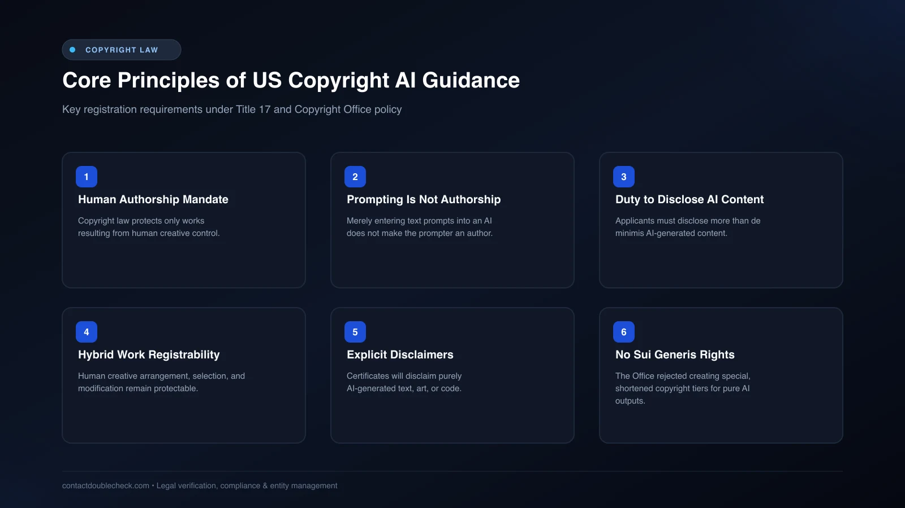
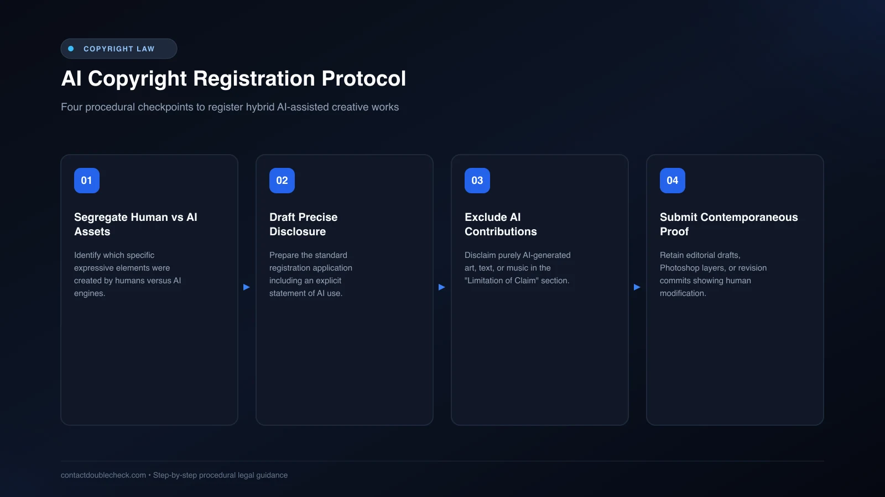

*A practical legal guide to U.S. Copyright Office registration guidance, human authorship requirements, disclosure rules, and protecting hybrid AI-assisted creative works as of November 2026. General information, not legal advice.*

**Key takeaways:**

- Copyright protection under Title 17 requires human authorship; purely AI-generated text, images, music, or code cannot be copyrighted.
- Federal courts and the Copyright Office have ruled that writing prompts does not make the prompter an author, as the AI controls the final expressive output.
- Hybrid works—where a human creatively modifies, edits, arranges, or compiles AI-generated material—are fully registrable.
- Applicants have an affirmative legal duty to disclose AI-generated content exceeding a de minimis threshold on copyright applications.
- Registrations for hybrid works will protect the human's expressive contributions while explicitly disclaiming the underlying AI-generated components.

## 1. The quick answer

**Quick answer:** The U.S. Copyright Office enforces a strict **human authorship requirement** grounded in the U.S. Constitution and decades of judicial precedent. Works generated entirely by artificial intelligence, autonomous algorithms, or text-to-image/text-to-code models without human creative intervention are legally in the public domain upon creation.

However, creators can secure robust copyright protection for **hybrid works**. If a human author takes AI-generated assets and exercises creative control by substantially modifying them, digitally painting over them, or creatively arranging and coordinating them into a larger original work (such as a graphic novel, software suite, or compilation), the human's independent creative contributions are copyrightable. Applicants must proactively disclose AI elements on Form TX, VA, or PA to avoid invalidating their registration.

For startup founders, digital creators, and software engineers managing proprietary assets, review our guides on [protecting AI-generated software code](/blog/ai-generated-code-ip-startup-founders/) and [copyright issues in solo business content](/blog/ai-generated-content-copyright-solo-business/).

## 2. The human authorship bedrock in statute and case law

The U.S. Copyright Office’s position is anchored in foundational legal authorities:

- **The Constitutional Standard:** Article I, Section 8, Clause 8 empowers Congress to promote the Progress of Science and useful Arts by securing to *Authors* the exclusive Right to their respective *Writings*. Courts have uniformly interpreted "authors" as human beings.
- **Burrow-Giles Lithographic Co. v. Sarony (1884):** The landmark Supreme Court ruling establishing that copyright requires an author's personal creative conception and intellectual contribution.
- **Thaler v. Perlmutter (D.D.C. 2023):** Affirming the Register of Copyrights’ rejection of an AI-generated artwork, holding that "human authorship is a bedrock requirement of copyright."
- **Zarya of the Dawn Determination:** The Copyright Office granted registration for the text and overall compilation of a graphic novel authored by a human, while canceling copyright protection for the individual comic panels generated by Midjourney.

## 3. Why prompt engineering fails the authorship test

Many digital creators argue that spending hours refining complex, multi-paragraph prompts constitutes sufficient creative labor to confer authorship. The Copyright Office has directly rejected this argument:

- **Instructions vs. Execution:** Prompts operate as instructions or design briefs given to a commissioned artist. While the prompter conveys an idea, the AI model exercises the ultimate discretion over the expressive elements (e.g., color saturation, brushstroke, line shading, grammatical rhythm).
- **The Core Tenet of Copyright:** Copyright protects the *expression* of an idea, not the idea itself (17 U.S.C. § 102(b)). Because the prompter does not draw the lines or write the specific phrases, they cannot claim authorship of the output.
- **Lack of Predictable Control:** A user cannot predict the exact pixel-by-pixel or sentence-by-sentence output of a generative model, distinguishing AI prompting from traditional creative tools like Photoshop brushes or digital synthesizers.

## 4. Registering hybrid works, compilations, and disclaimers

Creators frequently integrate AI into multi-stage production workflows. The Copyright Office provides clear avenues to protect these assets:

### Protectable Contributions
1. **Substantial Human Modification:** A creator uses AI to draft a baseline graphic, then spends hours digitally painting, editing, retouching, and altering the image in a graphic editor. The resulting modifications are protectable.
2. **Creative Selection and Arrangement:** An author compiles multiple AI-generated chapters, images, and charts, creatively arranging them into an original anthology, textbook, or web design layout. The arrangement is protectable as a compilation under 17 U.S.C. § 103.
3. **Mixed Codebases:** A software developer uses an AI copilot for basic autocomplete, but writes the architectural logic, custom algorithms, and database queries. The human-authored code is protected.

### The Limitation of Claim
In the standard copyright application, the applicant must complete the "Limitation of Claim" section:
- In "Material Excluded," write: "AI-generated text" or "AI-generated artwork."
- In "New Material Included," write: "Original text, compilation, and editorial revisions by author."

## 5. The duty of candor and registration disclosure rules

Applicants appearing before the Copyright Office bear an affirmative duty of candor:

- **The De Minimis Rule:** Minor or incidental AI usage (such as spell-check, automated noise reduction, or basic grammar suggestions) does not need to be disclosed.
- **Consequences of Non-Disclosure:** If an applicant fails to disclose substantial AI-generated content and later files an infringement lawsuit in federal court, the defendant can move to invalidate the copyright registration under 17 U.S.C. § 411(b) for fraud on the Copyright Office.

## 6. Copyright application filing checklist for AI creators

Creative agencies, software startups, and authors should implement the following four-point filing checklist:

1. **Maintain Workflow Provenance:** Keep version-controlled records of raw AI outputs versus human revisions (e.g., layered PSD files, Git commit histories, tracked changes).
2. **Evaluate Human Expression:** Confirm that the human author’s modifications meet the threshold of independent creative effort rather than trivial tweaks.
3. **Complete the Limitation of Claim:** Explicitly disclaim purely AI-generated text, visual art, or musical scores in the application form.
4. **Draft Accurate Authorship Statements:** Accurately describe the human contribution as "text," "editing," "compilation," or "source code."
5. **Secure Vendor Terms of Use:** Ensure the AI platform’s commercial terms grant the user full ownership and commercial rights to generated outputs.

## Where DoubleCheck fits

[DoubleCheck](https://www.contactdoublecheck.com) provides businesses, general counsel, and enterprise teams with automated contract review, AI-assisted verification, and legal workflow assurance. DoubleCheck helps teams verify citations, audit regulatory compliance across California, Colorado, New York, and federal agencies, and connect with experienced attorneys to ensure compliance with emerging AI standards.

**Related reading:**
- [AI-Generated Code and Startup IP Protection](/blog/ai-generated-code-ip-startup-founders/)
- [AI-Generated Content Copyright for Solo Businesses](/blog/ai-generated-content-copyright-solo-business/)
- [Trademark Business Name Check and Clearance Guide](/blog/trademark-business-name-check/)
- [USPTO AI Inventions Patent Inventorship Guidance](/blog/uspto-ai-assisted-inventions-patent-inventorship-guidance/)

**Sources:** [U.S. Copyright Office, Copyright Registration Guidance: Works Containing Material Generated by Artificial Intelligence (88 FR 16190)](https://www.copyright.gov/ai/ai_policy_guidance.pdf); [U.S. Copyright Office, Copyright and Artificial Intelligence Part 2: Copyrightability Report](https://www.copyright.gov/ai/); [United States District Court for the District of Columbia, Thaler v. Perlmutter, Case No. 22-1564](https://www.dcd.uscourts.gov/); [Cornell Legal Information Institute, 17 U.S.C. § 102 (Subject Matter of Copyright: In General)](https://www.law.cornell.edu/uscode/text/17/102); [Cornell Legal Information Institute, 17 U.S.C. § 411 (Registration and Civil Infringement Actions)](https://www.law.cornell.edu/uscode/text/17/411).

## FAQ

**Can you copyright art or text generated entirely by artificial intelligence?**

No. The U.S. Copyright Office and federal court rulings (such as Thaler v. Perlmutter) establish that works created purely by AI without human creative control are entirely ineligible for copyright protection.

**Does writing a complex prompt make someone the author of the output?**

No. The Copyright Office has repeatedly held that prompts function like instructions to a commissioned artist; the AI system, not the prompter, determines the expressive elements of the resulting work.

**Can you copyright a work that combines human effort with AI tools?**

Yes. Hybrid works are copyrightable. The human author can protect their original creative selection, coordination, arrangement, or substantial human modifications, while disclaiming the raw AI elements.

**What happens if an applicant fails to disclose AI usage on a copyright form?**

Failing to disclose AI material violates the duty of candor and can render the resulting copyright registration invalid and unenforceable in infringement litigation.

**Is AI-assisted code eligible for copyright registration?**

Yes, provided human programmers wrote or substantially edited the source code. Purely machine-generated code blocks must be excluded from the scope of protection.

---

*General information only. This article is not legal, tax, investment, or accounting advice.*
