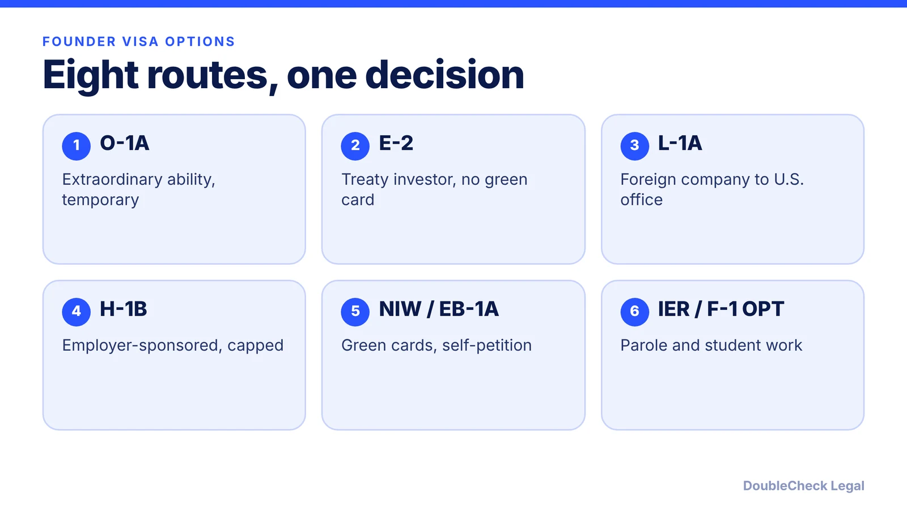
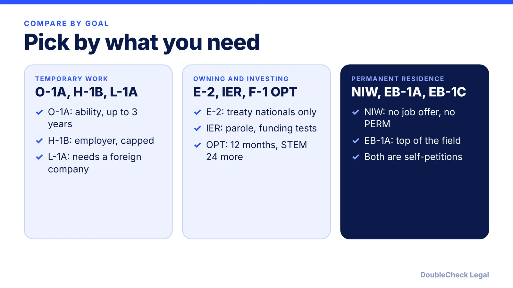

*There is no single founder visa. Here are the eight main U.S. options compared by eligibility, duration, and green card path, with a guide to each.*

**Key takeaways:**

- O-1A, E-2, L-1A, and H-1B are temporary; NIW and EB-1A are green card categories.
- E-2 holders must intend to leave; L-1A can lead to an EB-1C green card.
- The International Entrepreneur Rule is parole, not a visa, with funding tests.
- F-1 OPT gives 12 months, plus 24 months for STEM, and STEM OPT needs an E-Verify employer.

## 1. The quick answer

**Quick answer:** There is no single "founder visa" in the U.S. Founders use eight main routes: O-1A, E-2, L-1A, H-1B, the national interest waiver (NIW), EB-1A, the International Entrepreneur Rule (parole, not a visa), and F-1 OPT. They differ in who must qualify, how long you can stay, and whether they lead to a green card. As of November 2026, the right one depends on your nationality, your evidence, whether you have a foreign company, and whether you want to own and run your own company.

## 2. The options side by side

Durations and rules below come from USCIS's STEM pathways page and the DoubleCheck guides linked in each line, which cite their own sources.

- **O-1A.** For extraordinary ability in sciences, education, business, or athletics. Either a major international award or at least three evidentiary criteria. Up to three years initially, extensions up to one year each with no limit, no annual cap. A U.S. employer or agent must file. No green card path by itself. [Guide](/blog/o-1a-visa-for-startup-founders-evidence/), [documents](/blog/o-1-visa-documents-checklist-founder/), [cost](/blog/o-1-visa-cost-filing-and-attorney-fees/).
- **E-2.** Treaty-country nationals who invest substantially in a real U.S. business and own at least 50% or control it, per USCIS. Two years initially, unlimited two-year extensions. Holders must intend to leave, so it is not a green card route. [Guide](/blog/e-2-treaty-investor-visa-for-founders/).
- **L-1A.** A manager or executive with one continuous year in the past three at a related foreign company. One year for a new office, then two-year extensions, seven years maximum. No cap, and an EB-1C green card route exists. [Guide](/blog/l-1a-visa-new-office-foreign-founders/), [EB-1C](/blog/eb-1c-multinational-manager-green-card/).
- **H-1B.** A bachelor's-level specialty occupation, filed by a U.S. employer. Up to three years initially, generally six in total, with annual cap of 85,000 including 20,000 for U.S. master's holders. Owning a company is easier than working for it. [Ownership vs. work](/blog/start-company-on-h1b-visa-ownership-vs-work/), [fee status](/blog/h1b-100000-fee-status-2026/), [lottery](/blog/h1b-weighted-lottery-wage-levels-explained/).
- **F-1 OPT.** Up to 12 months after graduation, plus 24 months of STEM OPT for eligible degrees. STEM OPT needs an E-Verify employer and a Form I-983. [Founder rules](/blog/f1-opt-stem-opt-start-your-own-startup/), [CPT vs. OPT](/blog/cpt-vs-opt-f1-students/).

## 3. The green card routes

Three of the eight lead to permanent residence directly. The **EB-1A** needs a one-time major award or three of ten criteria plus a final merits review ([for engineers](/blog/eb-1a-for-software-engineers-and-tech-employees/), [vs. O-1 for founders](/blog/eb-1a-vs-o-1-founder-which-path/)). The **NIW** needs an advanced degree or exceptional ability and the three Dhanasar prongs ([for founders](/blog/niw-eb-2-national-interest-waiver-founders/), [for engineers](/blog/niw-for-software-engineers-and-researchers/)). Both can be self-petitioned. Employer-sponsored paths use [PERM](/blog/perm-labor-certification-green-card-process/) and take years; see the [H-1B to green card timeline](/blog/h-1b-to-green-card-timeline-tech-workers/) and [how priority dates work](/blog/visa-bulletin-explained-priority-dates-eb-categories/). Investors can also look at the [EB-5](/blog/eb-5-investor-visa-requirements-2026/).

## 4. The International Entrepreneur Rule and special cases

The **International Entrepreneur Rule** is case-by-case parole, not a visa. Per the DoubleCheck guide, it requires a recently formed U.S. startup, at least 10% ownership, a central role, and funding thresholds ($311,071 from qualified investors for filings on or after October 1, 2024). It has no direct green card path, and secondary sources describe its status as in place but underused, so verify before relying on it ([details](/blog/international-entrepreneur-rule-startup-parole-2026/)).

Nationality can open other doors: [TN for Canadians and Mexicans](/blog/tn-visa-canada-mexico-tech-professionals/) and [E-3 for Australians](/blog/e-3-visa-australians/). Whatever you choose, form the company first ([how to incorporate](/blog/how-to-incorporate-a-company-in-the-us/), [from abroad](/blog/start-us-company-as-non-us-resident/)), understand [foreign-founder taxes](/blog/foreign-founder-us-taxes-substantial-presence-test/), and talk to [an immigration lawyer](/blog/how-to-find-good-immigration-lawyer-startup-founder/). Forming a company does not give you a visa.

## Where DoubleCheck fits

[DoubleCheck](https://www.contactdoublecheck.com) helps businesses and founders start legal work with AI, verify it, and, when professional advice is warranted, connect with an independent attorney, including for immigration questions. Attorney availability and practice areas vary. Attorneys on DoubleCheck are independent professionals; an attorney-client relationship forms only if an attorney accepts your engagement.

**Sources:** [USCIS: nonimmigrant pathways for STEM employment](https://www.uscis.gov/working-in-the-united-states/stem-employment-pathways/nonimmigrant-pathways-for-stem-employment-in-the-united-states); [USCIS E-2 treaty investors](https://www.uscis.gov/working-in-the-united-states/temporary-workers/e-2-treaty-investors); [Study in the States: OPT vs. STEM OPT](https://studyinthestates.dhs.gov/2016/06/difference-between-post-completion-opt-and-stem-opt-explained); [8 CFR 204.5](https://www.govinfo.gov/content/pkg/CFR-2012-title8-vol1/pdf/CFR-2012-title8-vol1-sec204-5.pdf).

## FAQ

**What is the best US visa for a startup founder?**

There is no single best. O-1A, E-2, L-1A, NIW, and EB-1A each fit different facts: nationality, evidence, a foreign company, and whether you want a green card. An immigration attorney can compare them for your case.

**Which founder options lead to a green card?**

EB-1A and NIW are green card categories you can self-petition. The L-1A can lead to EB-1C, per the linked guide. E-2 holders must intend to leave, per USCIS.

**Is there a startup visa in the US?**

Not exactly. The International Entrepreneur Rule grants parole case by case with funding and ownership tests, and it is not a visa. See the linked guide for its status.

**How long can I stay on each visa?**

Per USCIS: O-1A up to 3 years then 1-year extensions; H-1B up to 3 years, generally 6 total; L-1 new office 1 year, up to 7 years for managers. E-2 is 2 years with unlimited 2-year extensions, per USCIS.

---

*General information only. This article is not legal, tax, investment, or accounting advice.*
