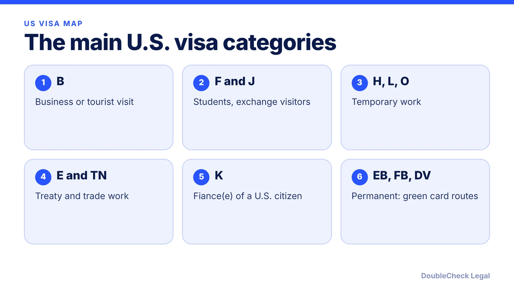
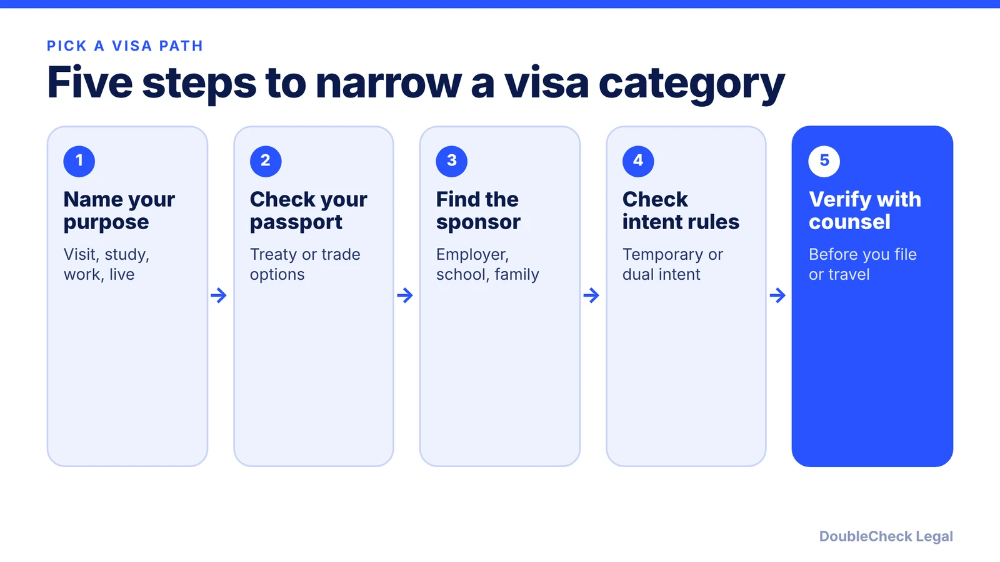

*Letters mark temporary visas; preference categories mark permanent ones. Here is how the pieces fit.*

**Key takeaways:**

- Nonimmigrant visas are temporary and purpose-specific; immigrant routes lead to permanent residence (per CRS).
- B visas do not allow employment; F-1 off-campus work needs special permission; H, L and O are common work categories.
- H-1B, L-1 and K-1 are commonly treated as dual intent; B, F-1 and J-1 expect nonimmigrant intent (per CitizenPath).
- Green card routes are family-based, employment-based (EB-1 to EB-5) or diversity; limits come from law and change in practice.

## 1. The quick answer

**Quick answer:** U.S. visas fall into two groups. Nonimmigrant visas are for a specific purpose and a limited time, such as visiting, studying or working temporarily. Immigrant visas and green card categories are for living in the U.S. permanently. Per the Congressional Research Service (CRS), nonimmigrants are admitted "for a specific purpose and period of time," while lawful permanent residents are admitted "to live permanently." Letters mark the purpose: B for visitors, F and M for students, J for exchange visitors, H, L and O for most employment, E for treaty traders and investors, TN for Canadians and Mexicans, K for fiance(e)s. Permanent routes are family-based, employment-based (EB-1 to EB-5) or the diversity lottery.

## 2. Immigrant vs nonimmigrant: the core difference

**Nonimmigrant** means temporary and purpose-specific. Cornell's Legal Information Institute describes it as a visa that lets a foreign national stay in the U.S. temporarily for purposes such as study, work, tourism, business or medical care, and notes that the category you need depends on your purpose. Your status is tied to that purpose: a student visa is for study, a visitor visa is not for employment.

**Immigrant** means permanent. The person becomes a lawful permanent resident (green card holder). The paths are family-based, employment-based or diversity.

**Dual intent** is the idea that you may pursue permanent residence while holding a temporary status. Per CitizenPath, H-1B, L-1 and K-1 are commonly listed as dual intent categories, and O-1 appears in its list too. B-1/B-2, F-1 and J-1 are examples where the law expects nonimmigrant intent, and CitizenPath states plainly that "the F-1 is not a dual intent visa." It also describes E-2 as not officially dual intent but often treated with flexibility in practice. Per the founder comparison we link below, E-2 holders must intend to leave. Treat these as starting points: how an officer weighs intent depends on the facts, so see our [F-1 visa interview guide](/blog/f-1-visa-interview-questions-international-students-214b/) if you are a student.

**Numbers, for scale.** Per CRS, fiscal year 2024 had 10,969,936 nonimmigrant visa issuances and 1,364,090 new lawful permanent residents. These are different counts for different groups, so do not compare them directly. For immigration data, see our post on [how many people immigrate to the U.S. each year](/blog/how-many-people-immigrate-to-the-us-each-year-green-cards-visas-data/).

## 3. The main nonimmigrant categories, and whether they allow work

Descriptions below follow the State Department's temporary worker listing, Nolo and the linked guides. Work rules differ by category, so confirm yours.

- **B-1/B-2, visitor.** Business or pleasure. Per NNU Immigration, B-1/B-2 visas do not allow employment in the U.S. See [what a B-1 business visitor can do](/blog/b-1-b-2-visa-business-visitor-what-founders-can-do/).
- **F-1, academic student.** Nolo says F-1 holders may study but cannot work off campus unless they get special permission. Post-study work such as OPT has its own rules: see [CPT vs OPT](/blog/cpt-vs-opt-f1-students/) and the [OPT application timeline](/blog/how-to-apply-for-opt-step-by-step-i-765-timeline/).
- **J-1, exchange visitor.** Study, work or train as part of an exchange program (Nolo). Some J-1 holders face a [two-year home residency requirement](/blog/j-1-two-year-home-residency-requirement-212e-waiver/).
- **H-1B, specialty occupation.** Jobs generally requiring at least a bachelor's degree or equivalent, sponsored by an employer (State Department). Per CRS, the cap is 65,000, plus 20,000 for holders of a U.S. advanced degree. The registration process and fees have changed recently: see the [H-1B $100,000 fee status](/blog/h1b-100000-fee-status-2026/) and the [weighted lottery explained](/blog/h1b-weighted-lottery-wage-levels-explained/).
- **L-1, intracompany transferee.** Managers, executives or specialized-knowledge workers moving within a related company. The State Department says it requires one year of employment with that employer abroad within the prior three years. See [L-1A for founders](/blog/l-1a-visa-new-office-foreign-founders/) and [L-1B](/blog/l-1b-specialized-knowledge-visa-tech-employees/).
- **O-1, extraordinary ability.** Science, art, education, business or athletics, with support categories (State Department). See the [O-1A evidence guide](/blog/o-1a-visa-for-startup-founders-evidence/).
- **E-1/E-2, treaty trader or investor.** E-2 is for investors from treaty countries who own at least 50% or control the business (NNU). See the [E-2 guide](/blog/e-2-treaty-investor-visa-for-founders/).
- **TN and E-3.** TN is for Canadian and Mexican citizens in listed professions, with no annual numerical cap per Clark Hill; E-3 is for Australians, capped at 10,500 new principals a year per DFAT and NNU. Read [TN](/blog/tn-visa-canada-mexico-tech-professionals/) and [E-3](/blog/e-3-visa-australians/).
- **K-1, fiance(e) of a U.S. citizen.** Per an Adhikari Law summary, you must intend to marry within 90 days of entering the U.S., after which you may apply for permanent residence. See the [K-1 process](/blog/k-1-fiance-visa-process-timeline-requirements/).

Also on the State Department list: H-1B1 for Chile and Singapore (applied for at the embassy, not by petition), H-2A and H-2B seasonal work, H-3 trainees, P and Q categories.

## 4. Permanent routes: green card categories

There are three main permanent routes. The numbers below are annual limits from CRS (FY2024 context); the underlying law sets them, but visa supply, backlogs and policy shift, so check current data.

- **Family-based.** Immediate relatives (spouses, minor children and parents of U.S. citizens) have no annual limit. Preference categories are capped: F-1 23,400, F-2 114,200, F-3 23,400, F-4 65,000 per CRS. See the [I-130 spouse petition](/blog/i-130-petition-spouse-green-card-marriage-based-process/).
- **Employment-based.** CRS lists EB-1 and EB-2 at 40,040 each, EB-3 at 40,040 (up to 10,000 for unskilled workers), EB-4 and EB-5 at 9,940 each. Per CitizenPath, EB-1 covers extraordinary ability, outstanding professors and researchers, and multinational managers; EB-2 covers advanced degrees, exceptional ability and the national interest waiver; EB-3 requires a job offer and labor certification; EB-5 involves a substantial investment in a new enterprise that creates jobs. CitizenPath also notes EB-1A and the NIW can be self-filed. Compare [EB-2 vs EB-3](/blog/eb-2-vs-eb-3-green-card-categories/), [PERM](/blog/perm-labor-certification-green-card-process/) and [EB-5 requirements](/blog/eb-5-investor-visa-requirements-2026/).
- **Diversity.** CRS gives the annual limit as 55,000 (FY2024 context). See the [diversity visa guide](/blog/diversity-visa-lottery-green-card-lottery-eligibility-how-to-apply/).

Backlogs often depend on your country and category: see the [Visa Bulletin explained](/blog/visa-bulletin-explained-priority-dates-eb-categories/). Which path fits you is a different question, covered in our [decision guide by situation](/blog/which-us-visa-is-right-for-you-by-situation-decision-guide/).

**When you can handle it yourself, and when to get an attorney.** Reading category definitions and listing your facts is a good first step. Get an attorney to look when you hold a temporary status with a deadline, when you plan to change categories, when you have past refusals or overstays, or when you want a petition reviewed before filing. See [immigration lawyer fees](/blog/immigration-lawyer-fees-flat-fee-vs-hourly/).

## Where DoubleCheck fits

[DoubleCheck](https://www.contactdoublecheck.com) helps businesses and founders start legal work with AI, verify it, and, when professional advice is warranted, connect with an independent attorney, including for immigration questions. Attorney availability and practice areas vary. Attorneys on DoubleCheck are independent professionals; an attorney-client relationship forms only if an attorney accepts your engagement.

**Sources:** [CRS, Nonimmigrant and Immigrant Visa Categories: Data Brief](https://www.everycrsreport.com/files/2026-06-18_R45938_dc36a96226b067c538d43d5fc2f1cc8da8d503de.html); [Cornell LII, nonimmigrant visa](https://www.law.cornell.edu/wex/nonimmigrant_visa); [State Department, temporary worker visas](https://adoption.state.gov/content/travel/en/us-visas/employment/temporary-worker-visas.html); [CitizenPath, dual intent](https://citizenpath.com/dual-intent-visas/); [CitizenPath, employment-based green cards](https://citizenpath.com/employment-based-green-card-process/); [Nolo, nonimmigrant visa types](https://nolo.com/legal-updates/u-s-to-refuse-or-revoke-visas-of-chinese-grad-students-with-ties-to-china-s-military-schools.html); [NNU Immigration](https://www.nnuimmigration.com/nonimmigrant-visa/); [Clark Hill, TN status](https://www.clarkhill.com/services/practice/immigration-law/tn-status/); [DFAT, E-3 visas](https://www.dfat.gov.au/geo/united-states-of-america/Pages/e-3-visas-for-the-united-states); [NNU Immigration, E-3 guide 2026](https://www.nnuimmigration.com/?p=17942); [USCIS, E-2 treaty investors](https://www.uscis.gov/working-in-the-united-states/temporary-workers/e-2-treaty-investors); [Adhikari Law, K-1](https://www.adhikarilaw.com/immigration-employment-family/family-based-green-card/family-member-of-a-u-s-citizen/visas-for-fiancees-of-u-s-citizens/). The travel.state.gov directory and uscis.gov K-1 page did not load, so secondary sources are named.

## FAQ

**What is the difference between an immigrant and a nonimmigrant visa?**

A nonimmigrant visa is for a temporary, specific purpose such as study, work or tourism (Cornell LII). An immigrant visa or green card category is for living in the U.S. permanently. CRS defines nonimmigrants as admitted for a specific purpose and period of time.

**Which U.S. visas allow dual intent?**

Per CitizenPath, H-1B, L-1 and K-1 are commonly listed as dual intent, and O-1 appears in its list. B-1/B-2, F-1 and J-1 expect nonimmigrant intent. Officers weigh the facts of each case.

**Can I work on a B-1 or B-2 visa?**

No. Per NNU Immigration, B-1/B-2 visas do not allow employment in the U.S. B-1 covers business activities such as meetings and negotiating contracts.

**How many types of green card categories are there?**

Three main groups: family-based, employment-based and diversity. CRS lists annual limits of 226,000 across the four family preference categories (summed from its figures), 140,000 across employment categories (summed) and 55,000 for diversity, with no limit for immediate relatives.

---

*General information only. This article is not legal, tax, investment, or accounting advice.*
