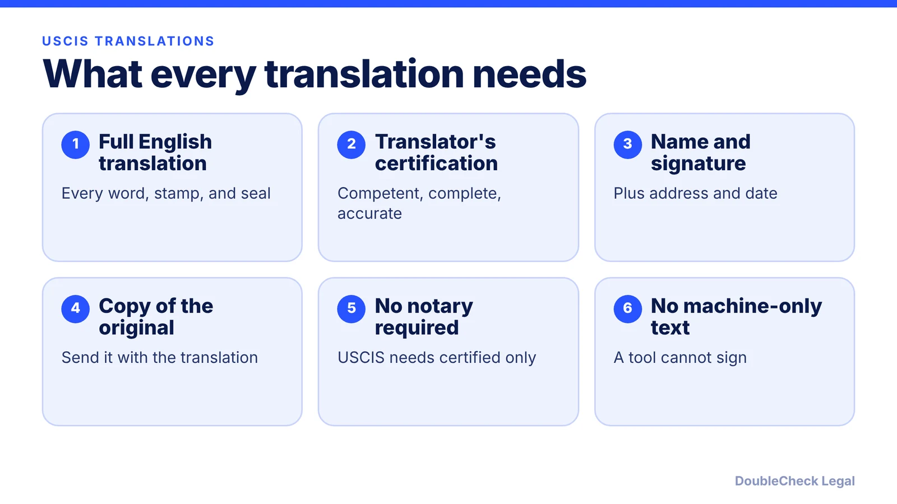
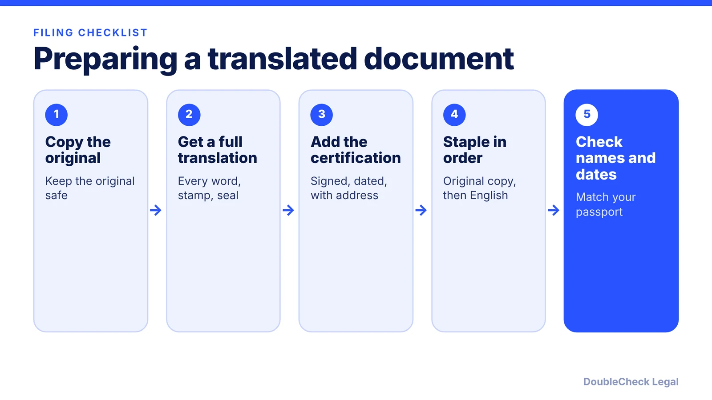

*Any foreign-language document you send USCIS needs a complete English translation and a signed certification. Here is what that means in practice.*

**Key takeaways:**

- 8 CFR 103.2(b)(3) requires a full English translation plus the translator's certification of competence and accuracy.
- No list of approved translators exists, and notarization is not required (per CitizenPath).
- Submit a copy of the original with the certified translation.
- Machine translation alone is not acceptable.

## 1. The quick answer

**Quick answer:** Under 8 CFR 103.2(b)(3), any foreign-language document you send USCIS must come with a full English translation and the translator's certification that they are competent to translate from that language into English and that the translation is complete and accurate. There is no official USCIS list of approved translators, and notarization is not required, per CitizenPath. Submit a copy of the original document together with the certified translation. Machine translation alone does not work, because a tool cannot sign a certification.

## 2. The certification statement

The regulation, 8 CFR 103.2(b)(3), as quoted by CI Law Group and ImmiHelp, says any document containing foreign language submitted to USCIS shall be accompanied by a full English language translation and by the translator's certification that he or she is competent to translate from the foreign language into English. CitizenPath also cites the USCIS Policy Manual (Volume 1, Part E) for the requirement of a signed statement affirming fluency in both languages and that the translation is complete and accurate.

No special format is required (CitizenPath). A workable certification includes:

- The translator's full name, signature, address, and date.
- A statement that they are fluent in English and the source language, so competent to translate.
- A statement that the translation is complete and accurate.
- Ideally the name of the document being translated, so it ties to the original (ImmiHelp's sample does this).

The translation should represent everything on the original, including stamps, seals, and notations (CitizenPath). Missing or poorly certified translations commonly lead to a request for evidence; CI Law Group says providing no translation or an incorrect one is likely to delay a case at minimum.

## 3. Who can translate

CitizenPath says USCIS keeps no official list of approved translators and that no license is required, since the translator certifies their own competence. In practice:

- **You or a family member:** allowed if fluent in both languages, but CitizenPath strongly advises against it, because officers may question conflicts of interest, such as a spouse translating a marriage-based petition. See our [marriage-based green card guide](/blog/marriage-based-green-card-process-timeline/).
- **A friend or colleague with no stake:** no legal bar, but a mistake or bad formatting can still get the filing rejected or questioned.
- **A professional service:** recommended for most applicants. ImmiHelp suggests looking for a member of the American Translators Association or the National Association of Judiciary Interpreters and Translators.
- **Google Translate or AI alone:** not acceptable, per CitizenPath, CI Law Group, and ImmiHelp.

A translated document is only as accurate as its source, so check names, dates, and spellings against your passport before you send it, especially in cases where mismatches trigger questions, such as [O-1 evidence](/blog/o-1-visa-documents-checklist-founder/) or a [PERM](/blog/perm-labor-certification-green-card-process/) record.

## 4. Which documents to translate and what to send

CitizenPath says the rule covers any foreign-language document submitted with a USCIS application, not only civil records. Examples include:

- Birth, marriage, divorce, and death certificates.
- Passport biographical pages.
- Police clearance certificates.
- Academic transcripts and diplomas.
- Court records and adoption decrees.
- Affidavits and letters of support.

ImmiHelp's list matches: transcripts, birth, marriage, divorce, and death certificates, and passports.

**Originals vs. copies.** CitizenPath says to submit a copy of the foreign-language document with the certified translation, and lists submitting the translation alone as a common mistake that can trigger an RFE. Keep your originals unless USCIS specifically asks for them. Requirements at U.S. embassies and consulates vary by post, so follow that post's instructions (CitizenPath), for instance in a [221(g) administrative processing](/blog/visa-221g-administrative-processing/) request. For wider immigration paperwork help, see [how to find a good immigration lawyer](/blog/how-to-find-good-immigration-lawyer-startup-founder/) and our guide to [checking immigration documents with AI](/blog/check-immigration-documents-with-ai-before-filing/).

## Where DoubleCheck fits

[DoubleCheck](https://www.contactdoublecheck.com) helps businesses and founders start legal work with AI, verify it, and, when professional advice is warranted, connect with an independent attorney, including for immigration questions. Attorney availability and practice areas vary. Attorneys on DoubleCheck are independent professionals; an attorney-client relationship forms only if an attorney accepts your engagement.

**Sources:** [CitizenPath: certified translation](https://citizenpath.com/certified-translation/); [ImmiHelp: certified translation for USCIS](https://www.immihelp.com/what-is-a-certified-translation-for-uscis); [CI Law Group on 8 CFR 103.2(b)(3)](https://cilawgroup.com/news/2019/09/21/what-are-uscis-requirements-for-certified-foreign-language-translations/); 8 CFR 103.2(b)(3).

## FAQ

**Does a USCIS translation need to be notarized?**

No. CitizenPath says USCIS requires a certified translation, not a notarized one.

**Can I translate my own documents for USCIS?**

CitizenPath says it is permitted if you are fluent in both languages but strongly advises against it because of possible conflicts of interest, especially in marriage-based cases.

**Which documents must be translated?**

Per CitizenPath, any foreign-language document submitted with a USCIS filing, such as civil records, passport pages, police certificates, transcripts, court records, and affidavits.

**Do I send the original or a copy with the translation?**

CitizenPath says to submit a copy of the foreign-language document together with the certified English translation; sending only the translation is a common mistake that can trigger an RFE.

---

*General information only. This article is not legal, tax, investment, or accounting advice.*
