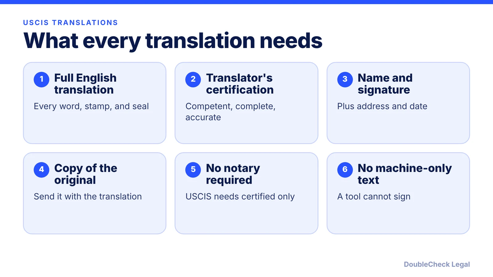
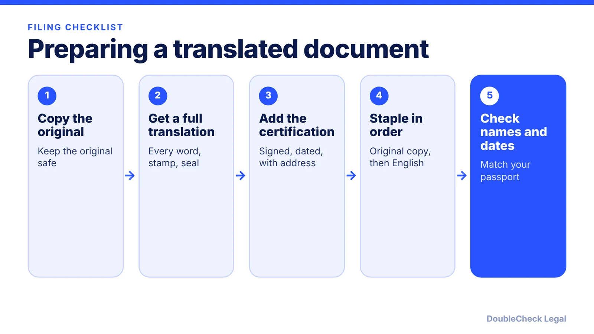

*Any foreign-language document you send USCIS needs a complete English translation and a signed certification. Here is what that means in practice.*

**Key takeaways:**

- 8 CFR 103.2(b)(3) requires a full English translation plus the translator's certification of competence and accuracy.
- No list of approved translators exists, and the regulation does not require notarization.
- Submit a copy of the original with the certified translation.
- Machine translation alone is not acceptable.

## 1. The quick answer

**Quick answer:** Under 8 CFR 103.2(b)(3), any foreign-language document you send USCIS must come with a full English translation and the translator's certification that they are competent to translate from that language into English and that the translation is complete and accurate. The regulation does not require notarization or a license, and does not designate approved translators. Submit a copy of the original document together with the certified translation. Machine translation alone does not work, because a tool cannot sign a certification.

## 2. The certification statement

The regulation, 8 CFR 103.2(b)(3), says any document containing foreign language submitted to USCIS shall be accompanied by a full English language translation and by the translator's certification that he or she is competent to translate from the foreign language into English. The certification should state that the translator is fluent in both languages and that the translation is complete and accurate.

The regulation does not prescribe a special format. A workable certification includes:

- The translator's full name, signature, address, and date.
- A statement that they are fluent in English and the source language, so competent to translate.
- A statement that the translation is complete and accurate.
- Ideally the name of the document being translated, so it ties to the original (a helpful practice).

The translation should represent everything on the original, including stamps, seals, and notations. Missing or poorly certified translations can lead to a request for evidence or delay a case.

## 3. Who can translate

The regulation requires the translator to certify their own competence and does not name a license or approved-translator list. In practice:

- **You or a family member:** allowed if fluent in both languages, but many practitioners advise against it, because officers may question conflicts of interest, such as a spouse translating a marriage-based petition. See our [marriage-based green card guide](/blog/marriage-based-green-card-process-timeline/).
- **A friend or colleague with no stake:** no legal bar, but a mistake or bad formatting can still get the filing rejected or questioned.
- **A professional service:** recommended for most applicants. consider a translator with professional credentials, such as membership in the American Translators Association.
- **Google Translate or AI alone:** not acceptable, because a tool cannot sign the required certification.

A translated document is only as accurate as its source, so check names, dates, and spellings against your passport before you send it, especially in cases where mismatches trigger questions, such as [O-1 evidence](/blog/o-1-visa-documents-checklist-founder/) or a [PERM](/blog/perm-labor-certification-green-card-process/) record.

## 4. Which documents to translate and what to send

The rule covers any foreign-language document submitted with a USCIS application, not only civil records. Examples include:

- Birth, marriage, divorce, and death certificates.
- Passport biographical pages.
- Police clearance certificates.
- Academic transcripts and diplomas.
- Court records and adoption decrees.
- Affidavits and letters of support.

**Originals vs. copies.** Submit a copy of the foreign-language document with the certified translation; submitting the translation alone can trigger an RFE. Keep your originals unless USCIS specifically asks for them. Requirements at U.S. embassies and consulates vary by post, so follow that post's instructions, for instance in a [221(g) administrative processing](/blog/visa-221g-administrative-processing/) request. For wider immigration paperwork help, see [how to find a good immigration lawyer](/blog/how-to-find-good-immigration-lawyer-startup-founder/) and our guide to [checking immigration documents with AI](/blog/check-immigration-documents-with-ai-before-filing/).

## Where DoubleCheck fits

[DoubleCheck](https://www.contactdoublecheck.com) helps businesses and founders start legal work with AI, verify it, and, when professional advice is warranted, connect with an independent attorney, including for immigration questions. Attorney availability and practice areas vary. Attorneys on DoubleCheck are independent professionals; an attorney-client relationship forms only if an attorney accepts your engagement.

**Sources:** 8 CFR 103.2(b)(3).

## FAQ

**Does a USCIS translation need to be notarized?**

No. The regulation, 8 CFR 103.2(b)(3), requires a full English translation with the translator's certification of competence and accuracy; it does not mention notarization. Confirm current USCIS instructions for your form.

**Can I translate my own documents for USCIS?**

The regulation requires the translator to certify competence in both languages, and does not bar applicants from translating their own documents. Many practitioners advise using an independent translator to avoid conflict-of-interest questions, especially in marriage-based cases.

**Which documents must be translated?**

Under 8 CFR 103.2(b)(3), any document containing foreign language submitted to USCIS, such as civil records, passport pages, police certificates, transcripts, and court records.

**Do I send the original or a copy with the translation?**

Submit a copy of the foreign-language document together with the certified English translation. Sending only the translation can leave the officer unable to compare the two and may trigger a request for evidence.

---

*General information only. This article is not legal, tax, investment, or accounting advice.*
