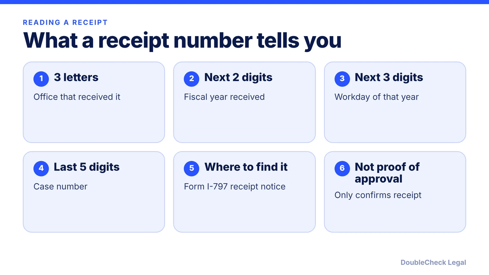
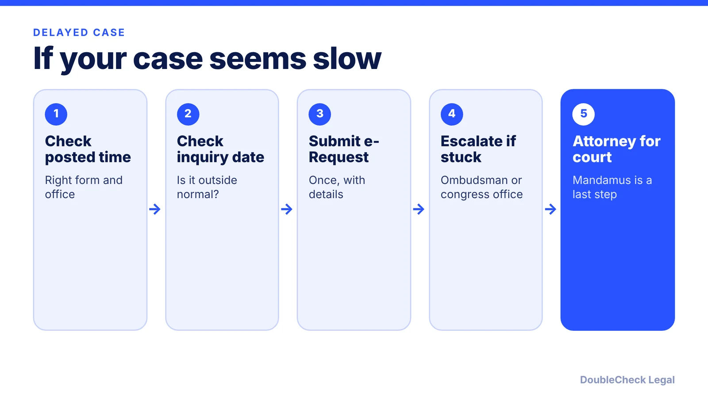

*Decode your receipt number, read your status, and know the next step if your case is slow.*

**Key takeaways:**

- A receipt number is 13 characters: three letters and ten digits, found on Form I-797.
- The status shows the last action, not a forecast; updates are event-based.
- Posted processing times are not deadlines; you can inquire once past the case inquiry date.
- Escalation runs from e-Request to congressional inquiry, Ombudsman, and, last, mandamus; keep your address current.

## 1. The quick answer

**Quick answer:** A USCIS receipt number is 13 characters: three letters followed by ten numbers, per [USCIS](https://uscis.gov/tools/checking-your-case-status-online). You find it on your Form I-797 receipt notice and enter it, without dashes, on the USCIS Case Status Online page. Per CitizenPath, the letters show the office that received the case, the next two digits are the fiscal year, the next three are the workday, and the last five are the case number. The status shows the last action on your case, not a prediction. Check it against USCIS processing times before you worry, and only act when your case is outside the normal range or a notice is missing.

## 2. How to read and check your receipt number

Per CitizenPath, using the example WAC 22 012 50960:

- **WAC** is the office prefix. USCIS lists prefixes such as EAC, WAC, LIN, SRC, NBC, MSC, and IOE; CitizenPath says IOE is used for online filings.
- **22** is the fiscal year received (October 1 to September 30).
- **012** is the workday of that fiscal year when the case was opened.
- **50960** is the case number.

Per Messersmith Law, some work now falls under SCOPS, so a prefix or your state does not reliably show where the case is handled. Treat the prefix as a label, not a map.

**To check status**, per USCIS:

1. Open Case Status Online on uscis.gov (computer or phone).
2. Enter the 13-character receipt number without dashes. Include other characters such as asterisks if your notice lists them.
3. Read the last action and any next steps.

A free myUSCIS account gives updates, including up to the last five actions, per USCIS. A receipt number confirms USCIS received your filing and is not proof of approval, per CitizenPath.

## 3. What common statuses mean

USCIS does not publish one dictionary of status names, so these meanings come from CitizenPath and NNU Immigration. Wording varies by form.

- **Case Was Received:** USCIS accepted the filing. Usually no action.
- **Biometrics Appointment Scheduled:** attend as scheduled.
- **Case Is Actively Being Reviewed:** an officer has the file, which does not mean a decision is near and can last months.
- **Request for Evidence Was Sent:** USCIS needs more information. The notice lists what and by when. Failing to respond generally leads to denial. See [how to respond to an RFE](/blog/how-to-respond-to-uscis-request-for-evidence-rfe/).
- **Case Was Transferred to a Local Office / Interview Was Scheduled:** often precedes an interview. See [what to expect at a green card interview](/blog/green-card-interview-what-to-expect/).
- **Case Was Approved:** a card or further steps may follow.
- **Case Was Denied:** the notice states the reasons and options.

**Updates are event-based.** Per CitizenPath, checking every week or two is enough, and frequent checks do not speed things up. A status of "Notice sent" matters if you have not received the notice, per NNU Immigration.

## 4. Outside normal processing time, escalation, and address changes

**Posted times are not deadlines.** Per Messersmith Law, the posted processing time reflects when USCIS completed 80% of cases over the prior six months. The case inquiry date uses the 93% figure minus time since receipt. Per Headman Law Group, you generally can inquire once your receipt date is earlier than USCIS's published inquiry date. Before that, you will mostly be told the case is within normal processing.

**Escalation ladder, from least to most serious** (per Headman Law Group and Messersmith Law):

1. **e-Request / case inquiry** on uscis.gov. It does not move you up in line, but can reveal real problems such as a document not linked to the file. Avoid duplicates and keep records.
2. **Expedite request.** Discretionary and criteria-based. A long wait alone is not enough.
3. **Congressional inquiry.** Your Senator's or Representative's constituent office can ask USCIS about a stuck case.
4. **CIS Ombudsman.** An independent DHS office that generally expects you to try USCIS first.
5. **Mandamus lawsuit.** A federal court is asked to compel a decision on an unreasonably delayed case. Per Headman, it forces a decision, not an approval, and is often oversold. A long wait alone does not establish a right to relief, per Messersmith. Talk to an attorney first. For paid speed-ups, see [premium processing](/blog/premium-processing-fees-and-timelines-2026/).

**Address changes.** Per Headman, a notice sent to an old address counts as delivered. NNU Immigration says you can update your address through a myUSCIS account or file Form AR-11 online. Do it right after you move.

**Self-handle vs. attorney.** Checking status and filing a first inquiry are fine on your own. Consider an attorney for an RFE or notice of intent to deny, a missing receipt, an unfamiliar notice, or any step beyond an inquiry. Be wary of "notarios"; see [how to avoid immigration scams](/blog/immigration-notario-scam-how-to-avoid/), and consider [checking documents with AI before filing](/blog/check-immigration-documents-with-ai-before-filing/).

## Where DoubleCheck fits

[DoubleCheck](https://www.contactdoublecheck.com) helps businesses and founders start legal work with AI, verify it, and, when professional advice is warranted, connect with an independent attorney, including for immigration questions. Attorney availability and practice areas vary. Attorneys on DoubleCheck are independent professionals; an attorney-client relationship forms only if an attorney accepts your engagement.

**Sources:** [USCIS Case Status Online](https://uscis.gov/tools/checking-your-case-status-online); [CitizenPath receipt numbers](https://citizenpath.com/uscis-receipt-number-explained/); [CitizenPath case status](https://citizenpath.com/uscis-case-status/); [NNU Immigration](https://www.nnuimmigration.com/uscis-case-status/); [Headman Law Group](https://headmanlaw.com/insights/uscis-case-outside-normal-processing-time/); [Messersmith Law](https://messersmithlaw.com/uscis-processing-times/). The USCIS processing-times and e-Request pages were not fetched directly; secondary sources are named.

## FAQ

**What does the receipt number on my USCIS notice mean?**

Per USCIS, it has 13 characters: three letters followed by ten numbers. Per CitizenPath, the letters show the receiving office, then two digits for fiscal year, three for workday, and five for the case number. It confirms receipt, not approval.

**How do I check my USCIS case status?**

Per USCIS, use Case Status Online on uscis.gov and enter the 13-character receipt number without dashes. A free myUSCIS account can show up to your last five actions.

**When can I contact USCIS about a delayed case?**

Per Headman Law Group, you generally can inquire once your case has been pending longer than the posted time and your receipt date is earlier than the case inquiry date USCIS publishes. Before that, an inquiry usually returns a within-normal-processing answer.

**Is a mandamus lawsuit a good way to speed up my case?**

Per Headman Law Group, mandamus compels a decision, not an approval, and is often oversold. Per Messersmith Law, a long wait alone does not establish entitlement. Try inquiry channels first and speak with an immigration attorney.

---

*General information only. This article is not legal, tax, investment, or accounting advice.*
