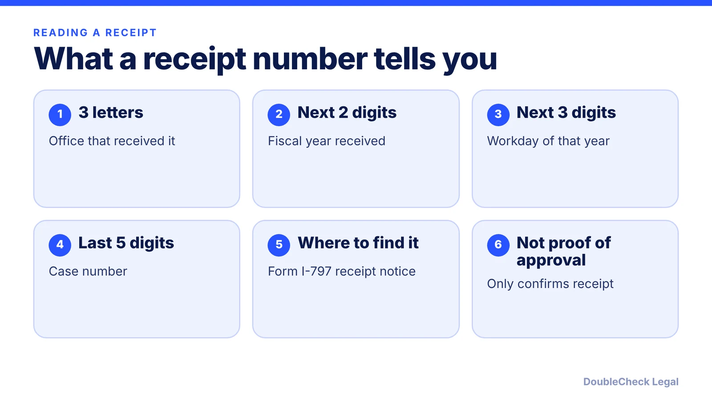
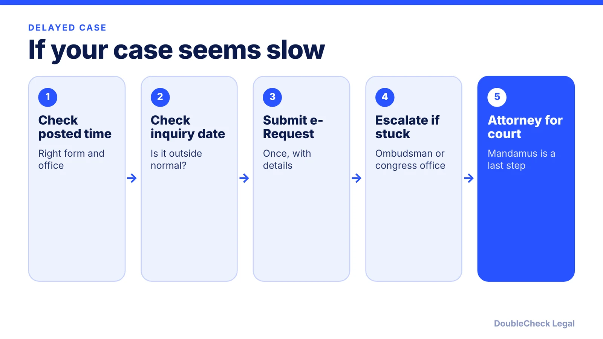

*Decode your receipt number, read your status, and know the next step if your case is slow.*

**Key takeaways:**

- A receipt number is 13 characters: three letters and ten digits, found on Form I-797.
- The status shows the last action, not a forecast; updates are event-based.
- Posted processing times are not deadlines; you can inquire once past the case inquiry date.
- Escalation runs from e-Request to congressional inquiry, Ombudsman, and, last, mandamus; keep your address current.

## 1. The quick answer

**Quick answer:** A USCIS receipt number is 13 characters: three letters followed by ten numbers, per [USCIS](https://uscis.gov/tools/checking-your-case-status-online). You find it on your Form I-797 receipt notice and enter it, without dashes, on the USCIS Case Status Online page. The letters are commonly read as a service center or office prefix, the next two digits as the fiscal year, the next three as the workday and the last five as the case number; this breakdown is a common reading, not an official USCIS explanation. The status shows the last action on your case, not a prediction. Check it against USCIS processing times before you worry, and only act when your case is outside the normal range or a notice is missing.

## 2. How to read and check your receipt number

Using the example WAC 22 012 50960, the common reading is:

- **WAC** is the office prefix. Prefixes you may see include EAC, WAC, LIN, SRC, NBC, MSC and IOE.
- **22** is the fiscal year received (October 1 to September 30).
- **012** is the workday of that fiscal year when the case was opened.
- **50960** is the case number.

A prefix does not reliably show where your case is being handled. Treat it as a label, not a map.

**To check status**, per USCIS:

1. Open Case Status Online on uscis.gov (computer or phone).
2. Enter the 13-character receipt number without dashes. Include other characters such as asterisks if your notice lists them.
3. Read the last action and any next steps.

A free myUSCIS account gives updates, including up to the last five actions, per USCIS. A receipt number confirms USCIS received your filing and is not proof of approval.

## 3. What common statuses mean

USCIS does not publish one dictionary of status names, so treat these as general descriptions. Wording varies by form, and your notice and the USCIS page control.

- **Case Was Received:** USCIS accepted the filing. Usually no action.
- **Biometrics Appointment Scheduled:** attend as scheduled.
- **Case Is Actively Being Reviewed:** an officer has the file, which does not mean a decision is near and can last months.
- **Request for Evidence Was Sent:** USCIS needs more information. The notice lists what and by when. Failing to respond generally leads to denial. See [how to respond to an RFE](/blog/how-to-respond-to-uscis-request-for-evidence-rfe/).
- **Case Was Transferred to a Local Office / Interview Was Scheduled:** often precedes an interview. See [what to expect at a green card interview](/blog/green-card-interview-what-to-expect/).
- **Case Was Approved:** a card or further steps may follow.
- **Case Was Denied:** the notice states the reasons and options.

**Updates are event-based.** The status changes when something happens on your case, so frequent checks do not speed anything up. If the status says a notice was sent and you have not received it, follow up with USCIS.

## 4. Outside normal processing time, escalation, and address changes

**Posted times are not deadlines.** USCIS publishes processing times and a case inquiry date on its website. Check them for your form and office before you inquire. If your case is still within the posted range, you will mostly be told it is within normal processing.

**Escalation ladder, from least to most serious** (general order; details vary by case):

1. **e-Request / case inquiry** on uscis.gov. It does not move you up in line, but can reveal real problems such as a document not linked to the file. Avoid duplicates and keep records.
2. **Expedite request.** Discretionary and criteria-based. A long wait alone is not enough.
3. **Congressional inquiry.** Your Senator's or Representative's constituent office can ask USCIS about a stuck case.
4. **CIS Ombudsman.** An independent DHS office that generally expects you to try USCIS first.
5. **Mandamus lawsuit.** A federal court is asked to compel a decision on an unreasonably delayed case. It is a serious legal step, so talk to an attorney first. For paid speed-ups, see [premium processing](/blog/premium-processing-fees-and-timelines-2026/).

**Address changes.** Notices go to the address on file, so update your address with USCIS right after you move.

**Self-handle vs. attorney.** Checking status and filing a first inquiry are fine on your own. Consider an attorney for an RFE or notice of intent to deny, a missing receipt, an unfamiliar notice, or any step beyond an inquiry. Be wary of "notarios"; see [how to avoid immigration scams](/blog/immigration-notario-scam-how-to-avoid/), and consider [checking documents with AI before filing](/blog/check-immigration-documents-with-ai-before-filing/).

## Where DoubleCheck fits

[DoubleCheck](https://www.contactdoublecheck.com) helps businesses and founders start legal work with AI, verify it, and, when professional advice is warranted, connect with an independent attorney, including for immigration questions. Attorney availability and practice areas vary. Attorneys on DoubleCheck are independent professionals; an attorney-client relationship forms only if an attorney accepts your engagement.

**Sources:** [USCIS Case Status Online](https://uscis.gov/tools/checking-your-case-status-online). Receipt-number breakdowns, status meanings and escalation steps are general descriptions, not official USCIS definitions; the USCIS processing-times and e-Request pages were not fetched directly.

## FAQ

**What does the receipt number on my USCIS notice mean?**

Per USCIS, it has 13 characters: three letters followed by ten numbers. The letters are commonly read as a service center or office prefix, followed by digits that relate to the fiscal year and workday of receipt. It confirms receipt, not approval.

**How do I check my USCIS case status?**

Per USCIS, use Case Status Online on uscis.gov and enter the 13-character receipt number without dashes. A free myUSCIS account can show up to your last five actions.

**When can I contact USCIS about a delayed case?**

USCIS publishes processing times on its website, and you generally should check them before inquiring. If your case is still within the posted range, an inquiry usually will not change anything. If it is outside the range, USCIS offers case inquiry options through its website.

**Is a mandamus lawsuit a good way to speed up my case?**

A mandamus lawsuit asks a federal court to compel a decision on an unreasonably delayed case. It is a serious legal step, so try inquiry channels first and speak with an immigration attorney.

---

*General information only. This article is not legal, tax, investment, or accounting advice.*
