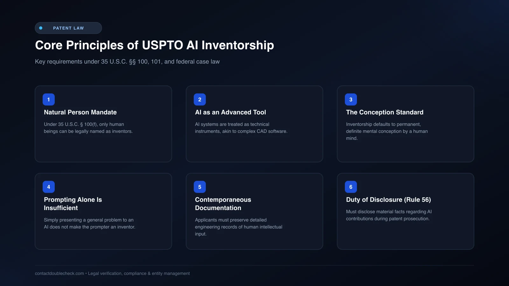
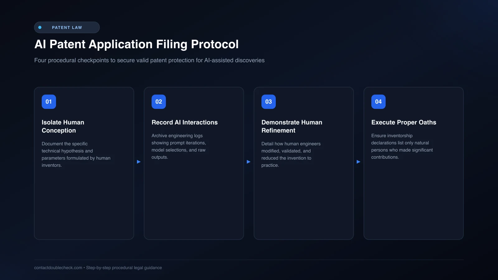

*A comprehensive analysis of U.S. Patent and Trademark Office (USPTO) inventorship guidance, federal statutory standards, and prosecution strategies for AI-assisted inventions as of November 2026. General information, not legal advice.*

**Key takeaways:**

- Under 35 U.S.C. §§ 100(f) and 101, inventorship is strictly limited to natural persons; AI platforms cannot be listed as inventors or co-inventors.
- Using generative AI or machine learning algorithms does not disqualify an invention, provided at least one human inventor made a significant contribution to its conception.
- The USPTO treats AI systems as sophisticated tools (comparable to computer-aided design systems) evaluated under traditional human conception jurisprudence.
- Merely presenting an AI system with a general problem to solve does not satisfy the legal standard for human conception.
- Patent applicants must document contemporaneous records demonstrating how human engineers exercised judgment to formulate, filter, and refine AI outputs.

## 1. The quick answer

**Quick answer:** The USPTO's official guidance on AI-assisted inventions reaffirms that patents may be granted for inventions developed using artificial intelligence, but **only natural persons** can be legally recognized as inventors. Under governing federal precedent established in *Thaler v. Vidal* (Fed. Cir. 2022), non-human machines and algorithms cannot be named on patent applications.

For an AI-assisted invention to be patent-eligible, a human inventor must have contributed significantly to the **conception** of the invention—the complete mental formation of the operative invention. Simply prompting an AI with a high-level goal and adopting its raw output without significant human refinement fails the inventorship test and will result in rejection or subsequent patent invalidation.

For technical founders and patent counsel managing intellectual property, see our related guides on [protecting AI-generated code and startup IP](/blog/ai-generated-code-ip-startup-founders/) and [trademark clearance for new software products](/blog/trademark-business-name-check/).

## 2. The statutory natural person mandate

The legal foundation of U.S. patent law is rooted in Article I, Section 8, Clause 8 of the U.S. Constitution and codified in Title 35 of the United States Code:

- **35 U.S.C. § 100(f):** Defines an "inventor" as the "individual" who invented or discovered the subject matter. The Federal Circuit affirmed in *Thaler v. Vidal* that the plain meaning of "individual" refers exclusively to natural human beings.
- **35 U.S.C. § 115:** Requires an oath or declaration signed by the inventor stating that they believe they are the original inventor. An automated software tool cannot execute an oath or possess legal capacity.
- **Global Priority Risks:** While some foreign jurisdictions have experimented with alternate frameworks, filing an international application naming an AI inventor can compromise priority rights and invalidate U.S. filings.

## 3. Traditional conception vs. AI tool assistance

The USPTO’s revised policy framework emphasizes that artificial intelligence is legally classified as an advanced instrument:

- **AI as an Instrument:** Much like a telescope, a centrifuge, or complex finite-element modeling software, AI is a tool employed by human minds. The central inquiry is not *whether* an AI tool was used, but *how* the human interacted with it.
- **The Conception Standard:** Conception is the touchstone of inventorship. It requires the formation in the mind of the inventor of a definite and permanent idea of the complete and operative invention, as it is hereafter to be applied in practice.
- **Autonomous Generation Precludes Patents:** If an AI model autonomously detects a chemical compound, designs an electrical circuit, and drafts the claims without human intellectual intervention, no patent can issue under U.S. law.

## 4. The prompt engineering boundary: what qualifies?

A critical question for technology companies is whether crafting complex prompts elevates a human prompter to the status of an inventor:

### When Prompting Fails Inventorship
- Submitting a prompt such as: "Design an optimized heat sink for an electric vehicle battery" and directly adopting the computer-generated CAD file.
- The prompter merely presented the problem to be solved; the machine conceived the solution.

### When Prompting Supports Inventorship
- The human inventor designs a specific technical architecture, defines novel constraint parameters, identifies a unique mathematical relationship, and utilizes the AI model to execute complex iterative validation.
- The human receives raw outputs, recognizes non-obvious defects, and applies independent creative engineering to modify and build upon the output.
- The human synthesizes multiple disparate outputs into a unified, functional system.

## 5. The duty of disclosure and candor under Rule 56

Under 37 CFR § 1.56 (Rule 56), every individual associated with the filing and prosecution of a patent application has an affirmative duty of candor and good faith in dealing with the USPTO:

- **Disclosing Material Facts:** If an applicant used AI in a manner that creates a material question regarding inventorship or conception, the facts surrounding that usage must be disclosed to the patent examiner.
- **Avoiding Inequitable Conduct:** Concealing that a claimed invention was entirely generated by an autonomous AI system without human conception can support a finding of inequitable conduct, rendering the entire patent unenforceable in federal court.

## 6. Patent prosecution checklist for AI innovations

Patent counsel and corporate R&D departments should implement standard operational controls for AI inventions:

1. **Maintain Contemporaneous Laboratory Notebooks:** Document the specific human engineering thoughts, hypotheses, and goals *prior* to running AI simulations.
2. **Archive Prompt Chains and Input Data:** Save the exact prompts, input datasets, and model versions used during development to demonstrate human direction.
3. **Record Human Refinement Milestones:** Document every engineering change, physical test, and modification made by human team members after receiving raw AI outputs.
4. **Audit Claim Scope Against Human Contribution:** Ensure that every independent and dependent claim in the patent application contains elements conceived by the human inventors.
5. **Execute Compliant Declarations:** Ensure the named inventors can truthfully sign the 35 U.S.C. § 115 declaration confirming their personal contribution to the conception of the invention.

## Where DoubleCheck fits

[DoubleCheck](https://www.contactdoublecheck.com) provides businesses, general counsel, and enterprise teams with automated contract review, AI-assisted verification, and legal workflow assurance. DoubleCheck helps teams verify citations, audit regulatory compliance across California, Colorado, New York, and federal agencies, and connect with experienced attorneys to ensure compliance with emerging AI standards.

**Related reading:**
- [AI-Generated Code and Startup IP Protection](/blog/ai-generated-code-ip-startup-founders/)
- [Trademark Office Action Section 2(d) Confusion Response](/blog/trademark-office-action-section-2d-likelihood-of-confusion-response/)
- [Trademark Clearance and Business Name Search](/blog/trademark-business-name-check/)
- [Safe Harbor 409A Valuation for Startup Stock Options](/blog/safe-harbor-409a-valuation-startup-stock-options-irs-rules/)

**Sources:** [U.S. Patent and Trademark Office, Inventorship Guidance for AI-Assisted Inventions](https://www.uspto.gov/initiatives/artificial-intelligence/artificial-intelligence-resources); [United States Court of Appeals for the Federal Circuit, Thaler v. Vidal, 43 F.4th 1207](https://cafc.uscourts.gov/opinions-orders/); [Cornell Legal Information Institute, 35 U.S.C. § 100 Definitions (Inventorship)](https://www.law.cornell.edu/uscode/text/35/100); [Cornell Legal Information Institute, 35 U.S.C. § 101 Inventions Patentable](https://www.law.cornell.edu/uscode/text/35/101); [Code of Federal Regulations, 37 CFR § 1.56 (Duty to Disclose Information Material to Patentability)](https://www.ecfr.gov/current/title-37/chapter-I/subchapter-A/part-1/subpart-B/subject-group-ECFRf34feeb66465360/section-1.56).

## FAQ

**Can an artificial intelligence system be named as an inventor on a US patent?**

No. Federal law (35 U.S.C. §§ 100 and 101) and the Federal Circuit ruling in Thaler v. Vidal establish that only natural persons can be named as inventors on a U.S. patent.

**Does using an AI tool automatically disqualify an invention from being patented?**

No. An invention developed with AI assistance is fully patentable, provided that at least one natural person made a significant human contribution to the conception of each claimed invention.

**Does the USPTO apply the Pannu joint inventorship test to AI tools?**

Under revised USPTO guidance, the USPTO clarified that Pannu is reserved for human-to-human joint inventorship. AI is treated as a sophisticated tool, with inventorship anchored in traditional human conception standards.

**Is writing a basic prompt enough to claim inventorship over an AI output?**

Generally, no. Simply presenting a generalized problem or asking an AI model to solve a problem does not constitute conception. The human must demonstrate intellectual contribution in formulating or substantially refining the solution.

**What happens if an applicant improperly names an AI as an inventor?**

The USPTO will issue a notice to comply or reject the application for failure to name a human inventor, and any resulting patent risks being declared invalid in federal court.

---

*General information only. This article is not legal, tax, investment, or accounting advice.*
