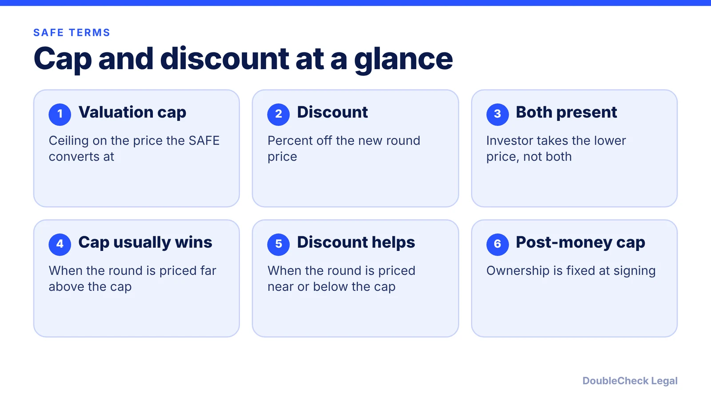
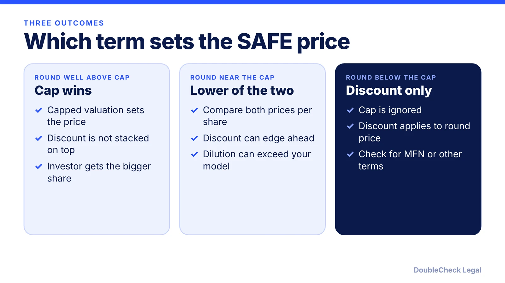

*On a SAFE with both a valuation cap and a discount, the investor converts at the lower price, not a stacked one. Here is how it works, with numbers, as of November 2026.*

**Key takeaways:**

- With both terms, the SAFE converts at whichever gives the lower price per share, not both combined.
- The cap usually wins when the round is priced well above it; the discount matters near or below the cap.
- Post-money SAFEs fix ownership at signing, so stacked SAFEs dilute the founders.
- Read MFN clauses and run the math at several round sizes before you sign.

## 1. The quick answer

**Quick answer:** On a SAFE that has both a valuation cap and a discount, the two do not stack. When the SAFE converts, the investor gets whichever one produces the lower price per share, which means more shares. If the priced round values the company well above the cap, the cap usually wins. If the round lands below or near the cap, the discount may be the only benefit the investor gets. This guide explains how a valuation cap vs discount SAFE conversion works, with simple numbers, and what to check before you sign.

## 2. What the valuation cap does

A SAFE is a simple agreement for future equity: an investor pays now and receives shares later, usually at the company's next priced round. The valuation cap sets the highest valuation used to turn the investor's money into shares. Cooley GO describes it as the maximum valuation at which the SAFE converts, effectively creating a floor for the SAFE holder's conversion; for example, a $10M cap against a $20M Series A means SAFE investors convert as if the company were worth $10M.

The cap rewards early risk. If the company grows quickly, the investor still converts at the lower, capped valuation.

Two versions matter:

- **Post-money cap:** released by Y Combinator in 2018 (per Cooley GO), it counts the SAFE money itself and the unissued option pool in the company capitalization, per the YC SAFE User Guide. A $1M investment on a $10M post-money cap converts to 10% ownership before the new round (per the YC SAFE User Guide).
- **Pre-money cap:** the older form, where, per Cooley GO, the conversion calculation does not include the conversion of other SAFEs, so later SAFEs affect earlier holders differently.

For a refresher on the instrument itself, see [SAFE notes explained for founders](/blog/safe-note-explained-for-founders/) and [the SAFE agreement for startup founders](/blog/safe-agreement-startup-founders/).

## 3. What the discount does

The discount is a percentage taken off the price new investors pay in the priced round. Cooley GO's example: a 20% discount on a $1.00 Series A share means the SAFE holder converts at $0.80 per share. The YC SAFE User Guide describes the discount the same way: the SAFE converts at the round price times one minus the discount.

The discount does not depend on a valuation number in the SAFE. It simply tracks whatever the next round turns out to be. That is why it protects an investor when the company raises at a modest valuation and the cap would otherwise not bind.

A SAFE can have:

- a cap only,
- a discount only,
- both, or
- neither (an uncapped, undiscounted SAFE, which gives the investor little advantage over the new-round price).

If you are comparing instruments before choosing one, see [convertible note vs SAFE](/blog/convertible-note-vs-safe/) and [SAFE vs convertible note for startups](/blog/safe-vs-convertible-note-startups/).

## 4. Which one wins: worked examples

The rule from Cooley GO and the YC SAFE User Guide is the same: compute the price under the cap, compute the price under the discount, and use whichever is more favorable to the investor. The numbers below are simplified illustrations using an effective-valuation shortcut, not a full cap table model.

**Example A, cap wins.** A SAFE has a $10M cap and a 20% discount. The Series A is priced at a $15M pre-money valuation. The discount implies an effective valuation of $12M ($15M times 0.8). The cap is $10M, which is lower, so the cap sets the price.

**Example B, discount wins.** Same SAFE, but the Series A is priced at an $11M pre-money valuation. The discount implies $8.8M ($11M times 0.8), which is below the $10M cap, so the discount sets the price.

**Example C, round below the cap.** An $8M-cap SAFE in a $7M round gains nothing from the cap, because the round price is already lower than the capped price. If a discount exists, it still applies.

When the Series A lands close to the cap, the discount can cause more dilution than a founder planned for. Run both calculations at several round sizes before you agree to terms. A model with only the cap case can understate dilution.

## 5. Post-money math and MFN: what founders miss

**Post-money SAFEs fix ownership at signing.** Illustration (simple arithmetic): three post-money SAFEs of $500K at a $5M cap, $750K at an $8M cap and $250K at a $10M cap imply 10% + 9.375% + 2.5% = 21.875% ownership, while a single $1.5M SAFE at a $10M cap would be 15%. Per the YC SAFE User Guide, SAFEs are not diluted by each other, so additional SAFEs dilute the founders, not the earlier SAFE holders. Lowenstein Sandler advises founders to model out how the formulas in multiple sets of converting SAFEs will interact. Stacking several SAFEs at different caps is a common way founders lose more of the company than they expected. See [cap table basics for first-time founders](/blog/cap-table-basics-for-first-time-founders/) and [option pool size and dilution](/blog/option-pool-size-and-dilution-first-round-explained/).

**The option pool counts.** On a post-money SAFE the capitalization includes the unissued option pool, per the YC SAFE User Guide, but excludes any option pool increase adopted in the equity financing, so SAFE holders are diluted by that increase.

**MFN clauses can reach back.** Per the YC SAFE User Guide, if the company later issues SAFEs with better terms, such as a cap or discount, the holder of an MFN SAFE may amend its SAFE to match those terms. Read the MFN language in every SAFE you have already signed.

**Check how the SAFE converts, not just the headline terms.** Conversion usually happens at the first priced equity round, and most SAFEs also cover a liquidity event such as an acquisition (per the YC SAFE User Guide). The details are in the document, which is why [a SAFE review before you sign](/blog/safe-review-before-you-sign/) is worth the time. For the round that follows, see [term sheet key terms explained](/blog/term-sheet-key-terms-explained/) and [pro rata rights explained](/blog/pro-rata-rights-explained-startups/).

## 6. A pre-signing checklist

Before you sign or accept a SAFE with a cap and a discount, confirm:

- **Which form:** post-money or pre-money, and whether it uses the standard YC wording or a modified version.
- **Cap and discount values:** both numbers, and whether the document says the investor takes the lower price.
- **Other SAFEs:** total dilution if all outstanding SAFEs convert at their caps.
- **MFN and side terms:** any MFN, pro rata side letter or information rights (see [side letters startup investors ask for](/blog/side-letters-startup-investors-what-they-grant/)).
- **Pool and round assumptions:** what option pool size your model uses.
- **Investor eligibility and filings:** whether the raise needs a [Form D under Rule 506](/blog/form-d-rule-506-fundraising-startups/).

Founders who are raising a first round can also read [startup funding stages from pre-seed to Series B](/blog/startup-funding-stages-pre-seed-to-series-b/). If an AI tool helped you summarize the SAFE, treat that summary as a starting point and verify it against the document; see [verify an AI-generated legal document](/blog/verify-ai-generated-legal-document/). Rules about securities filings differ by state and situation, so confirm with a qualified attorney.

## Where DoubleCheck fits

[DoubleCheck](https://www.contactdoublecheck.com) helps businesses and founders start legal work with AI, verify it, and, when professional advice is warranted, connect with an independent attorney, including for immigration questions. Attorney availability and practice areas vary. Attorneys on DoubleCheck are independent professionals; an attorney-client relationship forms only if an attorney accepts your engagement.

**Sources:** [Cooley GO, What you should know about SAFEs](https://cooleygo.com/what-you-should-know-about-safes); [Y Combinator, SAFE User Guide](https://bookface-static.ycombinator.com/assets/ycdc/SAFE%20User%20Guide-a47c6588327d73aa2799e61ed7c2cae9f1a0ee9acfa9c43b62039dc06e715832.pdf); [SEC Investor.gov, Investor Bulletin: Be Cautious of SAFEs in Crowdfunding](https://investor.gov/additional-resources/news-alerts/alerts-bulletins/investor-bulletin-be-cautious-safes-crowdfunding); [Lowenstein Sandler, Pitfalls of the SAFE tool for startups](https://www.lowenstein.com/media/sddji00k/pitfalls-of-the-safe-tool-for-startups.pdf).

## FAQ

**Does a SAFE use the valuation cap and the discount together?**

No. When both are present, the investor converts using whichever term gives the lower price per share, per Cooley GO and the YC SAFE User Guide. The two are compared, not combined.

**When does the discount beat the valuation cap on a SAFE?**

When the priced round is near or below the cap, the discounted round price can be lower than the capped price. For example, a 20% discount on a $10M pre-money round implies an $8M effective valuation, which would beat a higher cap.

**What is the difference between a post-money and pre-money SAFE?**

A post-money SAFE counts the SAFE money in the cap, so a $1M investment on a $10M post-money cap converts to 10% before the new round (per the YC SAFE User Guide). Y Combinator introduced it in 2018, replacing its earlier pre-money form.

**Is a valuation cap required on a SAFE?**

No. A SAFE can have a cap, a discount, both, or neither. Cooley GO notes that SAFEs often include a discount, typically 10-25%, off the price paid by priced-round investors.

**Should a lawyer review a SAFE with a cap and discount?**

It is worth considering, because MFN clauses, side letters and stacking effects can change dilution. An independent attorney can check the document against your cap table and securities filings.

---

*General information only. This article is not legal, tax, investment, or accounting advice.*
