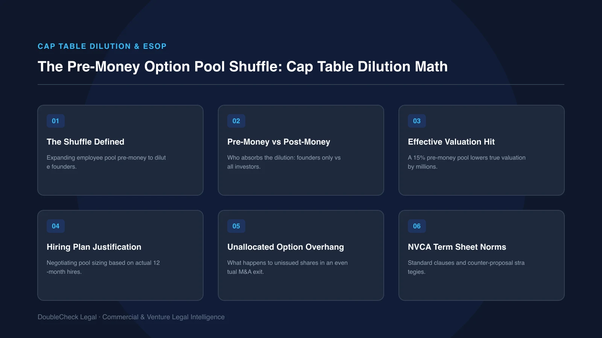
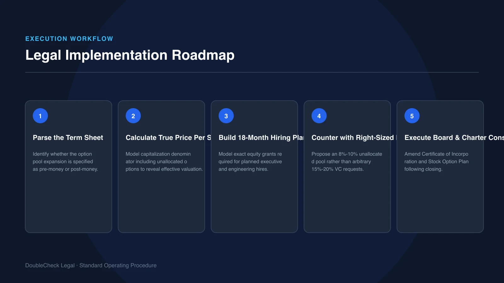

*A definitive guide to venture capital cap table math, analyzing the pre-money option pool shuffle, share price calculation mechanics, founder dilution modeling, and term sheet counter-negotiation strategies.*

**Key takeaways:**
- **Asymmetric Dilution:** When an option pool is expanded "in the pre-money," existing founders and common stockholders absorb 100% of the dilution; the incoming venture investor suffers 0% dilution from the pool.
- **Valuation Distortion:** A $20M pre-money valuation with a 15% unallocated option pool is economically equivalent to a $17M pre-money valuation without the pool.
- **The Hiring Plan Defense:** Founders should never accept arbitrary 15%-20% pool requests; the best counter-strategy is a defensible, itemized 18-month hiring forecast showing exactly how many shares are needed.
- **Exit Windfalls:** Unallocated options canceled in an acquisition benefit the venture investors at the expense of founders who absorbed the initial pre-money dilution.

## 1. The quick answer: How the option pool shuffle works

When venture capital firms issue a Series A term sheet, they almost universally include a clause requiring an **available, unallocated Employee Stock Option Pool (ESOP)** prior to the investment:

1. **The Investor Requirement:** "The Company shall have an unallocated option pool equal to 15% (or 20%) of the fully diluted capitalization of the Company immediately following the Closing, included in the pre-money valuation."
2. **The Mechanism:** The shares are issued **before** the investor wires their money.
3. **The Result:** The founding team absorbs the entire dilution hit alone. The incoming VC buys into a company that already has all anticipated future employee dilution baked into the pre-money share price.

## 2. In-depth legal analysis: The capitalization denominator and share price math

Understanding the mathematical mechanics reveals why term sheet semantics matter enormously.

### A. The Two Different Share Price Formulas
The price per share in a priced preferred stock financing is determined by dividing the agreed-upon valuation by the capitalization denominator:

$$	ext{Price Per Share} = rac{	ext{Pre-Money Valuation}}{	ext{Fully Diluted Pre-Money Capitalization}}$$

The legal dispute centers on what is included in the **"Fully Diluted Pre-Money Capitalization"**:
- **Founder-Friendly (Post-Money Pool):** Includes only issued common stock, vested/unvested existing options, and converted SAFEs/notes. The new option pool is created *after* the round, diluting founders and incoming investors proportionally.
- **Investor-Friendly (Pre-Money Pool):** Includes all issued stock, all existing options, all convertible notes, **PLUS the entire new unallocated option pool**.

### B. The Numerical Comparison: Pre-Money vs Post-Money Pool
Assume a startup with 10,000,000 existing common shares receives an offer of **$5,000,000 investment at a $20,000,000 pre-money valuation** ($25M post-money), with an investor demand for a **15% post-closing unallocated option pool**.

| Capitalization Line Item | Pre-Money Option Pool Shuffle | Pro-Rata Post-Money Pool Creation |
|---|---|---|
| Existing Founder Shares | 10,000,000 shares (**65.0%**) | 10,000,000 shares (**68.0%**) |
| Incoming Series A Preferred | 3,076,923 shares (**20.0%**) | 2,500,000 shares (**20.0%**) |
| Unallocated Option Pool | 2,307,692 shares (**15.0%**) | 1,875,000 shares (**12.0%** to 15%) |
| Effective Pre-Money Valuation | **$16,250,000** | **$20,000,000** |
| Series A Price Per Share | **$1.625** | **$2.000** |
| Founder Equity Lost to Shuffle | **-3.0% of entire company** ($750k+ value) | **$0** (Dilution shared equally) |

As shown above, agreeing to an unallocated pool "in the pre-money" reduces the founder's effective valuation by nearly **$3.75 million**, lowering the actual share price from $2.00 to $1.625.

## 3. Step-by-step: How founders should negotiate the option pool

Founders can prevent unnecessary equity forfeiture by following a disciplined negotiation procedure:

### Step 1: Decode the Term Sheet Language
Search the term sheet for the words "fully diluted capitalization shall include an unallocated option pool of X%." Recognize that this is a pre-money shuffle.

### Step 2: Build a Granular 18-Month Hiring Model
Never argue about percentages in the abstract. Build a spreadsheet listing:
- Specific roles to be hired before the next expected financing (e.g., VP of Sales, Head of Engineering, 4 Senior Engineers);
- Market-standard equity grant percentages for each role based on Option Impact or Carta industry benchmarks;
- Aggregate actual equity required (e.g., 8.5%).

### Step 3: Present the "Right-Sized Pool" Counter-Offer
Present your hiring plan to the lead investor:
- "Our data-backed hiring plan shows we will only grant 8.5% over the next 18 months. Expanding the pool to 18% creates unnecessary dilution for existing shareholders."
- Propose an unallocated pool of **9% or 10%**, saving 5% to 8% of the company for the founders.

### Step 4: Propose Milestone-Based Pool Expansions
Offer to expand the pool further at the Board level if hiring outpaces projections, or propose that any pool expansion beyond 10% be approved post-closing so both parties share dilution.

### Step 5: Implement Cap Table Protective Governance
Ensure the post-closing Investors’ Rights Agreement requires board approval (including the founder director) to grant options outside the approved budget.

## 4. The M&A cancellation trap: Where unallocated options go

A critical legal insight founders overlook:
- If a startup is acquired for $100M, any **unallocated options remaining in the pool are canceled**.
- However, because founders took 100% of the dilution when the pool was created in the pre-money, canceling those shares does **not** return 100% of the equity to the founders!
- Instead, the canceled shares increase the payout per share pro-rata across **all** stockholders, giving the venture investor a free windfall subsidized by the founders' upfront dilution.

## 5. Due diligence checklist: Option pool and cap table verification

1. **Verify Existing Pool Utilization:** Audit all outstanding option grants; cancel forfeited options from departed employees to replenish the pool before negotiating new pool size.
2. **Model SAFE Conversion Interaction:** Check whether outstanding post-money SAFEs convert into the capitalization denominator before or after the pool expansion.
3. **Review 409A Valuation Impact:** Ensure the expansion of authorized common stock does not artificially distort upcoming 409A fair market valuations.
4. **Delaware Corporate Filings:** Following closing, ensure the Amended and Restated Certificate of Incorporation filed under DGCL § 242 authorizes sufficient common shares to cover the expanded option pool.

## Where DoubleCheck fits

[DoubleCheck](https://www.contactdoublecheck.com) provides early-stage founders, startup CFOs, and emerging companies with AI-driven venture financing due diligence. DoubleCheck scans term sheets, parses capitalization formulas, uncovers hidden pre-money option pool shuffles, and runs real-time cap table simulations, empowering founders to negotiate term sheets from a position of analytical strength.

**Related reading:**
- [Post-Money SAFE Conversion Mechanics & Dilution](/blog/post-money-safe-conversion-mechanics-cap-table-dilution/)
- [Cap Table Cleanup Before Series A Common Problems](/blog/cap-table-cleanup-before-series-a-common-problems/)
- [Term Sheet Key Terms Explained](/blog/term-sheet-key-terms-explained/)
- [Stock Options 409A Valuation Startups](/blog/stock-options-409a-valuation-startups/)

**Sources:** [National Venture Capital Association (NVCA), Model Series A Term Sheet](https://nvca.org/model-legal-documents/); [Delaware General Corporation Law § 151 (Classes and Series of Stock)](https://delcode.delaware.gov/title8/c001/sc05/); [Internal Revenue Code § 409A](https://www.irs.gov/pub/irs-drop/rr-05-48.pdf); [American Bar Association, Venture Capital Financing Practices](https://www.americanbar.org/).

## FAQ

**What is the "option pool shuffle" in venture capital?**

The option pool shuffle is a venture capital negotiation tactic where an incoming investor requires the startup to create or expand an unallocated Employee Stock Option Pool (ESOP) within the pre-money valuation, forcing the existing founders to absorb 100% of the equity dilution.

**Why does a pre-money option pool expansion reduce the effective valuation?**

Because the new option shares are added before the new money enters, the share denominator increases, resulting in a lower price-per-share. An advertised $20M pre-money valuation with a 15% pre-money pool effectively values existing shares at only $17M.

**What is a typical unallocated option pool size for Series A?**

Investors typically ask for 15% to 20%, but savvy founders counter with a realistic 12-to-18 month hiring plan demonstrating that 8% to 12% is sufficient to cover planned senior and engineering hires.

**What happens to unallocated option pool shares if the company is acquired?**

In an acquisition, unallocated option pool shares are simply canceled, but because founders took 100% of the dilution upfront, the cancellation windfall is shared pro-rata with the venture investors.

**How can AI cap table tools help founders negotiate option pools?**

AI cap table tools run dynamic scenario models comparing pre-money vs post-money pool allocations, instantly quantifying the founder equity impact across various hiring plans and exit valuations.

---

*General information only. This article is not legal, tax, investment, or accounting advice.*
