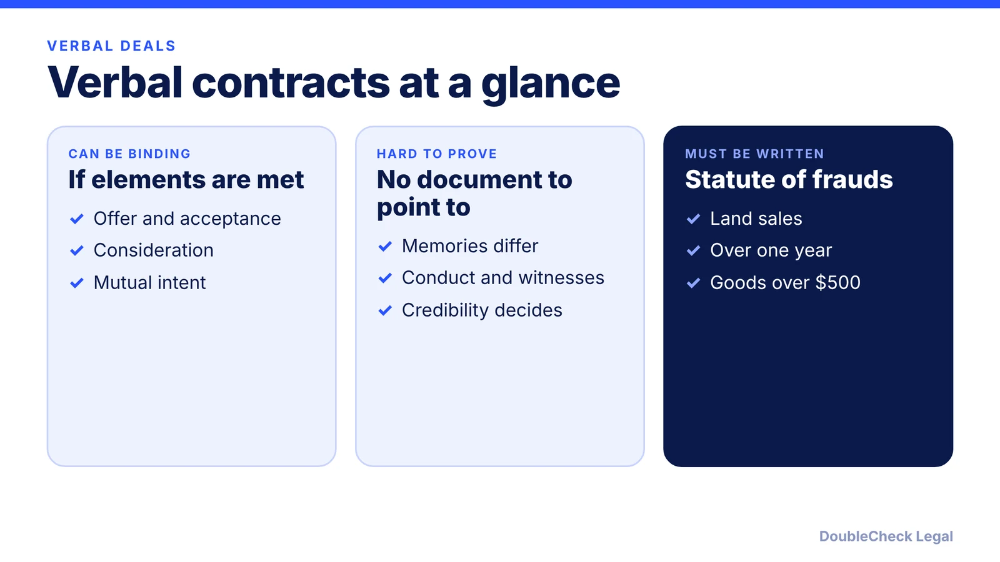
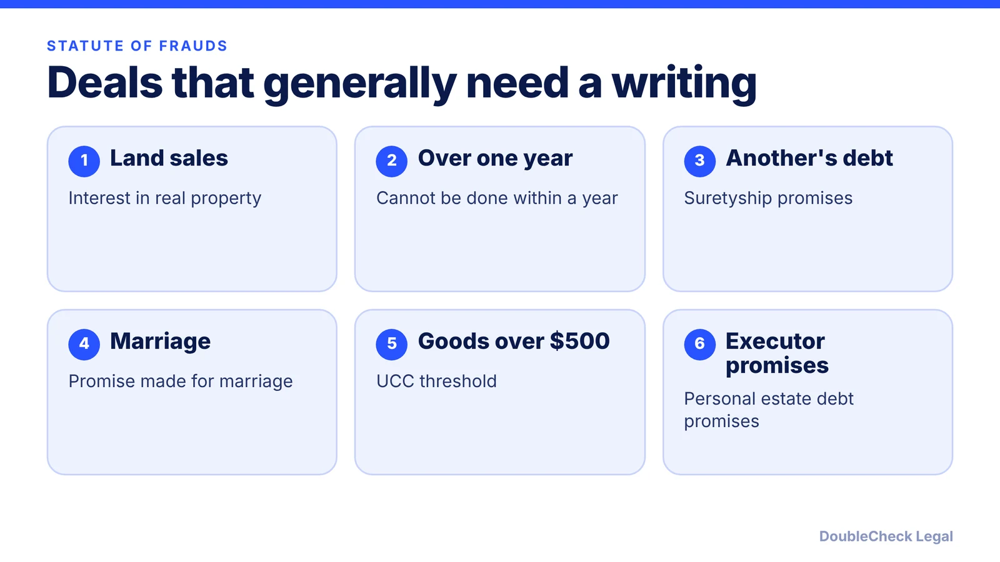

*A handshake can be a contract, but proving it is the hard part. Here is when verbal deals hold up and when you need paper.*

**Key takeaways:**

- Verbal contracts can be binding if they meet the basic elements, including under $500.
- The hard part is proof: it often comes down to testimony, conduct, and credibility.
- The statute of frauds generally requires a writing for land, over-one-year deals, others' debts, marriage, and goods over $500; states vary.
- Send a confirming email now and use a short written agreement for repeat or larger work.

## 1. The quick answer

**Quick answer:** Yes, verbal contracts can be legally binding if they meet the basic elements: an offer, acceptance, consideration, and mutual intent. The problem is proof. Per UpCounsel, without a writing each side must back up its own version of the deal, and it can become one person's word against the other's. Certain contracts, such as land sales, deals that cannot be performed within a year, and generally sales of goods over $500, must be in writing under the statute of frauds, and details vary by state.

## 2. When a handshake deal is enforceable

Per [UpCounsel](https://www.upcounsel.com/validity-of-oral-contracts), oral agreements can be binding, even under $500, but proving them is challenging. To be enforceable a verbal deal needs an offer, acceptance, consideration, and mutual intent (see [what makes a contract legally binding](/blog/what-makes-a-contract-legally-binding/)).

If a dispute reaches a court, UpCounsel says judges may look at witness testimony, the parties' conduct (course of conduct), and each party's credibility. Risks it lists include misremembered terms over time and difficulty proving breach or damages.

Texts and emails can help. A message that says "confirming we agreed to $4,000 for the logo by March 1" is evidence of the deal. Whether it also meets a statute of frauds writing requirement depends on your state and the facts, so ask an attorney if a large amount is at stake.

## 3. The statute of frauds: deals that generally need a writing

Per the [Chicago-Kent notes](https://blogs.kentlaw.iit.edu/harriscontracts/home/written-contracts/notes-on-the-statute-of-frauds), the statute of frauds covers:

1. sale of an interest in land
2. contracts whose performance extends beyond one year
3. promises to answer for another person's debt (suretyship)
4. promises where the consideration is marriage
5. sale of goods priced over $500
6. certain promises by executors and administrators

Some states add others, such as contracts to pay a real estate agent's commission, per the same source. [FindLaw](https://www.findlaw.com/smallbusiness/business-contracts-forms/what-contracts-are-required-to-be-in-writing.html) also lists real estate leases longer than one year and notes that the dollar threshold varies by state; it cites California's UCC-based statute for goods over $500.

**Two nuances.** The one-year rule applies only if the contract cannot be fully performed within a year, per Chicago-Kent. A delivery date more than a year out does not trigger it by itself. And a contract in these categories is not automatically void; FindLaw says it may be voidable, so either side may affirm or reject it.

**Exceptions for goods.** UpCounsel lists three: specially manufactured goods, an admission in court that a contract was made, and partial performance (payment accepted or goods delivered and accepted). Chicago-Kent's notes describe similar reliance and restitution ideas.

## 4. How to protect yourself when the deal started verbally

You do not need to cancel a deal because it started on a call. Turn it into a record:

- **Send a confirming email** the same day with price, scope, dates, and payment terms, and ask for a reply of "confirmed."
- **Use a short written agreement or SOW** for anything recurring or over a few thousand dollars. See [how to write a freelance contract](/blog/how-to-write-a-freelance-contract/) and [MSA and SOW basics](/blog/master-services-agreement-and-sow-small-business/).
- **Keep conduct on record:** invoices, deposits, delivery receipts, and messages.
- **If a verbal deal goes wrong,** gather your records first, then see [how to collect unpaid invoices](/blog/how-to-collect-unpaid-invoices-small-claims/) for the next steps.

An AI tool can draft a confirming message or a one-page agreement from your notes, which you should then verify. See [AI contract review for small business](/blog/ai-contract-review-small-business/) and [lawyer review of a ChatGPT contract](/blog/lawyer-review-chatgpt-contract/).

## Where DoubleCheck fits

[DoubleCheck](https://www.contactdoublecheck.com) helps businesses and founders start legal work with AI, verify it, and, when professional advice is warranted, connect with an independent attorney, including for immigration questions. Attorney availability and practice areas vary. Attorneys on DoubleCheck are independent professionals; an attorney-client relationship forms only if an attorney accepts your engagement.

**Sources:** [UpCounsel](https://www.upcounsel.com/validity-of-oral-contracts); [Chicago-Kent, Notes on the Statute of Frauds](https://blogs.kentlaw.iit.edu/harriscontracts/home/written-contracts/notes-on-the-statute-of-frauds); [FindLaw, What Contracts Are Required to Be in Writing](https://www.findlaw.com/smallbusiness/business-contracts-forms/what-contracts-are-required-to-be-in-writing.html).

## FAQ

**Are verbal contracts legally binding?**

They can be. Per UpCounsel, oral agreements can be binding, even under $500, but proving them can be challenging. They still need an offer, acceptance, consideration, and mutual intent.

**What contracts must be in writing?**

Per Chicago-Kent, the statute of frauds covers land sales, contracts that cannot be performed within a year, promises to pay another's debt, promises tied to marriage, goods over $500, and certain executor promises. Some states add categories.

**Is a text message or email a contract?**

It can be evidence of one. Messages can show the terms and that both sides agreed. Whether they satisfy a writing requirement depends on the contract type and your state, so confirm with an attorney for high-value deals.

**What if a verbal contract is for more than $500?**

Per UpCounsel, the UCC generally requires a writing for goods of $500 or more, with exceptions such as specially manufactured goods, an admission in court, and partial performance. The threshold and rules vary by state and by whether it is a sale of goods or services.

---

*General information only. This article is not legal, tax, investment, or accounting advice.*
