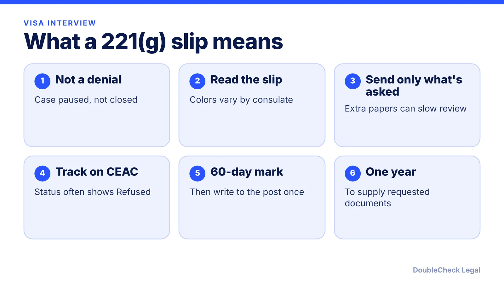
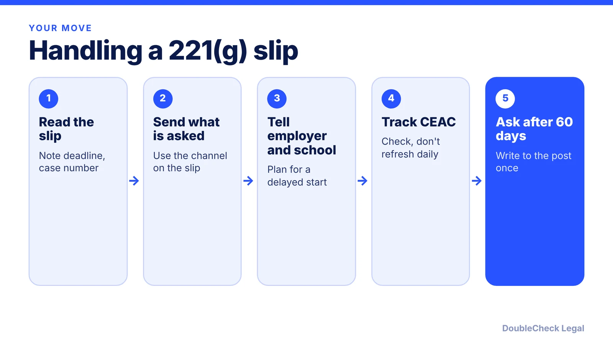

*A 221(g) slip after your visa interview is stressful but not a denial. Here is what it means, what to send, and how long to expect.*

**Key takeaways:**

- A 221(g) refusal is temporary: the case is paused for documents or checks, not closed.
- Slip colors are not standardized, so follow the written instructions on yours.
- Send only what is requested; one year from the refusal is the commonly cited deadline for documents.
- The State Department's stated goal is 60 days (per Mondaq), but security reviews can take months.

## 1. The quick answer

**Quick answer:** A 221(g) slip means the consular officer could not finish your visa decision at the interview, so the case is paused under section 221(g) of the Immigration and Nationality Act. It is a temporary refusal, not a final denial. Read the slip: if it asks for documents, send exactly those, through the channel it names, and keep in mind that a commonly cited deadline is one year from the refusal date. If it asks for nothing, the case is usually in background or interagency review. The State Department's stated goal, as summarized by Mondaq, is to finish within 60 days, but many cases take longer.

## 2. White, blue, yellow or pink: what the slip colors mean

Lighthouse reports that the State Department does not standardize slip colors and that they vary by post, so the written instructions on your slip always win. With that caveat, the usual pattern Lighthouse describes is:

- **White:** case under review; documents are sometimes requested.
- **Blue:** additional information or documents needed, usually a specific request.
- **Yellow:** a case-specific or employment-related review.
- **Pink:** administrative processing or security review, usually with nothing for you to do.

Ellis splits the causes into two buckets. In the first, the officer needs a missing form, translation, or proof of work, study, or travel history, and these cases often resolve quickly once you respond. In the second, the case goes to other U.S. agencies for a background check (Ellis names reviews informally called Visas Mantis and Visas Condor), and you usually have nothing to submit. Mondaq adds other triggers: missing or inaccurate information, petition approvals not yet entered in the State Department's database, legal questions needing supervisory review, and a prior visa refusal.

For founders and tech employees, the practical risk is a work or study start date. Mondaq notes that since September 2, 2025 most nonimmigrant applicants need an in-person interview, including H-1B, L-1, F-1, and O-1 applicants who could previously use a drop box, and that applicants for F, M, and J visas face expanded screening, including social media review, since a June 18, 2025 announcement. A temporary 221(g) can follow.

## 3. Documents to submit and how long it takes

**Documents.** Lighthouse advises sending only what the slip or consulate requests, because unrequested additions can slow review. Typical requests it lists include an updated employment letter, recent pay records, police certificates, an affidavit of support, and proof of the employer relationship. If a document is not in English, see our guide to [USCIS certified translations](/blog/uscis-certified-translation-requirements-documents/). Keep your interview letter, the slip, the approved petition (for example an [H-1B transfer](/blog/h-1b-transfer-change-of-employer-portability/) approval), and prior visa stamps handy.

**Timing.** There is no legal maximum, and the published figures differ by source:

- Mondaq: the State Department's stated goal is to complete administrative processing within 60 days; many cases resolve in weeks, others take months.
- Ellis: document-only cases often clear within days to a few weeks after you respond; security checks can take several months, and some take six months to a year.
- Johns Hopkins' international office: most cases resolve in a few months, a few take much longer, and status inquiries are not allowed until 60 days after processing begins.
- Lighthouse and Ellis both say you have one year from the refusal date to provide requested documents; miss it and you generally reapply and pay the fee again.

Ellis suggests waiting 180 days before inquiring unless it is a true emergency, while Mondaq and Johns Hopkins point to 60 days. Treat 60 days as the earliest point to ask politely, and check the instructions of your specific embassy.

## 4. What to do, step by step

Lighthouse and Ellis agree on the basics: respond fast and completely, do not book a new interview or reapply while the case is open, and check CEAC with your case number periodically. A CEAC status of "Refused" is common during processing and does not by itself mean a final denial (per Mondaq and Johns Hopkins).

Tell your employer's HR or immigration counsel right away. If you are changing jobs, check the rules in our posts on the [H-1B 60-day grace period](/blog/h-1b-layoff-60-day-grace-period/) and [H-1B portability](/blog/h-1b-transfer-change-of-employer-portability/) if your employment situation changes while the visa is pending. Mondaq notes mandamus lawsuits and congressional inquiries are options for very long delays, but neither guarantees speed, and a refusal that becomes final is generally not reviewable by a court because of the doctrine of consular non-reviewability. If the case stalls, see how to [find a good immigration lawyer](/blog/how-to-find-good-immigration-lawyer-startup-founder/), and beware of [notario scams](/blog/immigration-notario-scam-how-to-avoid/) offering to "speed up" a case. You can also run your document list through our guide to [checking immigration documents with AI](/blog/check-immigration-documents-with-ai-before-filing/).

## Where DoubleCheck fits

[DoubleCheck](https://www.contactdoublecheck.com) helps businesses and founders start legal work with AI, verify it, and, when professional advice is warranted, connect with an independent attorney, including for immigration questions. Attorney availability and practice areas vary. Attorneys on DoubleCheck are independent professionals; an attorney-client relationship forms only if an attorney accepts your engagement.

**Sources:** [Lighthouse: 221(g) white slip](https://www.lighthousehq.com/blog/221g-white-slip); [Ellis: administrative processing](https://www.ellis.com/resources/administrative-processing); [Mondaq: Decoding 221(g) visa refusals](https://www.mondaq.com/unitedstates/work-visas/1674344/decoding-221g-visa-refusals); [Johns Hopkins OIS](https://ois.jhu.edu/travel-information/administrative-processing-and-visa-issues).

## FAQ

**Is a 221(g) refusal the same as a visa denial?**

No. Ellis and Mondaq describe it as a temporary refusal while the officer waits for documents or completes checks, and it can be overcome.

**What do the white and blue 221(g) slips mean?**

Lighthouse says white usually means the case is under review and blue usually means a specific document request, but colors are not standardized and vary by consulate, so read the slip text.

**How long does 221(g) administrative processing take?**

Mondaq reports a State Department goal of 60 days. Ellis says document-only cases can clear in days to weeks, while some security checks take six months to a year.

**When can I contact the consulate about my case?**

Johns Hopkins' international office says inquiries are not allowed until 60 days after processing begins; Ellis advises waiting 180 days unless it is an emergency. Follow your embassy's instructions.

---

*General information only. This article is not legal, tax, investment, or accounting advice.*
