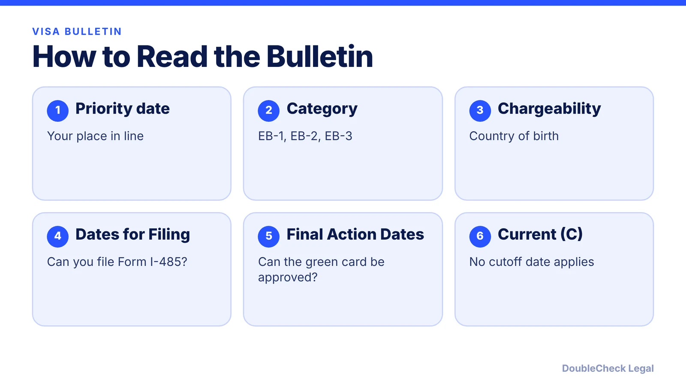
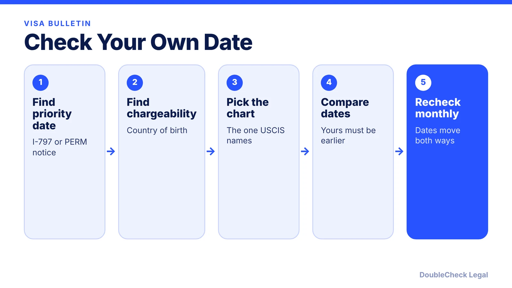

*How to read the monthly Visa Bulletin, with the November 2026 EB-1, EB-2, and EB-3 numbers for India, China, and everyone else.*

**Key takeaways:**

- Compare your priority date to the cutoff for your category and country of birth.
- Dates for Filing shows if you can file an I-485; Final Action Dates shows if it can be approved.
- In November 2026, USCIS used the Dates for Filing chart for employment-based filings.
- Retrogression moves a cutoff backward; a filed I-485 stays pending.

## 1. The quick answer

**Quick answer:** The Visa Bulletin is a monthly State Department chart of cutoff dates. If your priority date is earlier than the cutoff for your category and your country of birth, you can move forward. Each bulletin has two charts: Dates for Filing (can you submit Form I-485?) and Final Action Dates (can the green card be approved?). For November 2026, USCIS said employment-based adjustment applicants should use the Dates for Filing chart, per Fisher Phillips and Envoy.

## 2. The four terms you need

- **Priority date.** Per the National Law Review, it is the date USCIS received the immigrant petition. For PERM-based cases such as most EB-2 and EB-3, it is the date the Department of Labor accepted the labor certification, not the I-140 filing date. It does not change once set. See [PERM labor certification](/blog/perm-labor-certification-green-card-process/).
- **Chargeability.** The bulletin is organized by country of birth, not citizenship or residence. Married applicants may use a spouse's country of birth if that shortens the wait (cross-chargeability).
- **Final Action Dates.** Your priority date must be earlier than the listed cutoff for approval.
- **Dates for Filing.** A looser chart that shows when you may submit an I-485. Filing does not mean approval, because a visa number must still be available under Final Action Dates at adjudication, per Fisher Phillips.

"C" means current: no cutoff applies for that category and country, so applicants can move forward regardless of priority date.

## 3. November 2026 cutoffs for India, China, and everyone else

These are the November 2026 employment-based cutoffs as reported by Cilaw Group (Final Action) and Fisher Phillips (Dates for Filing). Check the State Department's bulletin itself before you file.

- **EB-1:** Final Action is current for most countries, Aug. 1, 2023 for China, Feb. 1, 2023 for India. Dates for Filing: current for most countries, July 1, 2024 for China and India.
- **EB-2:** Final Action is Apr. 1, 2025 for most countries, Oct. 1, 2021 for China, Nov. 1, 2013 for India. Dates for Filing: Mar. 15, 2026, Jan. 1, 2023, and Jan. 15, 2015.
- **EB-3 (professionals and skilled workers):** Final Action is June 15, 2024 for most countries, Jan. 22, 2022 for China, Jan. 22, 2014 for India. Dates for Filing: Aug. 1, 2024, Apr. 1, 2024, and Jan. 15, 2015.

Cilaw Group reports no retrogression in November 2026 and notes that China EB-2 applicants with priority dates between Jan. 1, 2023 and Apr. 1, 2024 may have an EB-3 downgrade option. Whether a downgrade makes sense depends on your job and PERM, which is a question for an attorney.

## 4. Retrogression and what it means in practice

Retrogression means a cutoff date moves backward, usually when demand reaches the annual limit. It can happen near the end of a fiscal year or when allocations reset, per the National Law Review. If your I-485 is already filed, it stays pending. If you have not filed, you wait until the date moves forward again.

Practical points for founders and tech employees:

- USCIS announces each month which chart to use for adjustment filings. It can differ from month to month, so do not rely on last month's choice.
- India and China have long backlogs because each country gets a fixed share of employment-based green cards. Rest-of-world applicants are far closer to current.
- Where your case sits in the sequence matters. See the [H-1B to green card timeline](/blog/h-1b-to-green-card-timeline-tech-workers/) and the [I-485 guide](/blog/i-485-adjustment-of-status-guide/).
- If you change jobs after an I-140 approval, the priority date can often be kept. See [I-140 portability](/blog/i-140-portability-ac21-changing-jobs/).

The priority date you read from your notice, not the date you started the process, is the number that counts.

## Where DoubleCheck fits

[DoubleCheck](https://www.contactdoublecheck.com) helps businesses and founders start legal work with AI, verify it, and, when professional advice is warranted, connect with an independent attorney, including for immigration questions. Attorney availability and practice areas vary. Attorneys on DoubleCheck are independent professionals; an attorney-client relationship forms only if an attorney accepts your engagement.

**Sources:** [Cilaw Group, November 2026 bulletin](https://cilawgroup.com/?p=16977); [Fisher Phillips](https://www.fisherphillips.com/en/insights/insights/the-fp-visa-bulletin-for-november-2026); [Envoy Global](https://www.envoyglobal.com/news-alert/november-2026-visa-bulletin/); [National Law Review, how to read the bulletin](https://natlawreview.com/article/how-read-visa-bulletin-step-step-guide-eb-1-and-eb-2-applicants); [National Law Review, priority dates and retrogression](https://natlawreview.com/article/understanding-visa-bulletin-priority-dates-current-status-and-retrogression). The State Department's own bulletin page could not be loaded; confirm figures there.

## FAQ

**What is a priority date?**

Per the National Law Review, it is the date USCIS received the immigrant petition, and for PERM-based cases it is the date the Department of Labor accepted the labor certification. It does not change once set.

**What is the difference between Final Action Dates and Dates for Filing?**

Dates for Filing shows when you may submit an I-485; Final Action Dates shows when the green card can be approved. USCIS announces which chart to use each month, and for November 2026 it chose Dates for Filing for employment-based cases, per Fisher Phillips.

**Does chargeability mean my citizenship?**

No. The bulletin follows country of birth, not citizenship or residence, per the National Law Review. A married applicant may sometimes use a spouse's country of birth.

**What is retrogression?**

A cutoff date moving backward, typically when demand reaches the annual limit. If your I-485 is already filed it stays pending; if not, you wait until the date advances again, per the National Law Review.

---

*General information only. This article is not legal, tax, investment, or accounting advice.*
