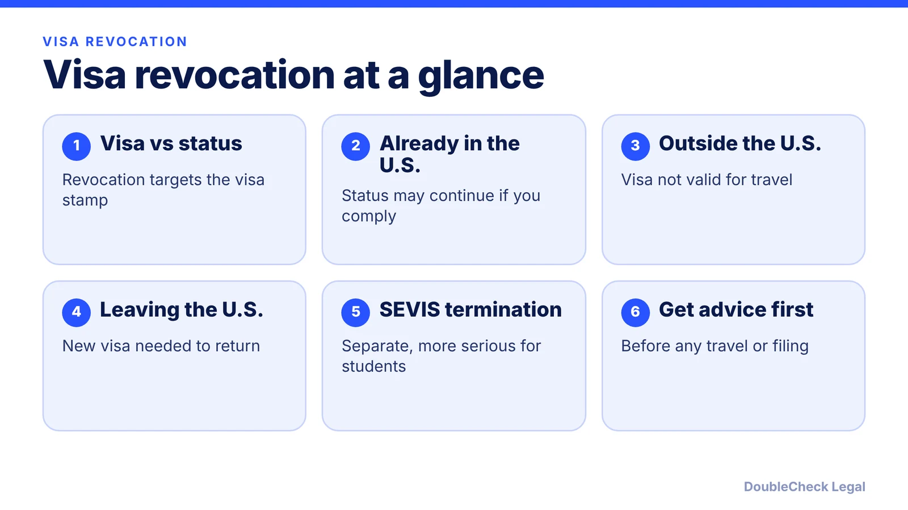
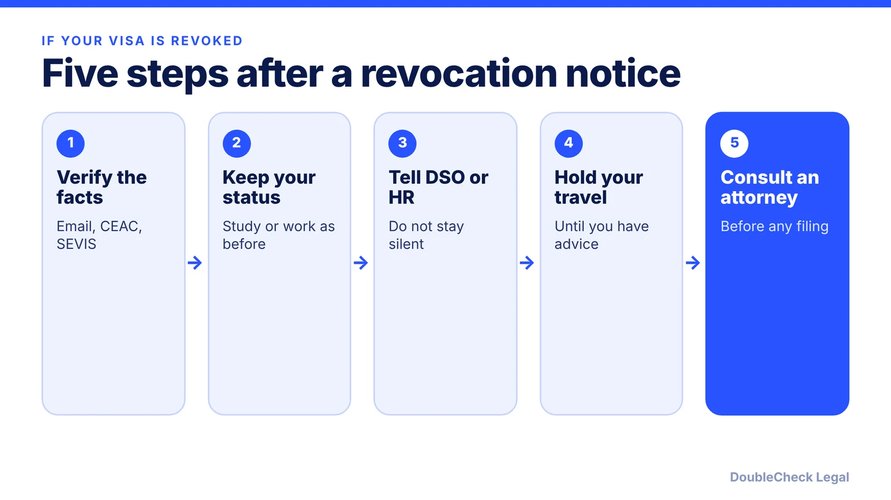

*A neutral explainer on U.S. visa revocation, with reported figures as of November 2026.*

**Key takeaways:**

- Revocation cancels the visa stamp; it is not the same as losing status, but you generally cannot re-enter on that visa.
- 22 CFR 41.122 lets a consular officer or the Secretary revoke at any time; notice is required where possible, but not guaranteed.
- Reported revocation counts vary by date and source; we attribute each one.
- Do not travel until you have advice, keep maintaining status, tell your DSO or employer, and never misstate facts.

## 1. The quick answer

**Quick answer:** A visa revocation cancels the visa stamp in your passport, which is your permission to seek entry to the U.S. It is not the same as losing your immigration status. Per 22 CFR 41.122, a consular officer or the Secretary of State may revoke a nonimmigrant visa "at any time, in his or her discretion." Per Porter Wright (January 2026), if you are already in the U.S. and keep following your visa terms, revocation does not automatically affect your lawful status, but you generally cannot re-enter on that visa if you leave. If you get a notice or suspect a problem, speak with an immigration attorney before you travel, and tell your DSO or employer's HR as appropriate.

## 2. What revocation means, and how you may learn of it

**Visa versus status.** The visa is the document a consulate places in your passport. Status is your permission to be in the U.S. under your admission, shown on your Form I-94. Per Murthy Law Firm's Sheela Murthy, as quoted by Business Standard, revocation applies to "the visa that is stamped in the passport." Per a Congressional Research Service report (R49040), revocation does not itself make a person removable; DHS must start removal proceedings, and a revocation generally does not automatically terminate SEVIS status.

**Legal basis.** The CRS report cites 8 U.S.C. 1201(i) (INA 221(i)) for the authority to revoke "at any time," and 22 CFR 41.121-123 for nonimmigrant visas. Under 22 CFR 41.122, revocation takes effect once it is entered in the State Department's Consular Lookout and Support System (CLASS), and the visa is then no longer valid for travel.

**Notice.** Per 22 CFR 41.122(c), unless the Department instructs otherwise, a consular officer must, where possible, notify the person that the visa was revoked. Per Porter Wright, notice is typically sent by email or letter to the address on the DS-160 and usually cites INA 221(i); the CEAC status may show "Revoked" but not always right away; and there is no automatic alert, so you must monitor your own email. Hacking Immigration Law says people typically hear from the embassy by email or phone. Because notice is not guaranteed, some people learn only when an airline refuses boarding or CBP denies entry.

**Common triggers cited.** Per Porter Wright: new derogatory information, arrests or charges (especially DUI), fraud or misrepresentation found after issuance, loss of eligibility for the category, or security concerns flagged during continuous vetting. Per the State Department's August 2026 fact sheet, as reported by Al Jazeera, most revocations stemmed from law-enforcement encounters involving criminal activity, with other grounds including visa violations, fraud and calls for violence.

## 3. 2025-2026 developments, with sources

Revocation has become more frequent and more visible. These figures are the State Department's or media reports of them, as stated on the pages we read; we could not confirm them against a primary State Department page, so treat them as reported figures:

- **85,000 revocations since January 2025:** a State Department statement of December 9, 2025, per Business Standard, which also cited a CNN report of more than 8,000 student visas.
- **Over 100,000:** per CRS, citing a January 12, 2026 Reuters report that attributes the figure to the State Department.
- **Over 175,000:** a State Department fact sheet released August 10, 2026, which said revocations came from "continuous vetting operations" (Al Jazeera).
- **Over 250,000:** an unnamed State Department official and spokesperson Tommy Pigott, as reported by Fox News on October 1, 2026 (via WJLA). That report says most revocations followed law enforcement encounters.

Counts of "visas revoked" are not counts of people removed, and they are not broken out by visa type in the sources we saw, except the student figure above.

**Students.** Per CRS, thousands of SEVIS records were terminated in 2025; SEVIS termination is a separate action from visa revocation. Per Shautsova Law, a terminated SEVIS record ends F-1 or J-1 status, stops OPT or CPT work authorization, and may make a student removable. Reinstatement under 8 CFR 214.2(f)(16) generally requires the violation to be within about five months, no unauthorized employment, and circumstances beyond the student's control, per the same firm. See [SEVIS and I-20 basics](/blog/sevis-i-20-explained-maintaining-f-1-status/).

**Related enforcement context:** [social media vetting for visa applicants](/blog/social-media-vetting-visa-applicants-2026-what-to-know/) and [221(g) administrative processing](/blog/visa-221g-administrative-processing/).

## 4. What to do, and when to get an attorney

**Steps that are generally safe and sensible:**

1. **Confirm what actually happened.** Check your email (including spam), the CEAC status for your DS-160, and your SEVIS record or employer petition status. A revoked visa, a terminated SEVIS record, and a denied petition are different problems.
2. **Keep maintaining status.** Per Hacking Immigration Law, you do not necessarily have to leave right away if you are maintaining status, which generally means keeping your I-20 or DS-2019 valid and continuing to study, or staying in the job that supports your H-1B.
3. **Tell the right people.** Students should contact their DSO. Employees should tell their employer's HR or immigration counsel.
4. **Pause international travel until you have advice.** Per Porter Wright, airlines may refuse boarding and CBP will deny admission on a revoked visa, and per Hacking, you cannot get a new visa inside the U.S.
5. **Do not lie, hide facts, or use someone else's documents.** Misstatements to officials create larger problems than the original revocation.

**Can you reapply?** Yes, generally by applying for a new visa at a U.S. embassy or consulate abroad. Per Shautsova Law, a prior violation will be visible to the consulate and could lead to denial. Revocation is separate from a visa refusal, and outcomes are discretionary. Consider your timing around [unlawful presence rules](/blog/immigration-overstay-unlawful-presence-3-10-year-bars-explained/) and [H-1B layoff grace periods](/blog/h-1b-layoff-60-day-grace-period/) if your status is also affected.

**When you can handle it yourself.** Checking your records, informing your DSO or HR, and gathering documents.

**When to get an attorney to look at it:**

- You have a notice, an arrest or charge, or a prior issue and need to decide whether to travel.
- Your SEVIS record was terminated, or you may be out of status.
- You are considering reinstatement, a new visa, or any filing based on revoked-visa facts.

See [immigration lawyer fees](/blog/immigration-lawyer-fees-flat-fee-vs-hourly/) and [how to find a good immigration lawyer](/blog/how-to-find-good-immigration-lawyer-startup-founder/).

## Where DoubleCheck fits

[DoubleCheck](https://www.contactdoublecheck.com) helps businesses and founders start legal work with AI, verify it, and, when professional advice is warranted, connect with an independent attorney, including for immigration questions. Attorney availability and practice areas vary. Attorneys on DoubleCheck are independent professionals; an attorney-client relationship forms only if an attorney accepts your engagement.

**Sources:** [22 CFR 41.122 (Cornell LII)](https://www.law.cornell.edu/cfr/text/22/41.122); [Congressional Research Service R49040](https://www.everycrsreport.com/reports/R49040.html); [Porter Wright, Employer Law Report (Jan 2026)](https://www.employerlawreport.com/2026/01/articles/immigration/prudential-visa-revocations-and-what-you-should-know/); [Business Standard](https://www.business-standard.com/immigration/us-doubles-student-visa-cancellations-in-2025-what-revocation-really-means-125121000479_1.html); [Al Jazeera, Aug 2026](https://www.aljazeera.com/news/2026/8/10/trump-administration-revoked-over-175000-visas-us-state-department); [WJLA/Fox News, Oct 2026](https://wjla.com/news/nation-world/state-department-says-more-than-250000-visas-revoked-president-trump-tommy-pigott-asylum-crimes); [Shautsova Law](https://shautsova.com/2026/03/17/student-visa-revocations-in-the-united-states-what-you-must-do-if-your-f-1-status-is-terminated/); [Hacking Immigration Law](https://hackinglawpractice.com/my-visa-got-revoked/). A primary State Department revocation page was not retrieved.

## FAQ

**Does a revoked visa mean I have to leave the U.S. immediately?**

Not automatically. Per Porter Wright (January 2026), revocation does not automatically affect lawful status inside the U.S. if you keep complying with your visa terms, and you can usually stay until your I-94 expires. The CRS also says revocation does not itself make a person removable. Get individual advice.

**How can I find out if my visa has been revoked?**

Check the email on your DS-160 and your CEAC status. Per Porter Wright, notice is typically sent but there is no automatic alert, and the CEAC status may not update right away. Under 22 CFR 41.122(c), the consulate must notify you where possible.

**Can I get a new visa after a revocation?**

Generally you would apply again at a U.S. embassy or consulate abroad. Per Shautsova Law, the prior revocation will be visible to the consulate and could lead to denial, and decisions are discretionary. You cannot get a new visa from inside the U.S.

**Is visa revocation the same as SEVIS termination?**

No. Per Shautsova Law, a SEVIS termination ends F-1 or J-1 status and stops OPT or CPT work authorization, while visa revocation affects the stamp used for entry. The CRS says revocation generally does not automatically terminate SEVIS status.

---

*General information only. This article is not legal, tax, investment, or accounting advice.*
