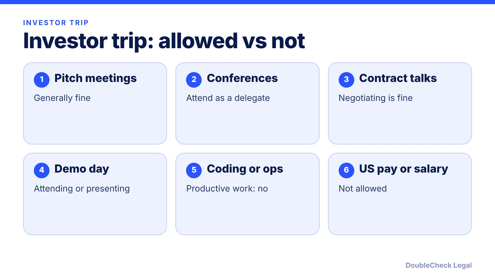
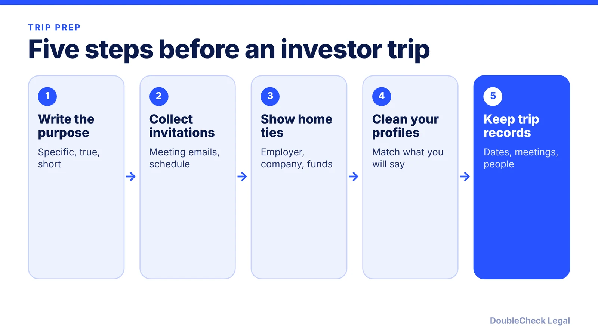

*ESTA and B-1 let you pitch, attend and negotiate. They do not let you work. Here is where the line sits.*

**Key takeaways:**

- ESTA and B-1 cover meetings, conferences as a delegate and contract negotiation; productive work and U.S. pay are not allowed (per NNU, K&L Gates).
- ESTA stays are capped at 90 days and cannot be extended or changed in the U.S. (per NNU).
- Ownership is not the problem; operational involvement is (per Grossman Young, June 2026).
- Bring specific, truthful purpose and evidence, and make sure your online profiles match.

## 1. The quick answer

**Quick answer:** A founder from outside the U.S. can generally travel on ESTA (Visa Waiver Program) or a B-1 visa to attend meetings, go to conferences and negotiate contracts, but cannot do productive work or take U.S. pay. Per NNU Immigration, ESTA business travel covers meetings, conferences as a delegate and contract negotiation, and prohibits direct employment by or paid services for a U.S. company, even if paid from abroad. Per Alma, investor meetings, contract negotiations and demo day fit B-1 or ESTA, while coding, marketing execution and product development do not. A pitch trip is fine; running your U.S. startup from a hotel room is not. As of November 2026, CBP still decides at the border whether to admit you.

## 2. ESTA vs B-1 for a startup trip

The two routes cover the same kind of business visit. The difference is how you get permission to travel.

- **ESTA (Visa Waiver Program).** For citizens of participating countries, no visa stamp. Per NNU Immigration, each stay is capped at 90 days, you cannot extend or change status from inside the U.S., and a trip to Canada or Mexico does not reset the clock. Harvard's International Office notes that visitors admitted in WB or WT status cannot extend beyond 90 days.
- **B-1 visa.** For people who need a visa or who expect longer or repeated stays. The visa gets you to the border; per terms.law, "having a valid visa does not guarantee entry" and CBP officers make the final determination.

Per a K&L Gates summary (September 2025), permitted activities include attending meetings or conferences, negotiating contracts, short-term planning and touring facilities. Per terms.law, B-1 investors can also do due diligence, consult attorneys and bankers, open bank accounts and sign entity formation documents. Per the same source, "buying a business on a B-1 is permitted; managing that business day-to-day on a B-1 is NOT permitted."

Note a gap: the sources we reviewed (NNU, K&L Gates) do not list "investor pitch meetings" by name. The Alma and Grossman Young pieces below do treat meeting investors as a traditional visitor activity. Treat it as a reasoned reading of the general rule, and check with an attorney if your trip is unusual.

Frequent travelers: per terms.law, officers may question whether you are living in the U.S. if you spend five to six months a year on B-1 status. See our [B-1/B-2 founder guide](/blog/b-1-b-2-visa-business-visitor-what-founders-can-do/) for more.

## 3. Permitted vs unauthorized work on a startup trip

**Usually fine for a visitor** (per Grossman Young, NNU and terms.law):

- Meeting investors, co-founders and advisers
- Customer discovery interviews and market research
- Attending conferences, trade shows and networking events
- Negotiating contracts, signing formation papers, opening a bank account
- Brief incidental tasks such as checking a few work emails (NNU)

**Not allowed:**

- Employment by any U.S. company, including your own U.S. entity (terms.law)
- Hands-on project work, supervising U.S. employees, delivering services to a U.S. client, or being paid from U.S. payroll beyond incidental expenses (K&L Gates)
- Full-time or ongoing remote work while physically in the U.S., and freelance work such as coding for clients (NNU)

**The grey zone is ownership.** Per Grossman Young (June 2026), owning shares or investing capital is generally not prohibited, but "the problem arises when ownership becomes operational involvement." Not being paid does not settle it. The firm says officers may ask whether work is ordinarily compensated or benefits a commercial enterprise, and unpaid work in exchange for future salary or equity is especially risky.

If you want to work for your company in the U.S., you need a status that allows it. See [starting a company on H-1B](/blog/start-company-on-h1b-visa-ownership-vs-work/), the [O-1A evidence guide](/blog/o-1a-visa-for-startup-founders-evidence/) and the [E-2 guide](/blog/e-2-treaty-investor-visa-for-founders/).

## 4. Documents, honest answers and online presence at the border

Prepare facts, not a script. Officers compare what you say with what they can see.

- **Be specific and truthful about purpose.** Per terms.law, "I am evaluating a franchise opportunity in Miami" works better than "exploring business opportunities." For you, that might be "three investor meetings in San Francisco and one conference." Harvard's guidance is to explain the purpose clearly and note a letter of invitation can help.
- **Carry evidence.** Per terms.law: letters or meeting invitations, flight and hotel bookings with a schedule, proof of ties to your home country such as an employer letter, business registration or contracts, and prior U.S. travel records.
- **Keep trip records.** Per terms.law, note entry and exit dates, the purpose of each visit and the meetings attended.
- **Do not understate.** K&L Gates describes a case where a vague description ("observing systems") met a LinkedIn profile showing the traveler leading a U.S. implementation. Grossman Young advises auditing LinkedIn, accelerator bios and your website so they do not suggest you work in the U.S.
- **Never lie to a border officer.** A misrepresentation can create lasting problems. If you are unsure whether your plan fits a visitor visit, ask an attorney first.

**Social media.** For visa applicants, the State Department's online presence review has expanded across categories: see [social media vetting for visa applicants](/blog/social-media-vetting-visa-applicants-2026-what-to-know/). For ESTA, a CBP proposal would require social media identifiers from the previous five years. Per Kelley Drye (December 2025), it was a proposal open for comment until February 9, 2026. Per AltexSoft (last updated May 27, 2026), it was not in effect and CBP was weighing a narrower version. Check the CBP ESTA page for what applies on your travel date.

**Self-handle vs attorney.** A short pitch trip with a clear agenda is usually something you can plan yourself. Get an attorney to look if you will be there for weeks, plan repeat trips, have a past refusal or overstay, or want to start doing real work for your U.S. company. See [how to find an immigration lawyer](/blog/how-to-find-good-immigration-lawyer-startup-founder/) and [what fees look like](/blog/immigration-lawyer-fees-flat-fee-vs-hourly/). For the wider picture, read [how to move to the U.S. as an entrepreneur](/blog/how-to-move-to-the-us-as-an-entrepreneur-options-compared/) and the [accelerator visa guide](/blog/accelerator-in-the-us-international-founders-visa-yc-techstars/).

## Where DoubleCheck fits

[DoubleCheck](https://www.contactdoublecheck.com) helps businesses and founders start legal work with AI, verify it, and, when professional advice is warranted, connect with an independent attorney, including for immigration questions. Attorney availability and practice areas vary. Attorneys on DoubleCheck are independent professionals; an attorney-client relationship forms only if an attorney accepts your engagement.

**Sources:** [K&L Gates, ESTA and B-1 boundaries (Sept 2025)](https://files.klgates.com/files/372118_understanding_esta_and_b-1_boundries_sept2025.pdf); [NNU Immigration, ESTA business travel rules](https://www.nnuimmigration.com/esta-permissible-activities/); [terms.law, B-1 business visitor](https://terms.law/Invest-USA/visa-pathways/b1-business-visitor.html); [Grossman Young (June 2026)](https://www.grossmanyoung.com/wp-content/uploads/2026/06/Startup-Founders-Beware-Participation-in-Incubators-and-Accelerators-Is-Drawing-Increased-Immigration-Scrutiny.pdf); [Alma, YC founder visa options](https://www.tryalma.com/learn/best-visa-options-yc-company-founders); [Harvard HIO, B and ESTA](https://www.hio.harvard.edu/visas-immigration/scholar-student-intern/b-esta.md); [Kelley Drye, ESTA social media](https://www.kelleydrye.com/viewpoints/blogs/labor-days/u-s-to-require-social-media-disclosure-for-esta-and-visa-applicants-what-travelers-need-to-know); [AltexSoft, ESTA social checks](https://www.altexsoft.com/travel-industry-news/us-may-soften-esta-social-checks-as-tourism-pushback-grows/). The CBP and travel.state.gov pages were not fetched, so law-firm and university sources are named.

## FAQ

**Can I meet investors in the U.S. on ESTA?**

Generally yes for meetings and conferences, as long as you do no productive work and take no U.S. pay. Per NNU Immigration, ESTA covers business meetings, conferences as a delegate and contract negotiation. Investor meetings are not listed by name there, so confirm unusual plans with an attorney.

**Can I attend a demo day or pitch event on B-1 or ESTA?**

Per Alma, demo day fits B-1 or ESTA. Presenting is different from working for a U.S. company or taking U.S. pay, which are not allowed. Keep the trip short and documented.

**How long can I stay on ESTA?**

Per NNU Immigration, each stay is capped at 90 days, you cannot extend or change status from inside the U.S., and leaving for Canada or Mexico does not reset the clock.

**Is ESTA social media disclosure required in November 2026?**

It was a CBP proposal, not a final requirement, in the sources we found: Kelley Drye (December 2025) and AltexSoft (updated May 27, 2026). Check the CBP ESTA page for the current form before you apply.

---

*General information only. This article is not legal, tax, investment, or accounting advice.*
