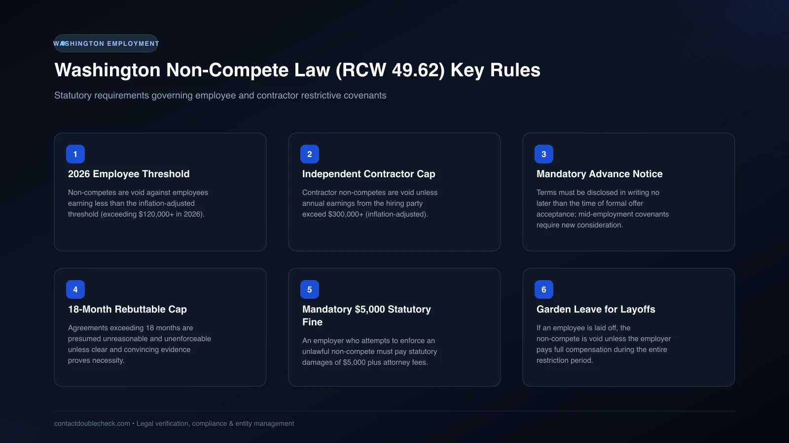
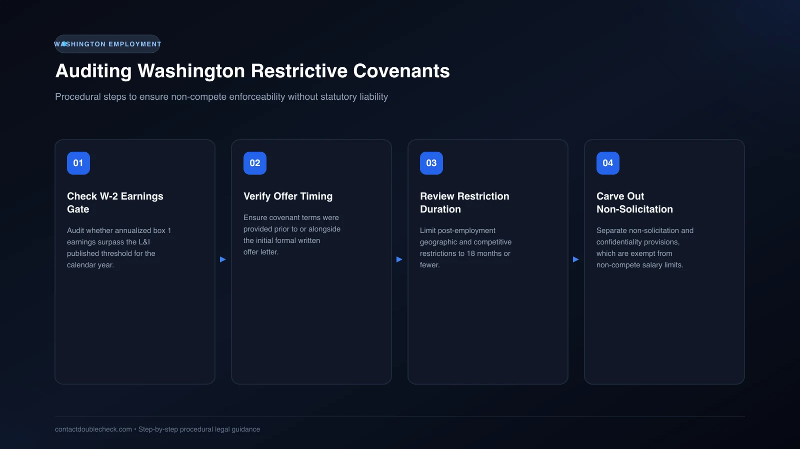

*Employer compliance guide to restrictive covenants under Washington State’s Non-Compete Act (RCW Chapter 49.62), as of November 2026. General information, not legal advice.*

**Key takeaways:**

- Non-compete covenants in Washington are void against employees earning less than the state-mandated inflation threshold (surpassing $120,000+ in 2026).
- Independent contractor non-competes are void unless annual contractor earnings from the hiring party exceed $300,000+ (inflation-adjusted).
- Restrictive covenants must be disclosed in writing prior to or at the time of initial offer acceptance; post-hire covenants require independent consideration.
- Any non-compete duration exceeding 18 months post-employment is statutorily presumed unreasonable and unenforceable.
- Attempting to enforce a non-compliant non-compete triggers a mandatory **$5,000 statutory penalty** plus attorney fees against the employer.

## 1. The quick answer

**Quick answer:** In Washington State, non-compete covenants are governed by one of the nation’s strictest restrictive covenant statutes: **RCW Chapter 49.62**. Under state law, any non-compete agreement entered into with an employee is **void and unenforceable** unless the worker’s annualized W-2 compensation exceeds the statutory earnings threshold established by the Washington Department of Labor & Industries (L&I). For 2026, this threshold surpasses **$120,000** for employees and **$300,000** for independent contractors.

Even for high-earning executives and engineers who clear the salary gate, employers must satisfy rigorous procedural rules: terms must be disclosed in writing prior to offer acceptance, post-employment restrictions are capped at a rebuttable presumption of **18 months**, and non-competes are unenforceable during layoffs unless the employer pays full wages (**garden leave**). 

Attempting to enforce an invalid covenant exposes the employer to an automatic **$5,000 statutory penalty**, actual damages, and mandatory employee attorney fee awards under RCW 49.62.080.

For national covenant trends, compare our guides on [non-compete agreements by state](/blog/non-compete-agreements-by-state-2026/) and [non-compete vs non-solicit vs NDA](/blog/non-compete-vs-non-solicit-vs-nda-which-to-use-after-the-ftc-rule/).

## 2. Statutory earnings thresholds for employees and contractors

Under RCW 49.62.020 and RCW 49.62.030, Washington ties non-compete enforceability directly to employee compensation, indexed annually to inflation according to the Consumer Price Index for All Urban Consumers (CPI-U).

### Historical Escalation of Earnings Gates:
- **2020 (Launch):** $100,000 (Employees) / $250,000 (Contractors)
- **2023:** $116,593.18 (Employees) / $291,482.95 (Contractors)
- **2024:** $120,559.99 (Employees) / $301,399.98 (Contractors)
- **2025–2026:** Inflation-adjusted thresholds surpassing **$120,000+** for employees and **$300,000+** for 1099 contractors.

**How Earnings Are Measured:**
Under RCW 49.62.010, "earnings" means compensation reflected in Box 1 of IRS Form W-2 (wages, bonuses, and taxable equity exercises). For independent contractors, earnings means the net compensation paid directly by the hiring business entity during the preceding 12-month period.

If an employee earns $115,000 in base salary and receives no bonus, a non-compete clause in their employment contract is completely void, regardless of the sensitive trade secrets or customer goodwill they access.

## 3. Offer timing and independent consideration rules

Under RCW 49.62.020(1)(a), timing is critical:

1. **New Hires:** The employer must disclose the terms of the non-compete agreement **in writing no later than the time of the acceptance of the offer of employment**. Handing a new hire an NDA containing a surprise non-compete on their first day of work renders the covenant void and actionable.
2. **Existing Employees:** If an employer introduces a non-compete covenant to a current employee after employment has already commenced, the covenant is void unless supported by **independent, additional consideration**. Continued at-will employment is statutorily insufficient in Washington. Independent consideration requires an actual promotion, salary increase, or bona fide equity award.

## 4. Duration limits and the 18-month presumption

Under RCW 49.62.020(2), a non-compete covenant that exceeds **18 months post-termination** is statutorily presumed unreasonable and unenforceable.

To overcome this presumption, an employer must prove by **clear and convincing evidence** that a longer duration is strictly necessary to protect the business or its goodwill. Washington courts have established that standard commercial software, tech, and service companies cannot overcome this high evidentiary burden. Standard drafting best practice in Washington caps all post-employment restrictions at 6 to 12 months.

## 5. Layoff rules and the mandatory $5,000 statutory penalty

Washington imposes severe penalties on employers that mishandle terminations or enforce overbroad agreements:

### The Layoff Garden Leave Rule
Under RCW 49.62.020(1)(c), if an employee is terminated as the result of a layoff, a non-compete covenant is void unless the employer continues to pay the employee **compensation equivalent to their base salary at the time of termination** for the entire period of enforcement (garden leave), minus any compensation the employee earns through subsequent employment. If the employer discontinues payments, the non-compete expires immediately.

### The $5,000 Statutory Penalty & Mandatory Attorney Fees
Under RCW 49.62.080, any person aggrieved by a non-compliant non-compete may bring a civil action or demand arbitration. If a court or arbitrator determines that a covenant violates the statute—or even rewrites ("blue-pencils") an overbroad clause—the court **must award the employee:**
- Actual damages or a **statutory penalty of $5,000**, whichever is greater; AND
- Reasonable attorney fees and all litigation costs.

This statutory fee-shifting creates tremendous leverage for departing employees, as employers attempting to enforce questionable covenants face guaranteed out-of-pocket legal expenses.

## 6. Non-solicitation and confidentiality exceptions

Crucially, RCW Chapter 49.62 targets true non-compete covenants that restrict an individual from working for a competing business. Under RCW 49.62.010, the statute **explicitly excludes** the following agreements from the salary thresholds and duration rules:

1. **Customer Non-Solicitation Agreements:** Contracts restricting a former employee from soliciting the hiring party's existing customers to divert business.
2. **Employee Non-Solicitation Agreements:** Clauses prohibiting a departing employee from raiding, recruiting, or encouraging colleagues to leave the employer.
3. **Confidentiality & Trade Secret Agreements:** Standard proprietary information and invention assignment agreements protecting IP.
4. **Sale of Business Covenants:** Non-competes entered into by the seller of a business or significant equity interest in an operating entity.

Consequently, Washington employers can protect sensitive client relationships and technical trade secrets across all compensation tiers by utilizing well-tailored non-solicitation and confidentiality covenants rather than vulnerable non-competes.

## Where DoubleCheck fits

[DoubleCheck](https://www.contactdoublecheck.com) helps founders and HR teams audit employment offer letters, review restrictive covenants, and ensure full compliance with state-specific labor codes. When restructuring agreements or evaluating departing employee risks, DoubleCheck connects you directly with independent employment attorneys admitted in Washington State.

**Related reading:**
- [Non-Compete Agreements by State in 2026](/blog/non-compete-agreements-by-state-2026/)
- [Non-Compete vs Non-Solicit vs NDA: Which to Use](/blog/non-compete-vs-non-solicit-vs-nda-which-to-use-after-the-ftc-rule/)
- [Trade Secret Protection for Small Business and Startups](/blog/trade-secret-protection-small-business-startups/)
- [Offer Letter vs Employment Contract Differences](/blog/offer-letter-vs-employment-contract-differences-startup/)

**Sources:** [Washington State Legislature, RCW Chapter 49.62 (Noncompetition Covenants)](https://app.leg.wa.gov/rcw/default.aspx?cite=49.62); [Washington State Department of Labor & Industries (L&I), Non-Compete Agreements & Annual Threshold Calculations](https://www.lni.wa.gov/workers-rights/workplace-policies/non-compete-agreements); [Washington State Office of the Attorney General, Restrictive Covenants Guidance](https://www.atg.wa.gov/); [Supreme Court of Washington, Labor & Restrictive Covenant Decisions](https://www.courts.wa.gov/opinions/); [Cornell Legal Information Institute, Non-Compete Covenants Overview](https://www.law.cornell.edu/wex/covenant_not_to_compete).

## FAQ

**What are the Washington State non-compete salary thresholds?**

Under RCW 49.62.020 and RCW 49.62.030, the Washington Department of Labor & Industries adjusts earnings thresholds annually for inflation. For 2026, employee thresholds exceed $120,000 and independent contractor thresholds exceed $300,000.

**What penalty does an employer face for an unlawful non-compete in Washington?**

Under RCW 49.62.080, if a court or arbitrator determines a non-compete agreement violates the statute, the employer must pay the employee statutory damages of $5,000 or actual damages, whichever is greater, plus reasonable attorney fees.

**Are non-solicitation clauses subject to the Washington salary threshold?**

No. RCW 49.62.010 explicitly carves out customer non-solicitation and employee non-solicitation agreements from the definition of a non-compete covenant, meaning salary thresholds do not apply to narrow non-solicitation clauses.

**What happens to a Washington non-compete if an employee is laid off?**

Under RCW 49.62.020(1)(c), a non-compete is void upon layoff unless the employer pays the employee full base compensation for the entire enforcement period (garden leave), minus any earnings from new employment.

**Can an employer use an out-of-state choice of law to enforce a non-compete against a Washington worker?**

No. RCW 49.62.050 renders void any contractual choice of law or venue clause that deprives a Washington-based employee or contractor of the protections of Washington law.

---

*General information only. This article is not legal, tax, investment, or accounting advice.*
