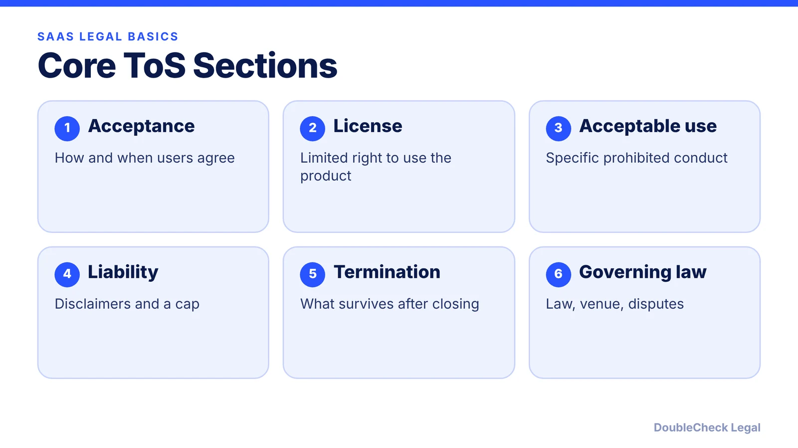
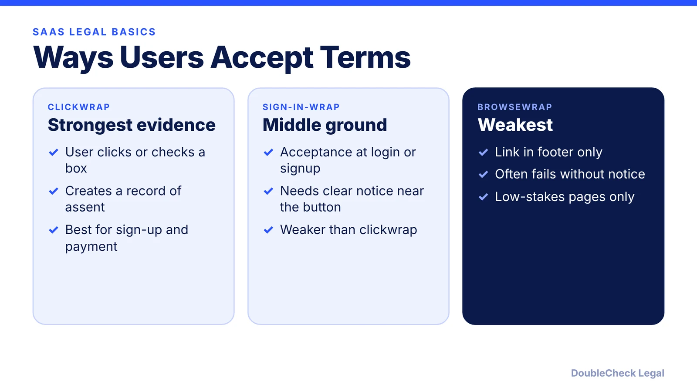

*The sections every SaaS terms of service needs, and how to get users to accept them in a way courts will respect.*

**Key takeaways:**

- Cover acceptance, license, acceptable use, disclaimers, liability cap, termination, governing law, and changes.
- Clickwrap is safer than browsewrap; courts look for notice and affirmative assent.
- Liability caps cannot override consumer protection laws or cover fraud or gross negligence in most places.
- Keep records of who accepted which version, and publish a privacy policy alongside.

## 1. The quick answer

**Quick answer:** A SaaS terms of service should cover acceptance, a limited license to use the product, acceptable use, disclaimers, limitation of liability, termination, governing law and disputes, and how you will change the terms. Just as important is how users accept them: courts generally require clear notice and affirmative assent, which is why a clickwrap (a checkbox or button) is much safer than a browsewrap (a footer link). Pair your terms with a privacy policy; see [how to write a privacy policy with AI](/blog/ai-write-privacy-policy/).

## 2. What to include

Based on a general terms-of-service guide from Legal Docs:

- **Acceptance:** say that using the service means agreeing, specify when agreement takes effect (account creation, first purchase), and include a version date.
- **License:** grant a limited license to use the service for its intended purpose, with no copying, redistribution, or derivative works. If users upload content, add a content license that states the rights granted, whether exclusive, and whether it survives account deletion.
- **Acceptable use:** list specific prohibited conduct such as illegal activity, malware, unauthorized scraping, impersonation, spam, and circumventing security. Vague rules are hard to enforce.
- **Disclaimers:** an "as is" section disclaiming uninterrupted availability, error-free operation, and content accuracy. For AI or generated outputs, state that they are a starting point, not professional advice.
- **Changes:** notify users of material changes, allow a reasonable review period (30 days is common), and consider re-acceptance for major changes.

Also address your own IP ownership, customer data, payment and auto-renewal terms (several states require specific auto-renewal disclosures), and confidentiality for B2B customers. See [terms and conditions generators for small business](/blog/terms-and-conditions-generator-small-business/) and [writing terms and conditions with AI](/blog/write-terms-and-conditions-with-ai/).

## 3. Liability, termination, and governing law

**Limitation of liability** caps your exposure, for example at the amount paid in the prior 12 months, and may exclude consequential, incidental, and punitive damages. It has limits: per Legal Docs, it cannot override consumer protection laws, and in most jurisdictions it cannot limit liability for fraud, gross negligence, or personal injury. Some states restrict these limits in consumer terms.

**Termination:** define when you can end access, whether users can close accounts, and which obligations survive (payment, IP licenses, liability limits).

**Governing law and disputes:** choose a governing law and venue, usually your home jurisdiction. Arbitration clauses are often enforced when clearly presented, and courts are split on some class action waivers. Unconscionable terms, material terms buried deep in a document, and terms that waive statutory consumer rights are often struck down. For high-stakes clauses (arbitration, liability, IP), get attorney review. If you serve users in the EU or California, see [GDPR for U.S. startups](/blog/gdpr-for-us-startups/) and [CCPA/CPRA compliance](/blog/ccpa-cpra-compliance-small-business/).

## 4. Clickwrap vs. browsewrap

**Clickwrap** requires users to click a button or check a box to agree. **Browsewrap** treats continued use as agreement, with no consent step. **Sign-in-wrap** collects acceptance during sign-up or login, falling between the two, per Ironclad.

Courts generally require clear notice of the terms and affirmative assent. Cited cases include *Specht v. Netscape* (a hyperlink at the bottom of a download page gave inadequate notice, so the terms failed) and *Southwest Airlines v. BoardFirst* (browsewrap succeeded because a cease-and-desist letter established actual knowledge). Ironclad, which sells clickwrap software, cites its own litigation report putting browsewrap's success rate at 14%, so weigh that source accordingly.

Practical setup: use a clickwrap at signup and checkout, link the terms and privacy policy next to the button, keep a record of who agreed to which version and when, and re-collect consent when terms change materially. Reserve browsewrap for low-stakes informational pages.

## Where DoubleCheck fits

[DoubleCheck](https://www.contactdoublecheck.com) helps businesses and founders start legal work with AI, verify it, and, when professional advice is warranted, connect with an independent attorney, including for immigration questions. Attorney availability and practice areas vary. Attorneys on DoubleCheck are independent professionals; an attorney-client relationship forms only if an attorney accepts your engagement.

**Sources:** [Legal Docs terms of service guide](https://legaldocs-6qk.pages.dev/blog/terms-of-service-guide-websites); [Ironclad on clickwrap vs browsewrap](https://ironcladapp.com/journal/contracts/clickwrap-vs-browsewrap).

## FAQ

**Do I need terms of service for my SaaS?**

It is strongly advisable. They set the license, acceptable use, liability limits, and dispute process. Have an attorney review high-stakes clauses such as arbitration and liability.

**What is the difference between clickwrap and browsewrap?**

Clickwrap requires an affirmative click or checkbox; browsewrap treats continued use as agreement. Courts generally require clear notice and assent, per Ironclad.

**Can I limit my liability in terms of service?**

Often, for example with a cap tied to fees paid, but per Legal Docs it generally cannot override consumer protection laws or limit liability for fraud, gross negligence, or personal injury.

**Is a terms of service the same as a privacy policy?**

No. Terms govern the contract between you and users; a privacy policy describes how you handle personal data. SaaS products usually need both. See our privacy policy guide.

---

*General information only. This article is not legal, tax, investment, or accounting advice.*
