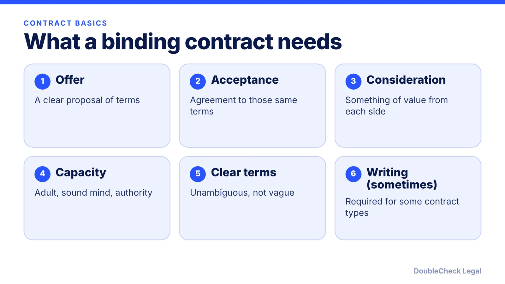
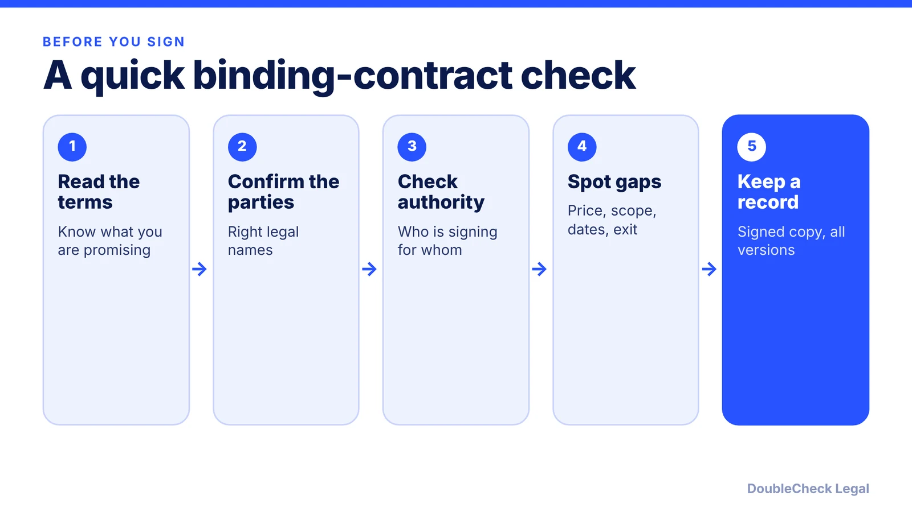

*Binding does not mean good. Here is what turns an agreement into an enforceable contract, and where writing rules come in.*

**Key takeaways:**

- A binding contract generally needs an offer, acceptance of clear terms, consideration, and capacity.
- A contract can often be verbal, but some types, such as land sales and goods over $500, generally must be in writing.
- Binding means enforceable, not fair: unread clauses can still bind you.
- State law varies, so check your state's rules for high-stakes deals.

## 1. The quick answer

**Quick answer:** A contract is generally legally binding when the parties reach an agreement through an offer and an acceptance of clear terms, each side gives something of value (consideration), and everyone signing has the capacity to do so. Per Rocket Lawyer, a contract can be formed verbally, but written contracts are "always preferred" because they record the terms and signatures. Some contract types must be in writing to be enforceable, and the details vary by state.

## 2. The core elements, in plain English

Sources group the elements differently, so you will see three, four, or six on different sites. [Rocket Lawyer](https://www.rocketlawyer.com/business-and-contracts/business-operations/contract-management/legal-guide/what-makes-a-contract-legally-binding) lists three: the subject (an offer and an acceptance of clear, unambiguous terms), consideration, and capacity. [UpCounsel](https://www.upcounsel.com/validity-of-oral-contracts) frames it as an offer, acceptance, consideration, and mutual intent.

- **Offer and acceptance:** one side proposes specific terms (price, scope, timing) and the other agrees to them. A reply that changes the terms is usually a counteroffer, not an acceptance.
- **Consideration:** per Rocket Lawyer, the reason or motive for the contract, such as money in a monetary deal or a desire to keep information confidential. Each side gives or promises something.
- **Capacity:** signers must be of legal age, of sound mind, and have legal authority to bind the person or company. If you sign for a business, confirm you are authorized and sign in the company's name.
- **Clear terms:** if key terms are missing or contradictory, a court may find there is no enforceable deal, or may have to guess what you meant.

A contract that meets these elements can still be "voidable," per Rocket Lawyer: it stays enforceable unless a party challenges it and proves a legal issue.

## 3. Does it have to be in writing?

Often no, but sometimes yes. Under the statute of frauds, certain contracts generally need a signed writing to be enforced. Per the [Chicago-Kent notes](https://blogs.kentlaw.iit.edu/harriscontracts/home/written-contracts/notes-on-the-statute-of-frauds), the classic categories are:

- sale of an interest in land
- contracts that cannot be fully performed within one year
- promises to answer for someone else's debt (suretyship)
- promises where the consideration is marriage
- sale of goods priced over $500 (the UCC rule)
- certain promises by executors and administrators

Some states add categories, per the same source. Exceptions exist too, for example goods that were already delivered or specially manufactured goods. We cover the practical side in [Are verbal contracts enforceable?](/blog/verbal-contract-enforceable-small-business/).

**Signatures count electronically.** Under federal and state law, a contract is not denied effect just because it is electronic, with listed exceptions. See [electronic signatures and the ESIGN Act](/blog/electronic-signatures-esign-act-contracts/).

## 4. Why a binding contract is not always a good one

A contract can be fully binding and still be a bad deal. Binding means a court can enforce it, not that it protects you. Small businesses most often get hurt by clauses they never read: auto-renewal, broad indemnities, one-sided caps on liability, or weak exit rights.

Before signing, read for the points in [contract red flags for small business](/blog/contract-red-flags-small-business/) and the [vendor contract checklist](/blog/ai-vendor-contract-checklist/). For specific terms, see [limitation of liability clauses](/blog/limitation-of-liability-clause-explained/) and [how to terminate a contract early](/blog/how-to-terminate-a-contract-early-termination-clause/).

An AI tool can help you summarize and flag unusual terms (see [AI contract review for small business](/blog/ai-contract-review-small-business/)), but it does not decide whether a clause is enforceable in your state. For a high-value or unusual deal, have a licensed attorney look at it. Cost expectations are in [how much a lawyer charges to review a contract](/blog/how-much-does-a-lawyer-charge-to-review-a-contract/).

## Where DoubleCheck fits

[DoubleCheck](https://www.contactdoublecheck.com) helps businesses and founders start legal work with AI, verify it, and, when professional advice is warranted, connect with an independent attorney, including for immigration questions. Attorney availability and practice areas vary. Attorneys on DoubleCheck are independent professionals; an attorney-client relationship forms only if an attorney accepts your engagement.

**Sources:** [Rocket Lawyer](https://www.rocketlawyer.com/business-and-contracts/business-operations/contract-management/legal-guide/what-makes-a-contract-legally-binding); [UpCounsel](https://www.upcounsel.com/validity-of-oral-contracts); [Chicago-Kent, Notes on the Statute of Frauds](https://blogs.kentlaw.iit.edu/harriscontracts/home/written-contracts/notes-on-the-statute-of-frauds).

## FAQ

**What are the basic elements of a legally binding contract?**

Per Rocket Lawyer, they are the subject (an offer and an acceptance of clear, unambiguous terms), consideration, and capacity. Other sources break these out differently, for example adding mutual intent.

**Does a contract have to be in writing to be binding?**

Not always. Per Rocket Lawyer, a contract can be formed verbally, though written contracts are preferred. Under the statute of frauds, certain types, such as land sales and goods over $500, generally need a writing.

**What is consideration in a contract?**

Per Rocket Lawyer, it is the reason or motive for the contract, such as money in a monetary deal or a desire to keep information confidential. In practice, each side gives or promises something.

**Can a binding contract be cancelled?**

It can end by its own terms or by agreement. A contract that meets the elements can also be voidable, which per Rocket Lawyer means it stays enforceable unless a party challenges it and proves a legal issue.

---

*General information only. This article is not legal, tax, investment, or accounting advice.*
