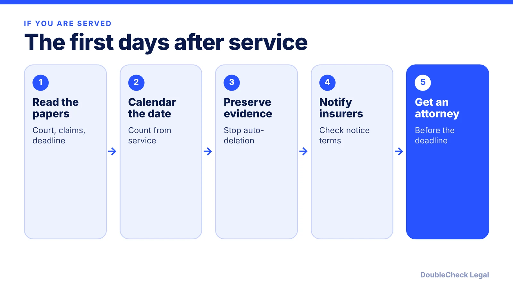
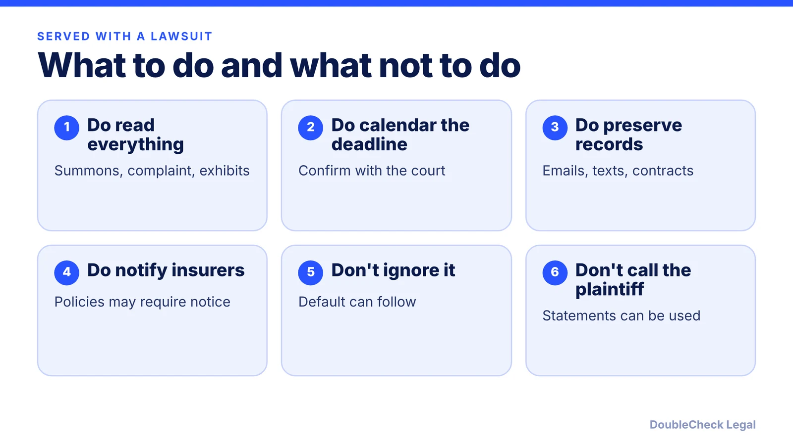

*A summons starts a clock. Here is how to find your deadline, protect evidence, and avoid a default judgment.*

**Key takeaways:**

- The response deadline depends on the court and service method: 21 days federal, 30 California, 20 or 30 New York, 20 Florida.
- Missing it can lead to default, so confirm the date with the court or an attorney.
- Preserve records and notify every potentially relevant insurer in writing.
- Do not negotiate with the plaintiff directly; contact a litigation attorney right away.

## 1. The quick answer

**Quick answer:** Do not ignore it. A summons and complaint start a deadline, and missing it can let the plaintiff win by default. The deadline depends on the court: 21 days in federal court under Rule 12(a) once you are served, 30 days in California state court, 20 or 30 days in New York depending on how you were served, and 20 days in Florida state court, per the sources below. Read the papers, calendar the deadline, preserve evidence, notify your insurer, and contact a litigation attorney right away.

## 2. Read what you were served, and find the deadline

You are typically served with a **summons** and a **complaint**. The summons names the court and states how long you have to respond; the complaint lists the claims. Check who was served (the business, an owner, or a registered agent), when and how, and what court it is.

Deadlines depend on the court, and the method of service can change the date:

- **Federal court:** 21 days after service of the summons and complaint under Rule 12(a). If the plaintiff sent a service waiver request under Rule 4(d), 60 days from when it was sent (90 days if sent outside the U.S. judicial districts). Weekends and holidays count, per RulesofCivilProcedure.com.
- **California state court:** 30 days, under CCP 412.20. Service by substituted delivery is complete on the 10th day after mailing, per RulesofCivilProcedure.com, which shifts the date.
- **New York:** 20 days if you were served by personal delivery within the state, and 30 days for most other methods. For some methods, service is complete only 10 days after proof of service is filed.
- **Florida state court:** 20 days, per Jimerson Firm.

Other states differ, and some local rules or court orders change timing. Do not rely on the table above for your case. Use the summons and ask an attorney to confirm. A **response** is typically an answer, a motion to dismiss, or another filing the court rules recognize.

## 3. Preserve evidence, notify insurance, and avoid default

Jimerson Firm lays out the practical steps for a business:

- **Preserve evidence (a litigation hold).** Once a lawsuit is foreseeable, suspend automatic deletion, tell employees in writing to keep relevant records, and preserve texts, voicemails, project files, accounting records, and contracts. Secure devices of departing employees.
- **Notify your insurer.** Review notice-of-claim terms on every potentially relevant policy and give written notice on time. Jimerson says many professional liability policies are claims-made and late notice is a common reason coverage is denied. See [business insurance types](/blog/business-insurance-types-small-business/).
- **Do not negotiate directly or discuss the facts casually.** Statements to the plaintiff or on social media can be used against you.
- **Choose a response with counsel.** Options include a motion to dismiss (for example, over jurisdiction or service), an answer with defenses (Jimerson notes failing to plead a defense can waive it), or a counterclaim.

**Default.** If you miss the deadline, the plaintiff can ask for a default. In Florida, Jimerson says that removes your right to contest liability and can lead to wage garnishment, bank levies, and liens on business assets. Setting aside a default generally takes showing a good reason and acting promptly, and the standard varies by state.

## 4. Hiring counsel and related situations

Most business lawsuits are worth an attorney's time even if you plan to settle, because the first filing can shape the case. Gather the summons, complaint, contracts, key emails, and insurance policies before the call. Ask about fees, a likely budget, and whether your insurer will appoint or pay for defense counsel. See [what a lawyer charges](/blog/how-much-does-a-lawyer-charge-to-review-a-contract/) and [when to hire a lawyer](/blog/when-to-hire-lawyer-small-business/).

A lawsuit often follows an earlier warning. If you got a demand letter first, see [how to respond to a cease and desist](/blog/how-to-respond-cease-and-desist-letter/). If a customer or vendor contract is at issue, check its dispute terms with our [contract red flags](/blog/contract-red-flags-small-business/). If you are the one owed money, see [collecting unpaid invoices](/blog/how-to-collect-unpaid-invoices-small-claims/) before litigation.

Entity structure matters too: whether the suit can reach personal assets depends on how the business is formed. See [LLC vs. C-corp](/blog/llc-vs-c-corp-startups/) and [how to incorporate in the US](/blog/how-to-incorporate-a-company-in-the-us/). AI tools can help you organize a timeline and summarize the complaint, but do not use them to decide your deadline or whether to respond. Confirm both with an independent attorney. This is general information, not legal advice.

## Where DoubleCheck fits

[DoubleCheck](https://www.contactdoublecheck.com) helps businesses and founders start legal work with AI, verify it, and, when professional advice is warranted, connect with an independent attorney, including for immigration questions. Attorney availability and practice areas vary. Attorneys on DoubleCheck are independent professionals; an attorney-client relationship forms only if an attorney accepts your engagement.

**Sources:** [Jimerson Firm: how to respond to a lawsuit against your business](https://www.jimersonfirm.com/blog/2026/05/how-to-respond-to-a-lawsuit-filed-against-your-business/); [RulesofCivilProcedure.com: federal answer deadlines](https://rulesofcivilprocedure.com/guides/federal/answering-a-complaint/); [California](https://rulesofcivilprocedure.com/guides/ca/responding-to-a-complaint/); [New York](https://rulesofcivilprocedure.com/guides/ny/responding-to-a-summons/).

## FAQ

**How long do I have to respond to a lawsuit?**

It depends on the court. Under Federal Rule 12(a) it is 21 days after service; California state court is 30 days; Florida state court is 20 days per Jimerson Firm; New York is 20 or 30 days depending on service method. Confirm yours on the summons.

**What happens if I ignore a lawsuit?**

The plaintiff can request a default. Jimerson Firm says in Florida this removes your right to contest liability and can lead to garnishment, bank levies, and liens on business assets.

**Should I call my insurance company?**

Generally yes, promptly and in writing. Jimerson Firm notes that late notice is a common reason coverage is denied, especially under claims-made policies. Review each policy's notice terms.

**Can I handle the lawsuit myself?**

Court rules on who may appear for a business differ, and deadlines are strict. Consider consulting an independent attorney before you file anything.

---

*General information only. This article is not legal, tax, investment, or accounting advice.*
