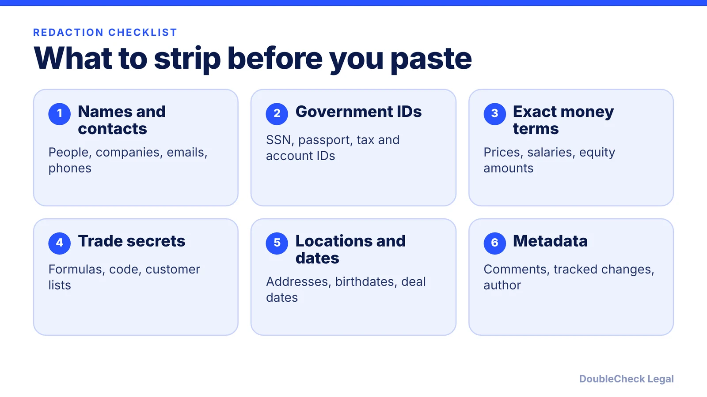
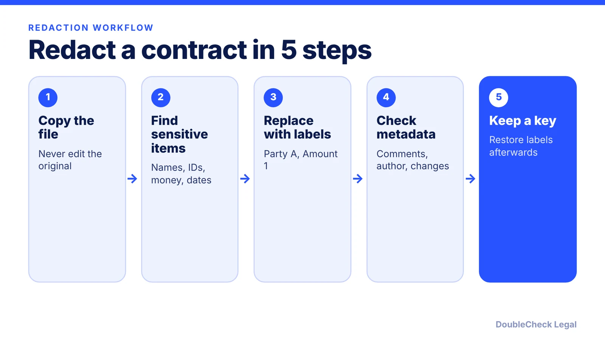

*Replace identity, keep structure. A practical checklist, plus where redaction stops being enough.*

**Key takeaways:**

- Replace names, IDs, exact money terms and trade secrets with placeholders before you paste.
- Delete comments, tracked changes and metadata, not just visible text.
- A local model can reduce, not erase, the need to redact; confidentiality clauses still apply.
- Pseudonymized data can still be personal data, so ask an attorney when other peoples data is involved.

## 1. The quick answer

**Quick answer:** Before pasting a contract into an AI tool, remove or replace anything that identifies a person or reveals confidential business detail: names, addresses, emails, ID and account numbers, exact prices and salaries, and trade secrets such as formulas, customer lists and source code. Swap them for consistent placeholders ("Party A", "Customer 1", "$X") so the model can still reason about the structure. If you use a business account with training off, or a model that runs on your own computer, you may need to redact less, but contract confidentiality clauses and privacy laws can still apply. Redaction lowers risk; it does not remove it.

Two cautions up front. First, pseudonymized data can still be personal data: in April 2025 the law firm Wiggin summarized UK ICO guidance warning that organizations sometimes assume data is anonymous when it is only pseudonymized and still personal data. Second, if the other side's contract has an NDA, sharing it with an outside tool may breach it, whatever you redact.

## 2. What to redact, and what to leave in

Aim to keep the legal structure and remove the identity. A model needs the clause wording, the roles of the parties and the relationships between numbers. It rarely needs real names.

**Remove or replace:**

- **People and companies.** Use "Party A (Vendor)" and "Party B (Customer)". Keep a private key of which placeholder is which.
- **Personal data.** Addresses, emails, phone numbers, birthdates, government ID and bank details, plus anything about employees, applicants or customers that appears in schedules and exhibits.
- **Commercial detail.** Replace exact fees, salaries and equity percentages with "$X" or ranges if the number is sensitive. Keep it if your question is about whether the number is reasonable, and then think about whether that tool is appropriate.
- **Trade secrets.** Source code, formulas, product roadmaps and customer lists. If the question needs them, do not paste them into a tool whose terms you have not checked.
- **Hidden data.** Delete comments, tracked changes and document properties. Check that a name has not been left behind in the file properties.

**Usually safe to leave in:** clause titles, section numbers, boilerplate, defined-term structure and generic obligations.

Two practical rules: redact before you paste, not after, and keep the redacted version as a separate file so you can reconcile it with the original when you review the output.

## 3. When a local model reduces the need to redact

Tools such as Ollama describe themselves as a way to run large language models locally, on your own hardware. If the model runs on your machine with no network calls, the contract text does not go to an outside vendor, which can remove much of the redaction burden. See [running AI locally for privacy](/blog/run-ai-locally-for-privacy-ollama-lm-studio-small-business/) and [whether local AI is private enough for confidential documents](/blog/is-local-ai-private-enough-for-confidential-documents-limits/).

Limits to keep in mind:

- **Your machine is now the security perimeter.** Disk encryption, updates and who else can use the computer matter. Local does not mean secure by default.
- **Capability.** Smaller models can be weaker on long contracts. Compare against another model; the [two-model cross-check method](/blog/cross-check-a-contract-with-two-ai-models-method/) shows how.
- **Confidentiality duties follow the document.** An NDA or confidentiality clause may restrict who may see the text, and local processing may or may not satisfy it. Read the clause.
- **Licenses and settings.** Check the model license and that the tool is not sending anything out.

If you use a hosted tool, check the account type. As of November 2026, OpenAI's help page says content from its consumer services may be used to train models unless you opt out, and that it does not train on content from its business offerings (ChatGPT Team, Enterprise, API). Other vendors differ and change terms, so read the current policy for your plan. Our posts on [uploading contracts to ChatGPT](/blog/uploading-contracts-to-chatgpt-confidentiality/) and [AI chats and privilege](/blog/ai-chats-not-privileged-heppner/) cover related risks. A law firm guide cites a February 2026 federal ruling in New York in which a defendant's documents created with a consumer AI tool about his own case were held not protected by attorney-client privilege.

## 4. Privacy law and confidentiality caveats

This is general information, and the rules depend on your location and the data involved.

- **Personal data laws.** If a contract or its exhibits include personal data of people in the EU or UK, or covered by US state privacy laws, sending it to an AI vendor may count as processing or disclosure. Pseudonymized data can remain personal data, per the ICO guidance as summarized by Wiggin. Start with [GDPR for US startups](/blog/gdpr-for-us-startups/), [CCPA and CPRA compliance](/blog/ccpa-cpra-compliance-small-business/) and the [state privacy laws checklist](/blog/state-privacy-laws-2027-small-business-checklist/).
- **Contractual confidentiality.** NDAs and customer contracts often limit disclosure to "representatives". Whether an AI vendor fits that term is a question for the contract and, if unclear, an attorney.
- **Lawyers face stricter rules.** ABA Formal Opinion 512 (July 29, 2024), as summarized by the Bar Examiner, says lawyers must assess the risk that others could access client information before entering it into a generative AI tool, and that informed consent is required before entering client information into self-learning tools. You are not a lawyer, but the point shows why careful handling matters.
- **Privilege.** Do not assume a chat with an AI is privileged.

**Handle it yourself vs. get an attorney.** Redacting a template or your own simple draft is a reasonable DIY step. If the contract holds other people's personal data, is under an NDA, or involves regulated data (health, financial, children), ask an attorney how to handle it before it goes into any AI tool. See [small business AI legal work safely](/blog/small-business-ai-legal-work-safely/).

**Related reading:** [AI Contract Review Prompts: What to Ask and What to Verify](/blog/ai-contract-review-prompts-what-to-ask-and-what-to-verify/); [Negotiate a Contract With AI: Redline Workflow and What to Verify](/blog/negotiate-a-contract-with-ai-redline-workflow-and-what-to-verify/); [Software License Agreement vs SaaS Agreement: Key Differences](/blog/software-license-agreement-vs-saas-agreement-differences/)

## Where DoubleCheck fits

[DoubleCheck](https://www.contactdoublecheck.com) helps businesses and founders start legal work with AI, verify it, and, when professional advice is warranted, connect with an independent attorney, including for immigration questions. Attorney availability and practice areas vary. Attorneys on DoubleCheck are independent professionals; an attorney-client relationship forms only if an attorney accepts your engagement.

**Sources:** [OpenAI Help, How your data is used to improve model performance](https://help.openai.com/en/articles/5722486-how-your-data-is-used-to-improve-model-performance); [Wiggin LLP, Anonymisation and pseudonymisation: ICO issues guidance (Apr. 14, 2025)](https://wiggin.co.uk/insight/anonymisation-and-pseudonymisation-ico-issues-guidance/); [NCBE Bar Examiner on ABA Formal Opinion 512](https://thebarexaminer.ncbex.org/article/fall-2024/generative-artificial-intelligence-tools/); [Legal Moves Law Firm, Using AI before you send something to your lawyer](https://legalmoveslawfirm.com/working-with-ai); [Ollama README (GitHub)](https://github.com/0x77dev/ollama).

## FAQ

**Do I need to redact a contract before using ChatGPT or Claude?**

Often it is wise to, especially for personal data, trade secrets and anything under an NDA. Account type matters: OpenAI says content from consumer services may be used for training unless you opt out, and that it does not train on its business offerings. Check the current terms for your plan.

**Does replacing names with placeholders make a contract anonymous?**

Not necessarily. UK ICO guidance, as summarized by Wiggin LLP in April 2025, warns that pseudonymized data can still be personal data. Details such as roles, amounts and dates can still identify someone.

**Can I skip redaction if I run a local model?**

You may need less, because the text stays on your machine, but your computer security, the model license and any confidentiality clause in the contract still matter.

**What should I never paste into an AI tool?**

Government ID and bank numbers, other peoples personal data, trade secrets and documents under an NDA you have not cleared are the main ones. If in doubt, ask an attorney first.

---

*General information only. This article is not legal, tax, investment, or accounting advice.*
