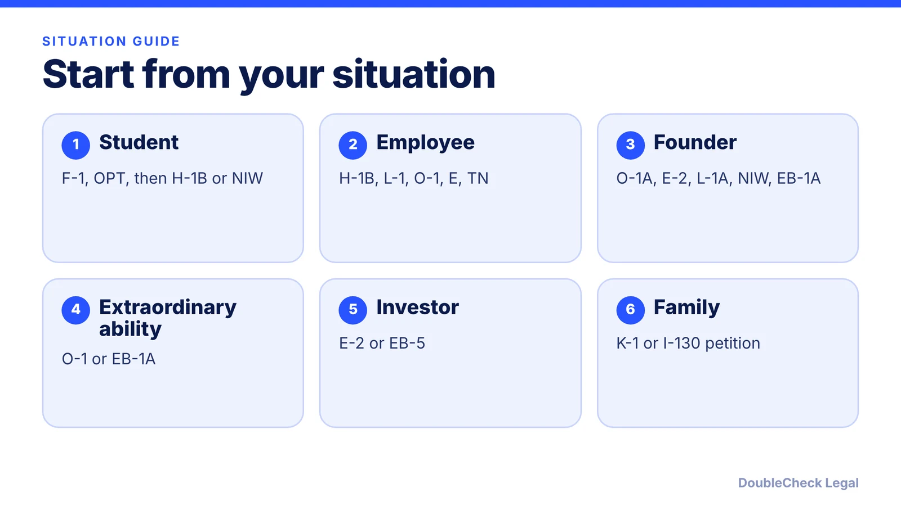
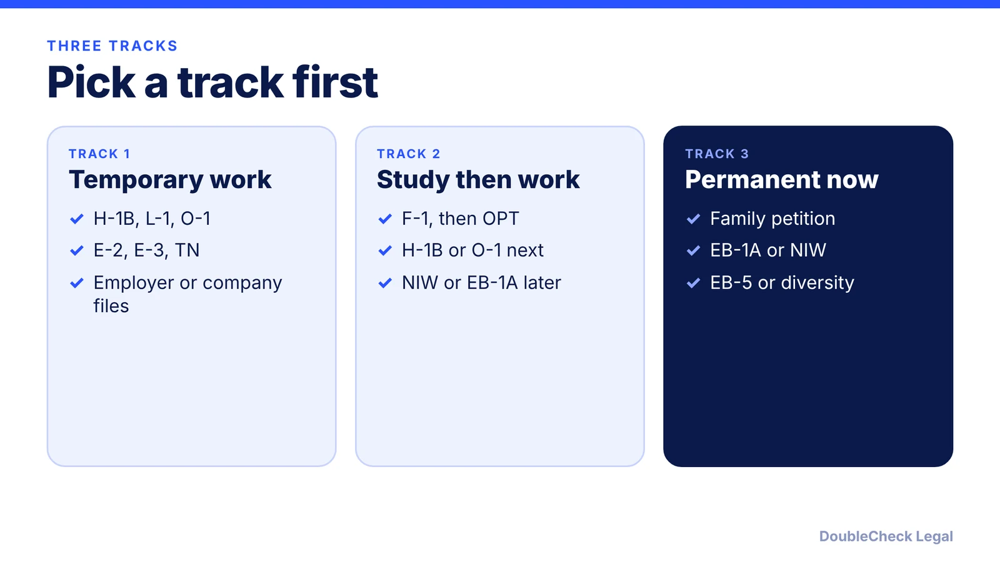

*Do not start from a visa name. Start from your purpose, your sponsor, your passport and your timeline.*

**Key takeaways:**

- Four facts narrow most choices: purpose, sponsor, nationality and temporary vs permanent goal.
- Treaty options exist: TN (Canada, Mexico), E-3 (Australia), H-1B1 (Chile, Singapore), E-1 and E-2 for treaty countries.
- EB-1A and NIW can be self-filed per CitizenPath; most other work routes need an employer or company to file.
- Verify with an immigration attorney before filing or traveling, especially with a deadline, past refusal or changed 2025-2026 rules.

## 1. The quick answer

**Quick answer:** Start with your situation, not the visa name. Four facts narrow most choices: what you want to do in the U.S. (visit, study, work, build a company, invest, join family), who can sponsor you (an employer, a school, a relative, or you), your nationality (treaty and trade options exist for some countries), and whether you want temporary status or a green card. Per the State Department's list, temporary work categories include H-1B for specialty occupations, L for intracompany transfers and O for extraordinary ability. Per CitizenPath, EB-1A and the national interest waiver (NIW) are employment-based green card routes you can file on your own. This guide is a map for asking better questions, not a ruling on whether you qualify.

## 2. Match your situation to a category

Use this as a matrix. Each line is a starting point with a guide, not an eligibility finding.

- **Student (F-1 or J-1).** F-1 covers academic study; Nolo notes F-1 holders generally cannot work off campus without special permission. Work after study runs through OPT: see [CPT vs OPT](/blog/cpt-vs-opt-f1-students/) and the [OPT application timeline](/blog/how-to-apply-for-opt-step-by-step-i-765-timeline/). Long-term options are mapped in the [student to green card roadmap](/blog/student-to-green-card-roadmap-f-1-opt-h-1b-niw-eb-1/). J-1 can carry a [two-year home residency requirement](/blog/j-1-two-year-home-residency-requirement-212e-waiver/).
- **Employee with a U.S. employer.** H-1B for jobs generally requiring a bachelor's degree or equivalent, L-1 if you already work for a related company abroad (one year within the prior three, per the State Department), O-1 if you have sustained acclaim. Compare them in [H-1B vs L-1 vs O-1](/blog/h-1b-vs-l-1-vs-o-1-which-visa-for-tech-employees/). H-1B rules and fees moved a lot recently, so check the [H-1B $100,000 fee status](/blog/h1b-100000-fee-status-2026/) and [weighted lottery](/blog/h1b-weighted-lottery-wage-levels-explained/). Employers can also sponsor a green card via [PERM](/blog/perm-labor-certification-green-card-process/).
- **Founder.** There is no single founder visa. Per our [founder visa comparison](/blog/us-visa-options-for-startup-founders-compared/), main routes include O-1A, E-2, L-1A, H-1B, NIW, EB-1A and the International Entrepreneur Rule, which is parole, not a visa. Owning a company and being employed by it are separate questions: see [starting a company on H-1B](/blog/start-company-on-h1b-visa-ownership-vs-work/).
- **Extraordinary ability.** O-1 is the temporary category; EB-1A is the permanent one. Read [EB-1A vs O-1](/blog/eb-1a-vs-o-1-founder-which-path/) and the [O-1A evidence guide](/blog/o-1a-visa-for-startup-founders-evidence/). The NIW is a different standard, aimed at work with "substantial merit and national importance" (CitizenPath): see [EB-1A vs NIW](/blog/eb-1a-vs-niw-which-is-better-for-founders/).
- **Investor.** E-2 is for investors from treaty countries who own at least 50% of the business or have operational control (NNU Immigration), and holders must intend to leave (per USCIS, as cited in our founder comparison). EB-5 is the permanent route and involves a substantial investment in a new enterprise that creates jobs (CitizenPath). See [E-2](/blog/e-2-treaty-investor-visa-for-founders/) and [EB-5 requirements](/blog/eb-5-investor-visa-requirements-2026/).
- **Family.** A fiance(e) of a U.S. citizen uses K-1 (marry within 90 days of entry, per Adhikari Law); a spouse uses a petition-based route. Per CRS, immediate relatives of U.S. citizens have no annual numerical limit, while preference categories do. See [K-1](/blog/k-1-fiance-visa-process-timeline-requirements/), [I-130](/blog/i-130-petition-spouse-green-card-marriage-based-process/) and [marriage-based green cards](/blog/marriage-based-green-card-process-timeline/).
- **Visitor.** B-1/B-2 does not allow employment (NNU Immigration). Founders should read [what a B-1 visitor can do](/blog/b-1-b-2-visa-business-visitor-what-founders-can-do/).
- **Diversity lottery.** The diversity visa program has an annual limit of 55,000 per CRS: see the [diversity visa guide](/blog/diversity-visa-lottery-green-card-lottery-eligibility-how-to-apply/).

## 3. Treaty and trade options by passport

Your nationality can open routes that others do not have. Per the sources below:

- **Canada or Mexico: TN.** For citizens in listed USMCA professions with a U.S. job offer; no annual numerical cap, up to three years per grant (Clark Hill, Lighthouse). Canadians can apply at a port of entry or through USCIS; Mexicans apply at a consulate. Read the [TN guide](/blog/tn-visa-canada-mexico-tech-professionals/).
- **Australia: E-3.** Specialty occupation jobs requiring a tertiary qualification. 10,500 new principals per fiscal year, no lottery, two-year renewable periods (DFAT, NNU Immigration). Read the [E-3 guide](/blog/e-3-visa-australians/).
- **Chile or Singapore: H-1B1.** Specialty occupation workers from these countries apply at the U.S. Embassy in Chile or Singapore rather than by petition (State Department).
- **Treaty countries: E-1 and E-2.** Treaty trader or investor status depends on your country being a treaty partner. Check the current list on the State Department site.

If none of these fit, the default employer routes are H-1B, L-1 and O-1. For spouses, see [spouse work rights on L-2, E and O-3](/blog/spouse-work-rights-l-2-e-visa-o-3-dependents/) and [H-4 EAD](/blog/h-4-ead-spouses-of-h-1b/).

## 4. Questions to narrow it down, and when to verify

Answer these before you spend money on any filing:

1. **What exactly will you do, and who pays you?** Owning a company and working for it can be different things under visa rules.
2. **Who sponsors?** A school, an employer, a family member, or yourself.
3. **Do you want to stay temporarily or end up with a green card?** This affects intent rules: per CitizenPath, H-1B, L-1 and K-1 are commonly treated as dual intent, while F-1 and B visas expect nonimmigrant intent. Details in [US visa types explained](/blog/us-visa-types-explained-immigrant-vs-nonimmigrant-categories/).
4. **What is your current status and deadline?** An expiring I-94 date changes everything. See [overstay and unlawful presence](/blog/immigration-overstay-unlawful-presence-3-10-year-bars-explained/).
5. **Any prior refusals, overstays or revocations?** See [visa revocation in 2026](/blog/visa-revoked-what-to-do-if-your-us-visa-is-revoked-2026/) and [221(g) administrative processing](/blog/visa-221g-administrative-processing/).
6. **Which options are even realistic given the backlog?** See the [Visa Bulletin explained](/blog/visa-bulletin-explained-priority-dates-eb-categories/) and the [easiest ways to immigrate compared](/blog/easiest-ways-to-immigrate-to-the-us-compared-by-eligibility/).

**When you can handle it yourself.** Researching categories, gathering your records and drafting a timeline are all things you can do yourself, and AI can help you organize them.

**When attorney verification matters.** Get a licensed immigration attorney to review before you file or travel if you are changing status, filing a self-petition with a lot of evidence, applying in a category with caps or lottery rules, have any past refusal or overstay, or the rules for your category changed in 2025 or 2026. Official fees and forms change, and a wrong category or missed deadline can be costly. See [how to find a good immigration lawyer](/blog/how-to-find-good-immigration-lawyer-startup-founder/) and [immigration lawyer fees](/blog/immigration-lawyer-fees-flat-fee-vs-hourly/).

## Where DoubleCheck fits

[DoubleCheck](https://www.contactdoublecheck.com) helps businesses and founders start legal work with AI, verify it, and, when professional advice is warranted, connect with an independent attorney, including for immigration questions. Attorney availability and practice areas vary. Attorneys on DoubleCheck are independent professionals; an attorney-client relationship forms only if an attorney accepts your engagement.

**Sources:** [State Department, temporary worker visas](https://adoption.state.gov/content/travel/en/us-visas/employment/temporary-worker-visas.html); [CitizenPath, employment-based green cards](https://citizenpath.com/employment-based-green-card-process/); [CitizenPath, dual intent](https://citizenpath.com/dual-intent-visas/); [CRS data brief](https://www.everycrsreport.com/files/2026-06-18_R45938_dc36a96226b067c538d43d5fc2f1cc8da8d503de.html); [Nolo](https://nolo.com/legal-updates/u-s-to-refuse-or-revoke-visas-of-chinese-grad-students-with-ties-to-china-s-military-schools.html); [NNU Immigration](https://www.nnuimmigration.com/nonimmigrant-visa/); [Clark Hill, TN status](https://www.clarkhill.com/services/practice/immigration-law/tn-status/); [DFAT, E-3 visas](https://www.dfat.gov.au/geo/united-states-of-america/Pages/e-3-visas-for-the-united-states); [Adhikari Law, K-1](https://www.adhikarilaw.com/immigration-employment-family/family-based-green-card/family-member-of-a-u-s-citizen/visas-for-fiancees-of-u-s-citizens/); [USCIS, E-2 treaty investors](https://www.uscis.gov/working-in-the-united-states/temporary-workers/e-2-treaty-investors). The travel.state.gov directory and uscis.gov K-1 page did not load, so secondary sources are named.

## FAQ

**How do I know which U.S. visa I qualify for?**

Start with your purpose, who can sponsor you, your nationality and whether you want temporary or permanent status. Then compare the matching categories. Only an adjudicator decides eligibility, and a licensed immigration attorney can review your facts before you file.

**Which U.S. visas can I get without an employer?**

Per CitizenPath, EB-1A and the national interest waiver can be self-filed. Other routes in this guide, such as H-1B, L-1, TN and E-3, generally need a U.S. employer or company. F-1 requires a school, and K-1 a U.S. citizen petitioner.

**Is there a visa for Canadians, Mexicans or Australians?**

Yes. Per Clark Hill, TN covers Canadian and Mexican citizens in listed professions with no annual cap. Per DFAT, E-3 is for Australians in specialty occupations with 10,500 new principals a year.

**Can I switch from a student visa to a work visa or green card?**

Many people do, but each step has its own rules and timing. Common paths are OPT then H-1B or O-1, and later NIW or EB-1A for some people. Ask your DSO about student status and an immigration attorney about changing category.

---

*General information only. This article is not legal, tax, investment, or accounting advice.*
