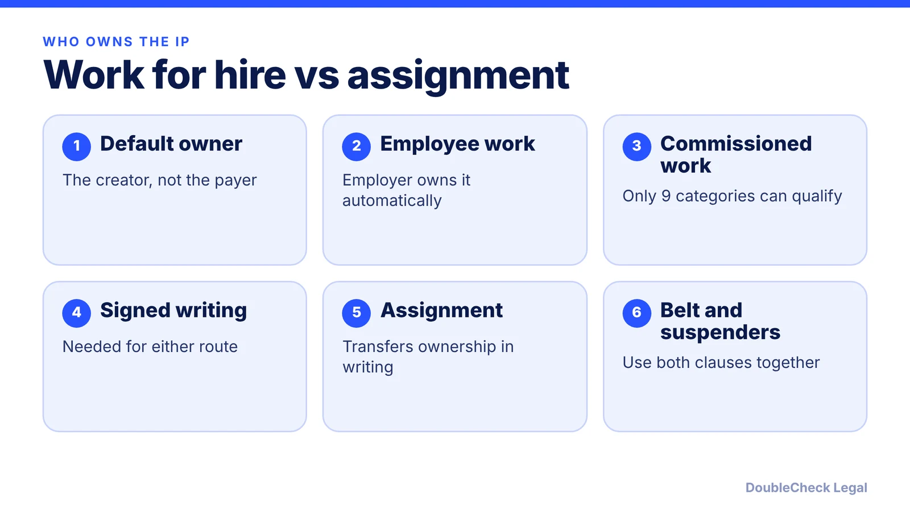
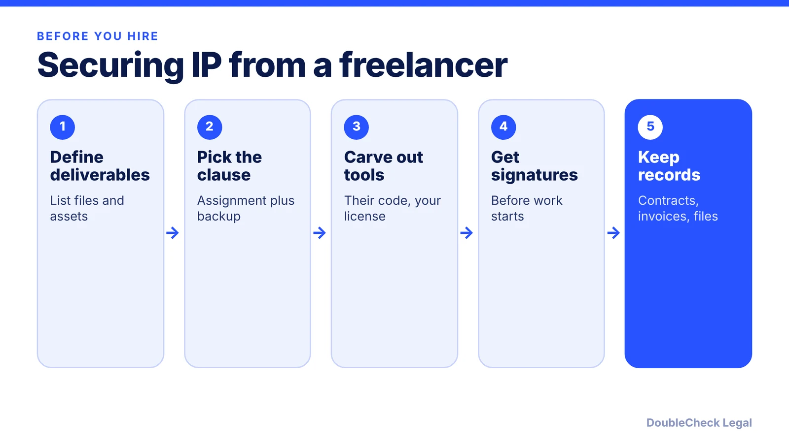

*Work for hire versus assignment for freelance designers and developers: who owns the IP by default, when each clause works and what to put in the contract, as of November 2026.*

**Key takeaways:**

- A contractor generally keeps copyright unless a signed writing transfers it to you.
- Commissioned work-for-hire status needs one of nine categories plus a signed writing; custom software generally is not listed.
- A signed assignment is the safer main tool, often paired with work-for-hire wording as a backup.
- Carve out the contractor tools, ask about third-party and open-source material and get signatures before work starts.

## 1. The quick answer

**Quick answer:** If you hire a freelance designer or developer, the contractor usually owns the copyright in what they create, even though you paid for it, unless a signed writing transfers it to you. "Work made for hire" and "assignment" are the two tools for that, and they work differently. Per the U.S. Copyright Office (Circular 30, revised August 2024), a commissioned work can be a work made for hire only if it falls into one of nine statutory categories and both parties sign a written agreement saying so. Most custom software and most logos and brand graphics do not clearly fit those categories, so a written copyright assignment is the safer route for who owns the IP.

This post is about the designer-or-developer question: who owns what you commissioned, which clause to use and what to check before the first payment. For the broader agreement see [what to include in an independent contractor agreement](/blog/independent-contractor-agreement-what-to-include/) and [how to write a freelance contract](/blog/how-to-write-a-freelance-contract/).

## 2. What work made for hire actually means

Section 101 of the Copyright Act defines a "work made for hire" in two ways, as described in the Copyright Office's Circular 30 (revised August 2024):

- **Employee route:** a work prepared by an employee within the scope of employment.
- **Commissioned route:** a specially ordered or commissioned work in one of nine listed categories, if the parties expressly agree in a signed written instrument that it is a work made for hire.

When a work qualifies, the hiring party is treated as the author and, unless the parties agree otherwise in writing, the initial owner of the copyright. The person who actually made it is not the legal author.

The nine categories, per the Copyright Office, are: a contribution to a collective work, a part of a motion picture or other audiovisual work, a translation, a supplementary work, a compilation, instructional text, a test, answer material for a test, and an atlas. The circular says that all four criteria must be met for a commissioned work: the category, a written agreement, an express work-made-for-hire statement and signatures from all parties. If any is missing, it is not a work made for hire.

Two practical points follow. First, the label alone does nothing. A contract that says "work made for hire" does not turn a logo or a mobile app into a category it is not in. The Copyright Office's Circular 30 explains that a commissioned work counts as a work made for hire only if it falls within the statute's listed categories and the parties sign a written agreement saying so. Custom software is not obviously one of them, so an assignment from the contractor to the company is the safer route. Some commissioned jobs may fit, but do not assume it; a lawyer can tell you whether a specific deliverable fits.

## 3. Employee or contractor: why the label matters

The employee route depends on whether the person is legally an employee, not on what your contract calls them. The Copyright Office says courts apply general agency law and look at factors such as who supplied the tools and workspace, how the creator is paid, whether taxes are withheld and whether the hiring party controlled the work schedule.

For most freelance designers and developers who run their own business, set their own hours and use their own tools, the employee route will not apply, and that is the reason the commissioned route and assignments matter. Be careful with the reverse problem. Treating someone as a contractor to avoid the work-for-hire analysis does not solve classification, and calling a full-time, directed worker a contractor can create separate employment and tax problems. See [employee vs independent contractor classification](/blog/employee-vs-independent-contractor-classification-startups/) and [misclassification penalties for employers](/blog/independent-contractor-misclassification-penalties-employers/).

If you are not sure which side a long-term freelancer falls on, do not rely on the work-for-hire label. Use an assignment, and ask an attorney to verify the relationship itself.

Quick comparison of who owns the copyright by default:

- **Employee, within scope of the job:** the employer, automatically.
- **Independent contractor, in a nine-category work with a signed work-for-hire writing:** the hiring party.
- **Independent contractor, anything else with no assignment:** the contractor. ownership does not pass to your business without a signed written transfer (17 U.S.C. 204).

## 4. Assignment: the clause most small businesses should rely on

A copyright assignment is a written transfer of ownership from the creator to you. Section 204(a) of the Copyright Act (17 U.S.C. 204) says a transfer of copyright ownership, other than by operation of law, is not valid unless it is in a writing signed by the owner of the rights being transferred or that person's authorized agent. An email thread or a handshake does not meet that standard on its own. An assignment is the most direct way to meet that requirement, and many contracts pair work-for-hire language with an assignment as a fallback.

Many contracts use both in one clause: the work is a work made for hire to the extent the law allows, and to the extent it is not, the contractor assigns all rights to the client. This is common for contract programmers: because the statute lists only specific categories of commissioned works, include work-for-hire language plus a fallback assignment.

One difference is worth knowing. Under 17 U.S.C. 203, an author or certain heirs can terminate a grant (other than for a work made for hire) during a five-year window that begins 35 years after the grant, per Cornell LII's text of the statute, with advance written notice. The Copyright Office confirms termination rights do not apply to works made for hire. For most small-business projects this is a long-horizon issue, but it is the main legal difference between the two routes, and a reason to know which one you are relying on.

Timing also matters. Ask for ownership to pass on payment, or on creation, and say which. State in the contract when ownership passes to you (for example, on payment). A contractor who has not been paid and has not yet assigned still holds the copyright.

## 5. What to put in the contract, and what to watch for

Use a short checklist before the project starts.

- **Deliverables:** describe exactly what is covered: source files, drafts, fonts, assets and documentation.
- **Assignment language:** an assignment of all right, title and interest in the deliverables, signed by the contractor, with work-for-hire wording as a backup.
- **Payment condition:** whether ownership passes on creation or only after full payment.
- **Pre-existing tools and code:** carve these out. A developer may reuse their own libraries, and a designer may use stock or licensed elements. You should get a license to anything they keep, for as long as you need it.
- **Third-party and open-source material:** require disclosure. Licensed fonts, stock images and open-source code come with their own terms. See [open-source license compliance for startups](/blog/open-source-license-compliance-startups-mit-gpl-apache-what-to-check/).
- **Confidentiality:** pair this with [confidentiality and IP assignment terms](/blog/confidentiality-ip-assignment-agreements-startups/).
- **Assignment of the agreement itself:** if you may sell the company, check whether the contract can be transferred. See [assignment clauses explained](/blog/assignment-clause-explained-can-your-contract-be-transferred/).

Common traps:

- **Hiring first, signing later.** An assignment signed after the work is done can still work, but a gap leaves a period where the contractor owns it.
- **Using a template without reading it.** Check that ownership is actually assigned, not merely licensed.
- **AI-assisted work.** Copyright treatment of AI-generated output is unsettled, so ask whether the contractor uses AI tools and whether it affects what you receive. See [AI-generated code and IP for startup founders](/blog/ai-generated-code-ip-startup-founders/).
- **Skipping registration.** Ownership and registration are separate; see [copyright registration](/blog/copyright-registration-small-business-how-to/) and [trademark vs copyright vs patent](/blog/trademark-vs-copyright-vs-patent-startups/).

## 6. When to handle it yourself and when to ask an attorney

A simple, low-value job, such as a one-off social graphic from a freelancer, may be fine with a clear written assignment clause in a short agreement. Attorney review makes more sense in these cases:

- **Core product code or brand assets** you plan to raise money on or sell the company with, where investors will ask for a clean chain of title.
- **Missing paperwork:** work already done with no signed document, or a contractor who is hard to reach.
- **Mixed ownership,** where the contractor keeps tools or code that your product depends on.

You can use AI to draft or compare a work-for-hire and assignment clause, and to spot gaps against the checklist above. Treat the result as a first draft: AI can mislabel an assignment as a license, or skip the signature and timing points. See [verify AI-generated legal documents](/blog/verify-ai-generated-legal-document/), and [how to choose a good lawyer](/blog/how-to-choose-good-lawyer/) if you need counsel.

## Where DoubleCheck fits

[DoubleCheck](https://www.contactdoublecheck.com) helps businesses and founders start legal work with AI, verify it, and, when professional advice is warranted, connect with an independent attorney, including for immigration questions. Attorney availability and practice areas vary. Attorneys on DoubleCheck are independent professionals; an attorney-client relationship forms only if an attorney accepts your engagement.

**Sources:** [U.S. Copyright Office, Circular 30: Works Made for Hire (rev. 08/2024)](https://www.copyright.gov/circs/circ30.pdf); [GovInfo, 17 U.S.C. 204](https://www.govinfo.gov/content/pkg/USCODE-2023-title17/html/USCODE-2023-title17-chap2-sec204.htm); [Cornell LII, 17 U.S.C. 203](https://www.law.cornell.edu/uscode/17/203.html).

## FAQ

**Who owns the IP when a freelance designer or developer makes it for me?**

The contractor generally owns the copyright unless there is a signed written transfer. Per the U.S. Copyright Office, a transfer of ownership requires a signed written agreement, so paying for the work does not by itself make your business the owner. An attorney can confirm how this applies to your project.

**Is work for hire the same as an assignment?**

No. Per the U.S. Copyright Office, a commissioned work counts as a work made for hire only if it falls in one of nine categories and the parties sign a writing saying so. An assignment is a signed transfer of ownership that works regardless of category, and many contracts include both.

**Does paying a developer mean I own the code?**

Not by itself. Under 17 U.S.C. 204, a transfer of copyright ownership requires a signed written assignment from the contractor, so paying for commissioned software does not by itself give you ownership. Put the assignment in writing and signed.

**Can I sign the assignment after the work is finished?**

A transfer must be in a writing signed by the owner to be valid under 17 U.S.C. 204(a), but the statute does not say when it must be signed. Signing before work starts avoids gaps and disputes, so use the contract up front where you can.

**Can a creator take back an assignment later?**

Under 17 U.S.C. 203, per Cornell LII, certain grants other than works made for hire can be terminated during a five-year window beginning 35 years after the grant, with advance written notice. The Copyright Office says termination rights do not apply to works made for hire.

---

*General information only. This article is not legal, tax, investment, or accounting advice.*
