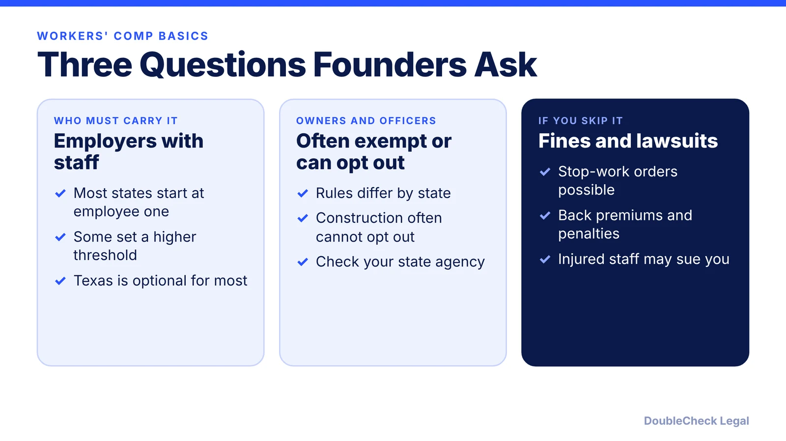
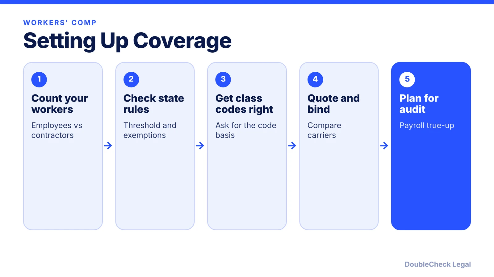

*Hiring your first employee usually triggers workers' comp. Here is how the rules and costs work.*

**Key takeaways:**

- Most states require coverage once you have employees; the employee-count trigger varies by state.
- Texas is the main exception, but non-subscribers can be sued with limited defenses.
- Owners and officers are often exempt or can opt out, except in some construction settings.
- Premiums are payroll times a class code rate times an experience modifier, trued up at audit.

## 1. The quick answer

**Quick answer:** Almost every state requires employers to carry workers' compensation insurance once they have employees, and the trigger varies. California applies after the first part- or full-time hire, while some other states set a higher employee threshold. Texas is the main exception: most private employers may opt out, but then they can be sued by injured workers. Owners and officers are often exempt or can elect out, and penalties for going uncovered can include fines, stop-work orders, and criminal charges.

## 2. Who must carry it, and how states differ

Workers' comp is required in nearly every state, usually once you hire your [first employee](/blog/how-to-hire-first-employee-legal-checklist/), while independent contractors and sole proprietors generally are not required to carry it for themselves. Thresholds and exceptions are set state by state, so confirm them with your state workers' compensation agency. Examples of state variation:

- **California:** coverage is generally required for businesses with at least one part- or full-time employee, and some licensed contractors must carry coverage even without employees. Employers must post a notice and notify new hires of benefits. Confirm current rules with the California Department of Industrial Relations.
- **Other states:** some states start coverage only at three or five employees, so check the threshold for your state.
- **Texas:** most private employers may choose not to carry coverage. Public employers and certain contractors working for public employers must carry it, along with a few other categories.

Part-time, seasonal, and family workers may count toward a threshold, depending on the state. Misclassifying employees as contractors can pull you into the requirement; see [employee vs. independent contractor classification](/blog/employee-vs-independent-contractor-classification-startups/) and [independent contractor vs. employee](/blog/independent-contractor-vs-employee/).

## 3. Owners, officers, and the Texas option

**Owners and officers.** Many states exempt sole proprietors, LLC members, and officers, or let them elect out. Some states require an opt-out or exemption filing, and construction owners frequently face stricter rules or cannot opt out. Your employees still need coverage even when you exempt yourself.

**Texas nonsubscribers.** In Texas, sole proprietors, partners, LLC members, and officers are included by default but can elect to be excluded. An employer that opts out of the system has no coverage penalty, but it must give new hires a signed notice, post notices, and file required notices with the state, and injuries must still be reported. Non-subscribers can be sued for workplace injuries with no statutory cap and lose common-law defenses such as contributory negligence.

For a company hiring its first people, compare this with [hiring employees through an EOR or contractor model](/blog/hire-international-employees-remote-eor-vs-contractor-vs-sponsorship/) and your [business license obligations](/blog/business-license-requirements-small-business/).

## 4. Penalties and how premiums are set

**Penalties vary by state.** Consequences can include fines, stop-work orders, license problems, back premiums, criminal charges in some states, and loss of the "exclusive remedy" shield that normally blocks employee lawsuits. Amounts differ widely, so check your state agency for current penalties.

**How premiums are set.** CompSource Mutual gives the basic formula: payroll divided by 100, times the class code rate, times the experience modifier, plus other factors, adjusted at audit. SAIF, an Oregon insurer, adds that the National Council on Compensation Insurance (NCCI) sets pure premium rates from industry loss data (approved by the state in Oregon), each carrier adds its own expenses, and a modifier compares your actual losses with expected losses. A new business starts at a neutral 1.0 per CompSource. Class codes matter: CompSource's examples range from $0.40 to $30.00 per $100 of payroll depending on risk.

**Related reading:** [Remote Work Policy Legal Checklist for Small Business: What to Cover Before You Allow It](/blog/remote-work-policy-legal-checklist-small-business/)

## Where DoubleCheck fits

[DoubleCheck](https://www.contactdoublecheck.com) helps businesses and founders start legal work with AI, verify it, and, when professional advice is warranted, connect with an independent attorney, including for immigration questions. Attorney availability and practice areas vary. Attorneys on DoubleCheck are independent professionals; an attorney-client relationship forms only if an attorney accepts your engagement.

**Sources:** [CompSource Mutual: Calculate workers' comp](https://www.compsourcemutual.com/learn/calculate-workers-comp/); [SAIF: Premium and rate overview](https://www.saif.com/employer-guide/learn-about-coverage/premium-and-rate-overview.html). State requirements, exemptions and penalties are summarized generally; verify with your state workers' compensation agency.

## FAQ

**Do I need workers' comp if I am a solo founder?**

Generally not for yourself as a sole proprietor in most states, but you need it once you hire employees in most states. Some contractor licenses require it regardless.

**Is workers' comp required in Texas?**

Texas is the main state that lets most private employers choose not to carry it, but non-subscribers can be sued and must give required notices. Public employers and certain contractors must carry it. Confirm with the Texas Department of Insurance, Division of Workers Compensation.

**What is the penalty for not carrying it?**

It varies by state. Penalties can include fines, stop-work orders, back premiums, or criminal charges, so check your state workers compensation agency.

**How much does workers' comp cost?**

It depends on payroll, class code, and your claims history. CompSource Mutual gives examples from $0.40 to $30.00 per $100 of payroll by risk class.

---

*General information only. This article is not legal, tax, investment, or accounting advice.*
