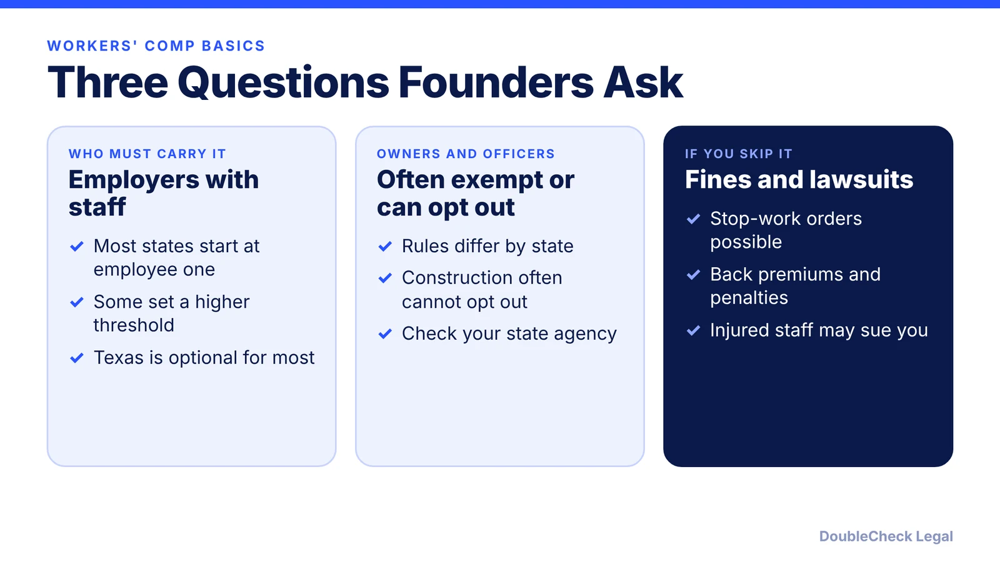
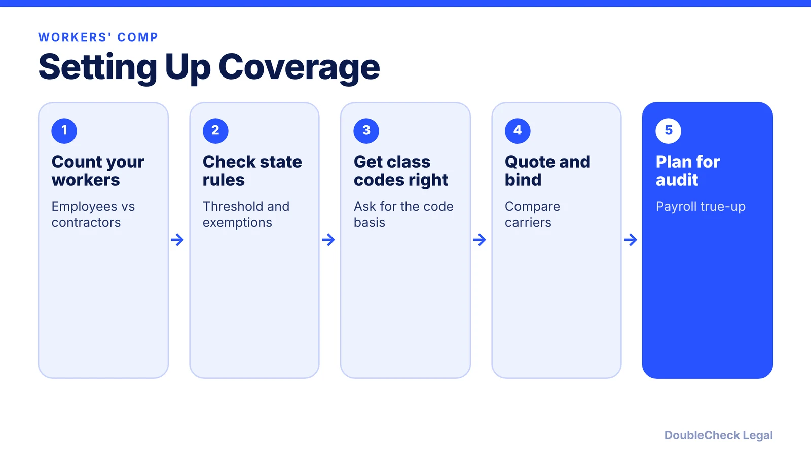

*Hiring your first employee usually triggers workers' comp. Here is how the rules and costs work.*

**Key takeaways:**

- Most states require coverage once you have employees; California starts at one, some states at three or five.
- Texas is the main exception, but non-subscribers can be sued with limited defenses.
- Owners and officers are often exempt or can opt out, except in some construction settings.
- Premiums are payroll times a class code rate times an experience modifier, trued up at audit.

## 1. The quick answer

**Quick answer:** Almost every state requires employers to carry workers' compensation insurance once they have employees, and the trigger varies. California applies after the first part- or full-time hire, while Alabama and Mississippi start at five employees, per TechInsurance. Texas is the main exception: most private employers may opt out, but then they can be sued by injured workers. Owners and officers are often exempt or can elect out, and penalties for going uncovered can include fines, stop-work orders, and criminal charges.

## 2. Who must carry it, and how states differ

TechInsurance says workers' comp is required in nearly every state, usually once you hire your first employee, and that independent contractors and sole proprietors generally are not required to carry it. Examples of state variation:

- **California:** coverage is required for businesses with at least one part- or full-time employee, including out-of-state businesses with an employee working in California, per Hourly. Hourly also reports that some licensed contractors must carry coverage even without employees, and that all California contractors must from 2026. Employers must post a notice and notify new hires of benefits.
- **Alabama and Mississippi:** coverage required at five or more employees (TechInsurance).
- **North Carolina:** generally three or more workers (Hourly).
- **Texas:** most private employers may choose not to carry coverage. Public employers and building and construction contractors working for public employers must, along with a few other categories (Workers Compensation Shop).

Part-time, seasonal, and family workers often count toward a threshold (QuoteSweep). Misclassifying employees as contractors can pull you into the requirement; see [employee vs. independent contractor classification](/blog/employee-vs-independent-contractor-classification-startups/) and [independent contractor vs. employee](/blog/independent-contractor-vs-employee/).

## 3. Owners, officers, and the Texas option

**Owners and officers.** Many states exempt sole proprietors, LLC members, and officers, or let them elect out. In Illinois, such owners are not required to be covered but must file an opt-out form (Hourly). Florida has a formal exemption process for certain corporate officers and LLC members in construction, with strict rules (Business Insurance USA). QuoteSweep adds that construction owners frequently cannot opt out. Your employees still need coverage even when you exempt yourself.

**Texas nonsubscribers.** In Texas, sole proprietors, partners, LLC members, and officers are included by default but can elect to be excluded. An employer that opts out of the system has no coverage penalty, but per Workers Compensation Shop it must give new hires a signed notice, post notices, and file an annual notice with the state, and injuries must still be reported. Non-subscribers can be sued for workplace injuries with no statutory cap and lose common-law defenses such as contributory negligence.

For a company hiring its first people, compare this with [hiring employees through an EOR or contractor model](/blog/hire-international-employees-remote-eor-vs-contractor-vs-sponsorship/) and your [business license obligations](/blog/business-license-requirements-small-business/).

## 4. Penalties and how premiums are set

**Penalties vary by state.** Examples from the sources: California $10,000 to $100,000 in fines and up to a year in jail; New York $1,000 to $50,000 plus $2,000 per 10 days uninsured; Illinois $500 per day with a $10,000 minimum; Pennsylvania up to $15,000 and seven years for intentional noncompliance (Hourly; Insureon). Insureon also lists stop-work orders, license revocation, back premiums, and loss of the "exclusive remedy" shield that normally blocks employee lawsuits.

**How premiums are set.** CompSource Mutual gives the basic formula: payroll divided by 100, times the class code rate, times the experience modifier, plus other factors, adjusted at audit. SAIF, an Oregon insurer, adds that the National Council on Compensation Insurance (NCCI) sets pure premium rates from industry loss data (approved by the state in Oregon), each carrier adds its own expenses, and a modifier compares your actual losses with expected losses. A new business starts at a neutral 1.0 per CompSource. Class codes matter: CompSource's examples range from $0.40 to $30.00 per $100 of payroll depending on risk.

## Where DoubleCheck fits

[DoubleCheck](https://www.contactdoublecheck.com) helps businesses and founders start legal work with AI, verify it, and, when professional advice is warranted, connect with an independent attorney, including for immigration questions. Attorney availability and practice areas vary. Attorneys on DoubleCheck are independent professionals; an attorney-client relationship forms only if an attorney accepts your engagement.

**Sources:** [TechInsurance: Workers' comp state laws](https://www.techinsurance.com/workers-compensation-insurance/state-laws); [Hourly: Requirements](https://hourly.io/workers-comp/workers-compensation-insurance-requirements); [QuoteSweep: By state](https://www.quotesweep.com/blog/workers-comp-requirements-by-state); [Workers Compensation Shop: Texas](https://www.workerscompensationshop.com/insurance-states/texas/information); [Insureon: Skipping coverage](https://www.insureon.com/products/workers-compensation/skipping-coverage); [CompSource Mutual: Calculate workers' comp](https://www.compsourcemutual.com/learn/calculate-workers-comp/); [SAIF: Premium and rate overview](https://www.saif.com/employer-guide/learn-about-coverage/premium-and-rate-overview.html); [Business Insurance USA: Exemptions](https://www.businessinsuranceusa.com/blog/workers-comp/what-is-workers-comp-exemption/).

## FAQ

**Do I need workers' comp if I am a solo founder?**

Generally not for yourself as a sole proprietor, per TechInsurance, but you need it once you hire employees in most states. Some contractor licenses require it regardless.

**Is workers' comp required in Texas?**

No for most private employers, per Workers Compensation Shop and Hourly, but non-subscribers can be sued and must give required notices. Public contractors must carry it.

**What is the penalty for not carrying it?**

It varies. California fines run $10,000 to $100,000 per Hourly, and other states add daily fines, stop-work orders, or criminal charges, per Insureon.

**How much does workers' comp cost?**

It depends on payroll, class code, and your claims history. CompSource Mutual gives examples from $0.40 to $30.00 per $100 of payroll by risk class.

---

*General information only. This article is not legal, tax, investment, or accounting advice.*
