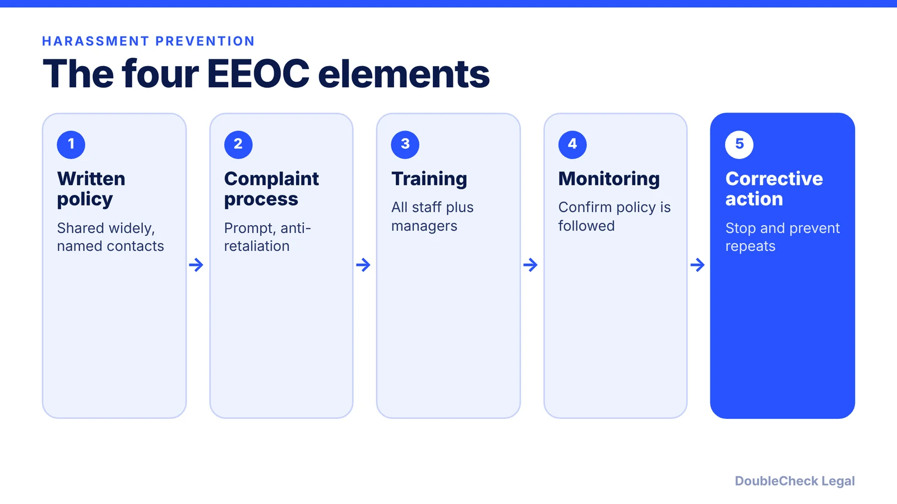
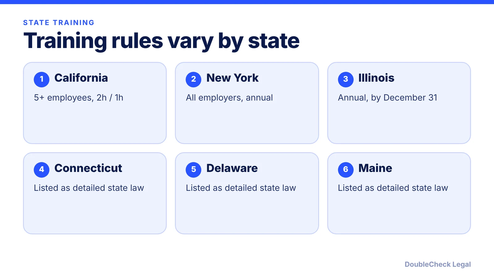

*Policy, complaint process, training, and follow-through: what the EEOC guidance and three state laws expect.*

**Key takeaways:**

- The EEOC's April 29, 2024 guidance points to policy, complaint process, training, and monitoring as elements of reasonable care.
- California requires training for employers with 5+ employees (2 hours supervisors, 1 hour others, every two years).
- New York requires a policy and annual training for all employers; Illinois requires annual training by December 31.
- A written policy alone is not enough if it is not implemented and employees are not trained.

## 1. The quick answer

**Quick answer:** Every employer should have a written anti-harassment policy, a complaint process, and training, and some states require training by law. Per Proskauer's summary of the EEOC's April 29, 2024 guidance, an employer showing it used reasonable care to prevent and correct harassment points to four elements: a widely shared policy, a prompt complaint process, regular training, and monitoring. California, New York, and Illinois have specific training mandates, and they differ in size thresholds and frequency.

## 2. What the federal guidance says

Per [Proskauer](https://www.proskauer.com/blog/eeoc-releases-final-guidance-on-harassment-in-the-workplace), the EEOC published final harassment guidance on April 29, 2024, consolidating and replacing agency documents issued between 1987 and 1999. Points relevant to a small business:

- Harassment based on sexual orientation or gender identity is covered, relying on *Bostock v. Clayton County* (2020).
- Sex-based harassment includes pregnancy, childbirth, and related conditions.
- Conduct in virtual meetings and other remote settings can contribute to a hostile work environment.
- A single incident can create a hostile work environment if severe enough.

On defenses, the guidance describes a policy that is widely shared, covers supervisors' reporting duties, and names accessible contacts; prompt, effective investigations with confidentiality and anti-retaliation protections; regular training for all employees with guidance for managers; and oversight. A written policy is not enough if it is not implemented or if employees are not trained. [Vensure](https://vensure.com/resources/blog/workplace-harassment-training/) describes the guidance as a national baseline and recommends training, but does not describe a general federal training mandate. The EEOC also offers a small business fact sheet among its supplemental resources.

## 3. State training rules: California, New York, Illinois

Vensure lists California, New York, Illinois, Connecticut, Delaware, and Maine as states with detailed harassment training laws for private employers. Verified details for three:

**California.** Per [CalChamber](https://www.calchamber.com/california-labor-law/harassment-training), the rule applies to employers with five or more employees, including those working outside California. Supervisors need two hours and nonsupervisory employees one hour, with retraining every two years. New hires and promoted employees are due within six months; seasonal and temporary workers within 30 calendar days or 100 hours worked, whichever is earlier.

**New York.** Per [NFIB](https://www.nfib.com/news/news/reminder-new-york-state-mandated-sexual-harassment-prevention-training-is-required-every-year/), all employers must adopt a policy meeting or exceeding state guidelines and provide annual training to all employees, including remote ones, with the policy and training materials given at hire and every year. The state offers a free model policy and training program. Per [Davis Wright Tremaine](https://www.dwt.com/blogs/employment-labor-and-benefits/2023/04/new-york-sexual-harassment-model-policy), New York's model policy says harassment need not be "severe or pervasive" to be illegal and lists the state hotline, 1(800)HARASS3.

**Illinois.** Per [Taft](https://www.taftlaw.com/news-events/law-bulletins/illinois-department-of-human-rights-releases-model-sexual-harassment-training-and-guidance/), every employer with at least one employee working in Illinois must train all employees (contractors excluded) annually, by December 31, with new hires trained as soon as possible. Restaurants and bars have extra requirements, including a written policy in English and Spanish given in the first week.

Other states may have rules not covered here; check your state agency, especially for [remote employees in multiple states](/blog/multi-state-remote-employees-compliance-startups/).

## 4. Building the policy and process

A usable policy usually includes:

1. A clear prohibition covering all protected characteristics and conduct in person, virtual meetings, and messaging apps.
2. Multiple reporting channels, with named contacts and a way to bypass the direct manager.
3. An anti-retaliation statement.
4. An investigation process: prompt, fair, documented, with corrective action.
5. Training schedule, tracked by date and attendee.
6. Where applicable, a state-required version or addendum.

The policy belongs in your handbook; see [what to include in a small business employee handbook](/blog/employee-handbook-small-business-what-to-include/). Acknowledgments should be collected at onboarding ([first employee checklist](/blog/how-to-hire-first-employee-legal-checklist/)). Complaints that lead to discipline or separation should be handled with documentation, as covered in [how to terminate an employee legally](/blog/how-to-terminate-an-employee-legally-small-business/). Time-off and pay rules in the same handbook are covered in [PTO and vacation pay laws](/blog/pto-vacation-pay-laws-small-business/).

## Where DoubleCheck fits

[DoubleCheck](https://www.contactdoublecheck.com) helps businesses and founders start legal work with AI, verify it, and, when professional advice is warranted, connect with an independent attorney, including for immigration questions. Attorney availability and practice areas vary. Attorneys on DoubleCheck are independent professionals; an attorney-client relationship forms only if an attorney accepts your engagement.

**Sources:** [Proskauer on the EEOC guidance](https://www.proskauer.com/blog/eeoc-releases-final-guidance-on-harassment-in-the-workplace); [Vensure](https://vensure.com/resources/blog/workplace-harassment-training/); [CalChamber](https://www.calchamber.com/california-labor-law/harassment-training); [NFIB](https://www.nfib.com/news/news/reminder-new-york-state-mandated-sexual-harassment-prevention-training-is-required-every-year/); [Davis Wright Tremaine](https://www.dwt.com/blogs/employment-labor-and-benefits/2023/04/new-york-sexual-harassment-model-policy); [Taft](https://www.taftlaw.com/news-events/law-bulletins/illinois-department-of-human-rights-releases-model-sexual-harassment-training-and-guidance/).

## FAQ

**Is a harassment policy legally required for small businesses?**

Rules vary. New York requires every employer to adopt a policy meeting state guidelines (NFIB), and Illinois requires annual training for any employer with an employee in Illinois (Taft). Even where not mandated, the EEOC guidance treats a policy as part of reasonable care.

**How often is harassment training required in California?**

Per CalChamber, retraining is every two years for employers with five or more employees, with two hours for supervisors and one hour for others; new hires are due within six months.

**Does New York's training requirement cover remote employees?**

Yes. Per NFIB, annual training must be provided to all employees, including remote employees.

**Can I use a model policy?**

New York offers a free model policy and training program (NFIB), and Illinois has model training (Taft). The DWT summary notes New York employers need not adopt the model word for word.

---

*General information only. This article is not legal, tax, investment, or accounting advice.*
