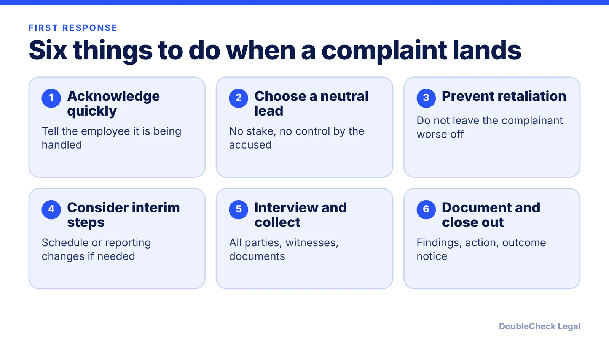
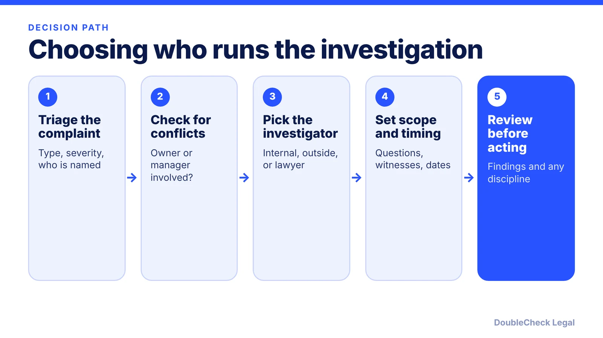

*How employers should respond to a workplace investigation complaint: a practical small-business plan, as of November 2026. General information, not legal advice.*

**Key takeaways:**

- Start reasonably soon after a complaint. Per Fisher Phillips, one day was prompt and two months without a reason likely was not under the 2024 EEOC guidance.
- Use a neutral investigator; the accused should have no control over the process.
- The EEOC rescinded its 2024 harassment guidance on January 22, 2026, but Title VII and state laws still apply.
- Do not retaliate, and avoid blanket gag orders on witnesses; the SEC fined KBR $130,000 in 2015 over one.

## 1. The quick answer

**Quick answer:** When an employee files a workplace complaint, an employer should acknowledge it quickly, pick a neutral person to look into it, protect the complainant from retaliation, gather facts from everyone involved, document each step, and close the loop with the people involved. Speed and neutrality matter most. In the EEOC's 2024 harassment guidance, an investigation is prompt if it starts reasonably soon after the employer learns of the problem, and the investigator should be impartial and trained. That guidance was rescinded on January 22, 2026, but Title VII is unchanged, and the same steps remain sensible practice as of November 2026.

This article is about the first response to a complaint, written for small employers who may not have an HR department. For the policy side, see [workplace harassment policy requirements for small business](/blog/workplace-harassment-policy-requirements-small-business/) and the [employee handbook guide](/blog/employee-handbook-small-business-what-to-include/).

## 2. What the rules say, and what changed in 2026

Federal law, including Title VII, the ADA and the ADEA, prohibits harassment based on protected characteristics. Agency guidance explains how the EEOC reads the law, but it is not binding, as Epstein Becker Green notes in its 2026 harassment-prevention piece.

Two dated points matter here:

- **April 29, 2024:** the EEOC issued its Enforcement Guidance on Harassment in the Workplace, which included a section on how employers should handle complaints.
- **January 22, 2026:** the Commission voted to rescind that entire guidance, per Holland & Knight. No replacement had been announced in the source we reviewed. The rescission does not change Title VII.

State and local laws continue to apply independently and can be more protective, and some jurisdictions require specific harassment-prevention steps, per Epstein Becker Green and Holland & Knight. Check your state and city rules, including any training or policy requirements, before you rely on a federal-only reading.

Because the guidance is gone, treat its investigation principles as a reasonable benchmark rather than a current legal test. They also match the EEOC's older small-employer Q&A page, which has been superseded but describes the same basics: investigate promptly, thoroughly and impartially, stop the conduct, and prohibit retaliation.

## 3. A step-by-step response plan

Here is a practical sequence, with the sourced principles noted.

**Step 1: Acknowledge and capture the complaint.** Write down who said what, when, and who else may know. The duty to act generally begins when the employer has notice, which under the 2024 guidance, as summarized by Jackson Lewis, can come from coworkers or third parties, not just a formal complaint.

**Step 2: Start reasonably soon.** Fisher Phillips, summarizing the guidance, said opening an investigation one day after a complaint is prompt, while waiting two months without mitigating facts likely is not. Do not wait for the perfect investigator.

**Step 3: Pick a neutral investigator.** The accused should have no direct or indirect control over the investigation, including supervisory authority over the investigator. A friend of the accused, or someone with no interviewing training, is a poor fit. For a very small company, that may mean an outside HR consultant or an attorney.

**Step 4: Consider interim measures.** If allegations are serious, temporary steps such as schedule changes or paid leave for the accused may be appropriate. The EEOC small-employer Q&A cautions that an involuntary transfer of the complainant could be unlawful retaliation.

**Step 5: Gather facts from all sides.** Interview the complainant, the accused and relevant witnesses, and collect messages, schedules and records. The point is to reach what the guidance called a "reasonably fair estimate of truth," not to run a courtroom trial. Remote conduct counts too: Fisher Phillips notes harassment can occur in virtual meetings, group chats and shared backgrounds.

**Step 6: Decide and act.** Corrective action should fit what was found and should be consistent with how you have handled similar situations.

**Step 7: Close the loop.** Per Jackson Lewis, tell the complainant and the accused the outcome, subject to privacy limits. Fisher Phillips says disclosing the specific discipline is generally not best practice.

## 4. Retaliation, confidentiality and records

**Retaliation.** Corrective action that leaves the complainant worse off than before can itself be unlawful retaliation, per the 2024 guidance as summarized by Jackson Lewis. Watch for changes to shifts, projects, reviews and access after a complaint. The EEOC small-employer Q&A recommends a policy statement that the employer will not tolerate retaliation against anyone who complains or takes part in an investigation. If you are considering discipline for the complainant for an unrelated reason, pause and get advice first. The guides on [performance improvement plans](/blog/performance-improvement-plan-pip-legal-risks-employers/) and [terminating an employee legally](/blog/how-to-terminate-an-employee-legally-small-business/) are good starting points.

**Confidentiality.** Employers often tell witnesses to keep an investigation confidential. That instinct can backfire. In 2015 the SEC fined KBR $130,000 over a confidentiality statement for witnesses in internal investigations that warned of discipline for discussing interviews without Law Department approval, per Goodwin. The SEC found it could discourage reporting to the agency, even though no one had been blocked. If you ask for discretion, keep it narrow, explain why, and make clear that employees can still contact government agencies. More in our companion post on [confidentiality versus whistleblower rights](/blog/employee-confidentiality-vs-whistleblower-rights-what-you-cannot-restrict/).

**Records.** Keep complaint and investigation files in a secure place. The guidance described records as useful for spotting patterns and informing training, per Jackson Lewis and Fisher Phillips. Write down dates, interview notes, evidence reviewed, conclusions and actions. A short, clear file is better than a long one written months later.

## 5. When to handle it yourself and when to bring in help

Some complaints are small and can be resolved with a conversation and a documented follow-up. Others need an outside investigator or an attorney. This split is a guide, not a legal test.

Consider outside help when:

- The accused is an owner, executive or the person who would normally investigate.
- The allegations involve physical conduct, threats, discrimination in pay or promotion, or possible criminal behavior.
- The complainant has mentioned a lawyer, an agency charge or a government report.
- Several employees are involved, or the issue looks like a pattern.
- You are about to fire someone connected to the complaint.

AI tools can help you organize a timeline, draft interview questions and tidy notes. They cannot decide credibility or replace a neutral human investigator, and employee records often contain sensitive information, so read [uploading contracts to ChatGPT and confidentiality](/blog/uploading-contracts-to-chatgpt-confidentiality/) before pasting anything in, and see [verifying AI-generated legal documents](/blog/verify-ai-generated-legal-document/). A related read: [at-will employment by state](/blog/at-will-employment-by-state-exceptions-employers/) explains why exceptions, including retaliation, make firing after a complaint riskier than it looks.

## 6. Mistakes that turn a complaint into a claim

Based on the principles above, these are the errors that most often make a bad situation worse:

- **Waiting.** Delay without a reason is the easiest thing for an agency or court to criticize.
- **Biased investigator.** An investigator with a stake, or reporting to the accused, undermines the result.
- **Telling everyone.** Share only what people need to know to take part.
- **Silence afterward.** Complainants who hear nothing assume nothing happened.
- **Overbroad gag orders.** See the KBR example above.
- **No paper trail.** If it is not written down, it is hard to show you acted.
- **Ignoring state law.** Some states add training, notice and timing rules on top of federal law.

If a complaint becomes a demand letter or an agency charge, the response is a different process. Get an attorney involved, and preserve all relevant emails, chats and files. For wider context see [how to hire your first employee](/blog/how-to-hire-first-employee-legal-checklist/) and [when to hire a lawyer for a small business](/blog/when-to-hire-lawyer-small-business/).

## Where DoubleCheck fits

[DoubleCheck](https://www.contactdoublecheck.com) helps businesses and founders start legal work with AI, verify it, and, when professional advice is warranted, connect with an independent attorney, including for immigration questions. Attorney availability and practice areas vary. Attorneys on DoubleCheck are independent professionals; an attorney-client relationship forms only if an attorney accepts your engagement.

**Sources:** [Holland & Knight, EEOC rescinds 2024 harassment guidance (Jan. 2026)](https://www.hklaw.com/en/insights/publications/2026/01/eeoc-rescinds-2024-harassment-guidance-addressing); [Epstein Becker Green, Harassment prevention in 2026](https://www.ebglaw.com/workforce-bulletin/harassment-prevention-in-2026); [Jackson Lewis, EEOC enforcement guidance on workplace harassment liability (May 2024)](https://www.jacksonlewis.com/insights/eeoc-enforcement-guidance-workplace-harassment-liability); [Fisher Phillips, EEOC provides employers with key workplace investigation tips (June 2024)](https://www.fisherphillips.com/en/news-insights/eeoc-provides-employers-with-key-workplace-investigation.html); [EEOC, Questions and answers for small employers on employer liability for harassment (superseded April 29, 2024)](https://www.eeoc.gov/laws/guidance/questions-answers-small-employers-employer-liability-harassment-supervisors); [EEOC, Enforcement Guidance on Harassment in the Workplace (April 29, 2024; rescinded Jan. 22, 2026)](https://www.eeoc.gov/laws/guidance/enforcement-guidance-harassment-workplace); [Goodwin, SEC applies whistleblower protections to confidentiality arrangements (2015)](https://www.goodwinlaw.com/en/insights/publications/2015/04/04_15_15-sec-applies-whistleblower-protections-to-confidentiality-arrangements). The EEOC guidance page returned only its header, so its detail comes from the law-firm summaries.

## FAQ

**How quickly must an employer start a workplace investigation?**

No single deadline applies in every case. Under the EEOC 2024 harassment guidance, summarized by Jackson Lewis, an investigation is prompt if it starts reasonably soon after the employer learns of the problem. Fisher Phillips said one day was prompt and two months without mitigating facts likely was not. State rules may differ.

**Is the EEOC harassment guidance still in effect in 2026?**

No. The EEOC voted on January 22, 2026 to rescind its 2024 Enforcement Guidance on Harassment in the Workplace, per Holland & Knight. Title VII and state and local laws still apply, so employers still need a complaint process.

**Can an employer tell witnesses to keep an investigation confidential?**

Sometimes, but keep it narrow. In 2015 the SEC fined KBR $130,000 over a witness confidentiality statement that threatened discipline for discussing interviews without approval, per Goodwin. Make clear that employees can still contact government agencies.

**Should a small business hire an outside investigator?**

Consider it when an owner or executive is accused, the allegations are serious, a lawyer or agency is involved, or no neutral insider exists. The accused should not control the investigation, per the EEOC guidance summarized by Jackson Lewis.

**Should we tell the complainant the result?**

Generally yes. Per Jackson Lewis, the employer should tell the complainant and the accused the outcome, subject to privacy laws. Fisher Phillips notes that disclosing specific discipline is generally not best practice.

---

*General information only. This article is not legal, tax, investment, or accounting advice.*
